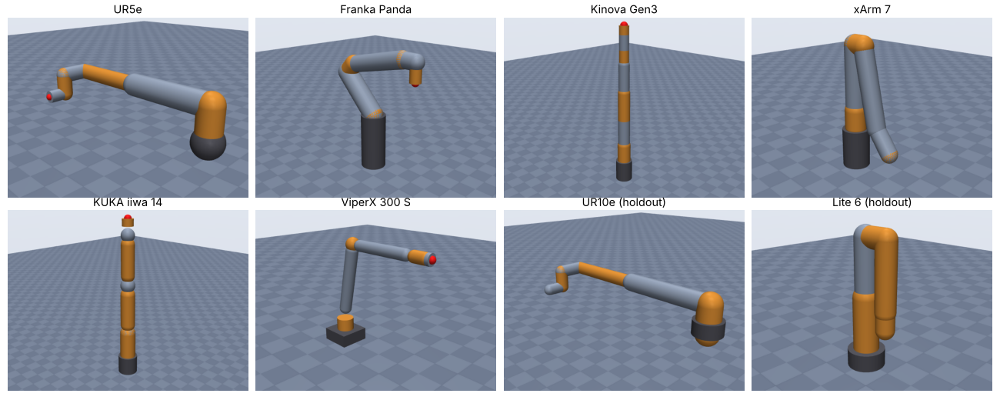
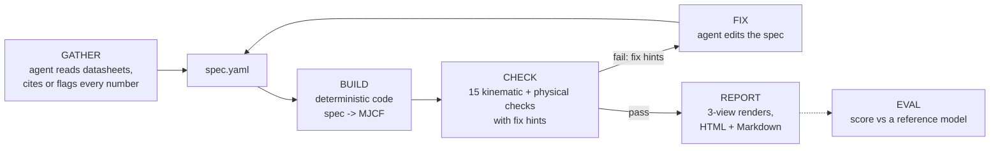

# sim-anything

**Turn a robot arm's public datasheets into a checked MuJoCo simulation.**

Give it a robot's name. A Claude Code agent collects the public specs
(datasheets, manuals, published DH tables), writes them into a `spec.yaml` in
which every number either cites a source URL or is explicitly marked as an
estimate, and deterministic code turns that into a MuJoCo model, checks it,
fixes it in a loop, renders it and writes a report. "Verified" means the model
passes the tool's own checks (section below); how close it is to the real robot
is measured separately by the evaluator. Serial arms with primitive geometry
only, for now.
A separate evaluator scores generated models against reference models, which is
how we measure whether it works.



## How it works



* **GATHER** — the plugin's skill (`plugin/skills/robot-to-mujoco/SKILL.md`) tells
  the agent where to look, how to read DH tables (standard vs modified), and the
  one rule that matters: never invent numbers. Every number is either listed in
  `sources` with a URL or in `estimates`.
* **BUILD** — `simanything/builder.py`: nested bodies from DH (standard or
  modified) or offset chains, primitive geoms (capsule/cylinder/box/sphere),
  inertia from link mass and shape, position actuators sized to hold the arm
  under gravity, an end-effector site, a `home` keyframe. The LLM never writes XML.
* **CHECK** — `simanything/check/`: compiles, joint structure, EE site,
  kinematics match the spec, joint limits, reach vs rated reach (5,000 samples),
  published drawing dimensions (e.g. flange height at the zero pose) when the
  spec has them, total mass, mass plausibility, inertia validity, self-collision at home,
  reported collision exclusions, 2 s stable hold, actuators, and source
  coverage (URLs, typo-free paths, estimate share). Each failure is
  machine-readable JSON with a severity (error blocks, warning informs) and a
  concrete `fix_hint`.
* **LOOP** — `sim-anything loop` runs one build+check iteration, records it,
  and re-renders and rewrites the report every time, so the report always shows
  the latest iteration; the agent edits the spec between calls (max 8 iterations).
* **EVAL** — `simanything/evaluate.py`: end-effector position/orientation
  error over 2,000 random configurations, joint-limit and mass differences,
  DOF match, and a 0–100 score.

Contracts (CLI, JSON formats, mapping file): [docs/CONTRACTS.md](docs/CONTRACTS.md).
Spec schema: [docs/spec.schema.json](docs/spec.schema.json).

## Quickstart (fresh clone, under 5 minutes)

Needs Python 3.11+.

```bash
git clone https://github.com/c-cheng10/sim-anything && cd sim-anything
```

```bash
python -m venv .venv && . .venv/bin/activate && pip install -e ".[dev]"
```

Build, check, render and report a (fictional) 6-DOF arm described by a DH table:

```bash
sim-anything loop examples/toy_6dof_dh.yaml --run-dir runs/toy --note "first run"
```

On a pass `loop` prints a one-line summary (`iteration 1/8: PASSED (15 checks,
0 errors, 1 warning(s))`), the non-blocking warnings (here `sources_complete`:
every number of the toy arm is an estimate), then the renders directory
(`runs/toy/renders`, with the views and the render backend), the report
(`runs/toy/report.html`, also `report.md`) and the check report
(`runs/toy/check.json`). The built model is `runs/toy/model.xml`. The
per-check details (measured vs expected, tolerance, messages) are in
`check.json` and in the report's checks table; on a failure the summary lists
each failed check with its fix hint. `loop` rewrites the renders and the report
after every iteration, so they always show the latest one. Running it again
with an unchanged spec starts no new iteration; to start over, delete the run
directory (`rm -rf runs/toy`) or pass a new `--run-dir`. Open the model in
MuJoCo's viewer with `python -m mujoco.viewer --mjcf runs/toy/model.xml`. The
individual steps:

```bash
sim-anything validate examples/toy_6dof_dh.yaml
sim-anything build examples/toy_6dof_dh.yaml -o runs/toy.xml
sim-anything check runs/toy.xml --spec examples/toy_6dof_dh.yaml --json
sim-anything render runs/toy.xml -o runs/toy_renders
sim-anything report runs/toy
```

Score a model against a reference through a joint-mapping file (here a test
fixture arm against a variant with flipped joint conventions and a rotated tool):

```bash
sim-anything eval tests/fixtures/eval/arm_cand.xml --reference tests/fixtures/eval/arm_ref.xml --map tests/fixtures/eval/arm_map.yaml
```

It prints `score 85.0/100` with 0.0 mm position error: the kinematics match
exactly once the evaluator has fitted the joint conventions, but the fixture's
joint ranges deliberately differ from the reference's (e.g. the candidate's
first joint keeps ±3 rad around a zero shifted by 90 deg), so the limits score
low (joint-limit MAE about 34 deg, limits term 0.03), and the reference has an
extra 0.05 kg finger (mass term 0.95). Add `--json` to see the fitted
conventions, the per-joint limit differences and the score breakdown.

Run the tests with `python -m pytest`.

Rendering uses MuJoCo's offscreen renderer when an OpenGL backend works
(`MUJOCO_GL=osmesa` with `libosmesa6` installed, or EGL), and falls back to a
matplotlib drawing of the primitives otherwise; the backend used is reported.

## Use it from Claude Code (plugin)

```bash
pip install git+https://github.com/c-cheng10/sim-anything
```

Then inside Claude Code:

```
/plugin marketplace add c-cheng10/sim-anything
/plugin install sim-anything@sim-anything
/sim-anything UR5e
```

`/sim-anything` runs a small agent team. Each agent does one job and hands off
through files in `runs/<robot>/`:

| Agent | Job | Writes |
|---|---|---|
| `source-scout` | finds the datasheet, manual and kinematic table; quotes every number | `sources.md` |
| `spec-writer` | picks the convention, transcribes tables exactly, flags every inference as an estimate, validates | `spec.yaml` |
| `loop-fixer` | runs build/check up to 8 times, fixes interpretations (never sourced numbers), checks the renders | `run/` |
| `source-auditor` | read-only second opinion: traces every number to a quote, checks transcription and loop honesty | verdict |

If the auditor says "not ready", the lead sends its findings back for one
rework round, then reports. `/sim-anything-audit <slug>` runs the auditor alone
on an existing model. The `robot-to-mujoco` skill holds the shared rules; it
also works on its own (single agent) and triggers when you ask for a MuJoCo
model of a robot arm.

Measured on one real run (`/sim-anything Trossen WidowX 250 6DOF`, network
without manufacturer sites): all four agents ran, 14/14 checks passed on the
first iteration, auditor verdict "ready with caveats", 7 minutes, about $2.20.
The single-agent flow did the same robot in 2 minutes for about $0.80, without
the independent audit. Details: [plugin/README.md](plugin/README.md).

## Results

Each benchmark model was generated **blind**: the agent saw only public web
pages and pre-gathered notes from them, never the reference models or any
URDF/MJCF/SDF file. References are [MuJoCo Menagerie](https://github.com/google-deepmind/mujoco_menagerie)
models (an external reference; not redistributed here — clone it into
`third_party/` to reproduce). Full tables, caveats and per-round history:
[benchmark/RESULTS.md](benchmark/RESULTS.md).

<!-- RESULTS:BEGIN -->
**Dev set, final tool (round 2, fresh blind runs):**

| Robot | Public kinematic source the agent used | Checks | Iter. | EE pos p95 (mm) | Limit MAE (deg) | Score |
|---|---|---|---|---|---|---|
| UR5e | DH table | all pass | 1 | 1.4 | 30.0 | 82.2 |
| Franka Emika Panda | DH table (modified) | all pass | 2 | 0.0 | 0.0 | 97.2 |
| Kinova Gen3 (7-DOF) | official link-length table, lateral offsets omitted | all pass | 1 | 24.5 | 0.2 | 68.3 |
| UFactory xArm 7 | DH table (modified) | all pass | 1 | 0.0 | 0.7 | 92.5 |
| KUKA LBR iiwa 14 R820 | dimension table | all pass | 1 | 0.0 | 0.0 | 98.9 |
| Trossen ViperX 300 S | reach/offset tables, shoulder height estimated | all pass | 1 | 7.6 | 3.0 | 74.1 |

**Holdout set (run once, never used during development):**

| Robot | Public kinematic source | Checks | Iter. | EE pos p95 (mm) | Limit MAE (deg) | Score |
|---|---|---|---|---|---|---|
| UR10e | DH table | all pass | 1 | 17.2* | 30.0 | 60.0 |
| UFactory Lite 6 | DH table (modified) | all pass | 2 | 1.3 | 0.0 | 94.9 |

\* The UR10e model follows UR's published flange distance (d6 = 116.55 mm); the
reference model's flange site is 16.55 mm shorter. Measured at UR's published
flange distance (diagnostic only) the error is 1.1 mm p95.

* 6/6 dev robots and 2/2 holdout robots pass all error-severity checks.
* Median p95 EE error over dev robots whose makers publish DH tables: 0.7 mm
  (round 2); 0.2 mm in rounds 0 and 1. In rounds 0-1 Kinova (0.4 mm) and
  ViperX (0.3 mm) were built from tables the round-2 agents did not find or
  chose not to trust; run-to-run variance in finding the right public source is
  the dominant error. History: [benchmark/RESULTS.md](benchmark/RESULTS.md).
* Gallery: built by `python gallery/build.py` and deployed by
  `.github/workflows/pages.yml` once GitHub Pages is enabled for the repository.
<!-- RESULTS:END -->

Read these numbers with care: the kinematic error is tiny when a manufacturer
publishes an exact kinematic table and the agent copies it correctly, because
the reference models were built from the same data. Errors are measured after
aligning discrete conventions (joint sign, multiples-of-90° zero offsets, base
yaw), which RESULTS.md lists per robot.

## Limitations

* Primitive geoms only (capsules, cylinders, boxes, spheres): collision shapes
  and inertias are approximations; no meshes.
* Serial arms only; no grippers, closed chains, mobile bases or humanoids.
* Accuracy is bounded by public data, and by whether the agent finds it: the
  same robot came out at 0.4 mm in one run and 24.5 mm in another depending on
  which kinematic source the agent found and trusted. Masses, inertias, joint
  torques and housing sizes are often unpublished; the tool then estimates
  (and says so).
* "Verified" means the model passes the tool's own checks. For a model the
  builder wrote, five of them (joint structure, joint limits, kinematics match,
  total mass, actuators) only guard against hand edits of the XML; the ones that
  test the robot itself are reach, drawing, plausibility, inertia, collisions, stability
  and sources. A self-consistent but wrong spec (e.g. a misread DH row) passes
  unless the spec also carries a published drawing dimension it contradicts
  (the `drawing` check); otherwise the auditor agent and a reference
  comparison are what catch it.
* Reach checks depend on how a datasheet defines "reach", which is often
  unstated; then they only warn.
* The benchmark is small (6 dev + 2 holdout arms), its references are
  themselves models (with their own errors, e.g. the UR10e flange distance), and
  the agents in this run could not open manufacturer websites (blocked network),
  so most values came from search-result excerpts.

## Gates (usable-draft criteria)

| Gate | Status |
|---|---|
| 1. pytest green, CI green | met |
| 2. Fresh-clone quickstart works | met (verified by a new-user tester, rounds 1 and 2: 23-24 s) |
| 3. Plugin installs; `/sim-anything <robot>` runs gather -> loop -> report | met (tester installed it in an isolated config and ran `/sim-anything Trossen WidowX 250 6DOF` end to end: 128 s) |
| 4. >= 5 of 6 dev robots pass all checks | met (6/6 in rounds 1 and 2; 5/6 in round 0) |
| 5. Eval works for every robot; median p95 < 10 mm where DH is published | met (0.7 mm round 2; 0.2 mm rounds 0-1) |
| 6. Holdout reported separately | met (above) |

## Roadmap

* Mesh import from manufacturer STEP/STL downloads where licences allow.
* Gripper and end-effector modules; parallel and closed-chain mechanisms.
* Dynamics identification hooks (fit masses/friction to logged data).
* More benchmark robots and a measured-hardware reference.

## Repository layout

```
simanything/   spec.py builder.py check/ evaluate.py render.py report.py loop.py cli.py
plugin/        Claude Code plugin: skill, 4 agents, /sim-anything and /sim-anything-audit
benchmark/     robots.yaml, inputs/<robot>/, runs/<robot>/<round>/, RESULTS.md
gallery/       static gallery site
examples/      fictional example specs
docs/          CONTRACTS.md, spec.schema.json, dev/ (build logs)
```

## License

MIT (see [LICENSE](LICENSE)). MuJoCo Menagerie is used only as an external
evaluation reference under its own licences and is not included or redistributed.
