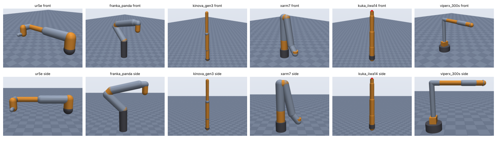
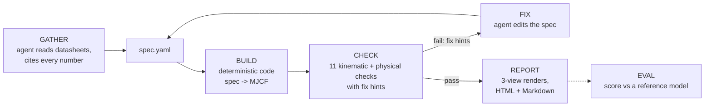

# sim-anything

**Reverse-engineer any robot arm into a verified MuJoCo simulation.**

Give it a robot's name. A Claude Code agent collects the public specs
(datasheets, manuals, published DH tables), writes them into a `spec.yaml` in
which every number cites its source, and deterministic code turns that into a
MuJoCo model, checks it, fixes it in a loop, renders it and writes a report.
A separate evaluator scores generated models against reference models, which is
how we measure whether it works.



## How it works



* **GATHER** — the plugin's skill (`plugin/skills/sim-anything/SKILL.md`) tells
  the agent where to look, how to read DH tables (standard vs modified), and the
  one rule that matters: never invent numbers. Every number is either listed in
  `sources` with a URL or in `estimates`.
* **BUILD** — `simanything/builder.py`: nested bodies from DH (standard or
  modified) or offset chains, primitive geoms (capsule/cylinder/box/sphere),
  inertia from link mass and shape, position actuators sized to hold the arm
  under gravity, an end-effector site, a `home` keyframe. The LLM never writes XML.
* **CHECK** — `simanything/check/`: compiles, joint structure, EE site, joint
  limits, reach vs rated reach (5,000 samples), total mass, inertia validity,
  self-collision at home, 2 s stable hold, actuators, and source coverage. Each
  failure is machine-readable JSON with a concrete `fix_hint`.
* **LOOP** — `sim-anything loop` runs one build+check iteration, records it,
  and on success renders and reports; the agent edits the spec between calls
  (max 8 iterations).
* **EVAL** — `simanything/evaluate.py`: end-effector position/orientation
  error over 2,000 random configurations, joint-limit and mass differences,
  DOF match, and a 0–100 score.

Contracts (CLI, JSON formats, mapping file): [docs/CONTRACTS.md](docs/CONTRACTS.md).
Spec schema: [docs/spec.schema.json](docs/spec.schema.json).

## Quickstart (fresh clone, under 5 minutes)

Needs Python 3.11+.

```bash
git clone https://github.com/c-cheng10/sim-anything && cd sim-anything
```

```bash
python -m venv .venv && . .venv/bin/activate && pip install -e ".[dev]"
```

Build, check, render and report a (fictional) 6-DOF arm described by a DH table:

```bash
sim-anything loop examples/toy_6dof_dh.yaml --run-dir runs/toy --note "first run"
```

That prints the check results and writes `runs/toy/model.xml`,
`runs/toy/check.json`, `runs/toy/renders/{front,side,top}.png` and
`runs/toy/report.html`. Open the model in MuJoCo's viewer with
`python -m mujoco.viewer --mjcf runs/toy/model.xml`. The individual steps:

```bash
sim-anything validate examples/toy_6dof_dh.yaml
sim-anything build examples/toy_6dof_dh.yaml -o runs/toy.xml
sim-anything check runs/toy.xml --spec examples/toy_6dof_dh.yaml --json
sim-anything render runs/toy.xml -o runs/toy_renders
sim-anything report runs/toy
```

Score a model against a reference through a joint-mapping file (here a test
fixture arm against a variant with flipped joint conventions and a rotated tool):

```bash
sim-anything eval tests/fixtures/eval/arm_cand.xml --reference tests/fixtures/eval/arm_ref.xml --map tests/fixtures/eval/arm_map.yaml
```

Run the tests with `python -m pytest`.

Rendering uses MuJoCo's offscreen renderer when an OpenGL backend works
(`MUJOCO_GL=osmesa` with `libosmesa6` installed, or EGL), and falls back to a
matplotlib drawing of the primitives otherwise; the backend used is reported.

## Use it from Claude Code (plugin)

```bash
pip install git+https://github.com/c-cheng10/sim-anything
```

Then inside Claude Code:

```
/plugin marketplace add c-cheng10/sim-anything
/plugin install sim-anything@sim-anything
/sim-anything UR5e
```

The agent gathers sources into `runs/<robot>/sources.md`, writes
`runs/<robot>/spec.yaml`, loops until the checks pass, and reports the paths to
the model, renders and `report.html`. Details: [plugin/README.md](plugin/README.md).

## Results

Each benchmark model was generated **blind**: the agent saw only public web
pages and pre-gathered notes from them, never the reference models or any
URDF/MJCF/SDF file. References are [MuJoCo Menagerie](https://github.com/google-deepmind/mujoco_menagerie)
models (an external reference; not redistributed here — clone it into
`third_party/` to reproduce). Full tables, caveats and per-round history:
[benchmark/RESULTS.md](benchmark/RESULTS.md).

<!-- RESULTS:BEGIN -->
Dev set, round 0 (first blind run):

| Robot | DH published | Checks | Iterations | EE pos p95 (mm) | Limit MAE (deg) | Score |
|---|---|---|---|---|---|---|
| UR5e | yes | all pass | 2 | 1.4 | 30.0 | 82.2 |
| Franka Emika Panda | yes | all pass | 1 | 0.0 | 0.0 | 97.2 |
| Kinova Gen3 (7-DOF) | yes | all pass | 1 | 0.4 | 0.2 | 98.7 |
| UFactory xArm 7 | yes | fail: reach | 1 | 0.0 | 0.7 | 92.5 |
| KUKA LBR iiwa 14 R820 | no | all pass | 1 | 0.0 | 0.0 | 98.9 |
| Trossen ViperX 300 S | no | all pass | 1 | 0.3 | 3.0 | 88.6 |

Holdout set: not run yet.
<!-- RESULTS:END -->

Read these numbers with care: the kinematic error is tiny when a manufacturer
publishes an exact kinematic table and the agent copies it correctly, because
the reference models were built from the same data. Errors are measured after
aligning discrete conventions (joint sign, multiples-of-90° zero offsets, base
yaw), which RESULTS.md lists per robot.

## Limitations

* Primitive geoms only (capsules, cylinders, boxes, spheres): collision shapes
  and inertias are approximations; no meshes.
* Serial arms only; no grippers, closed chains, mobile bases or humanoids.
* Accuracy is bounded by public data. Masses, inertias, joint torques and
  housing sizes are often unpublished; the tool then estimates (and says so).
* Reach checks depend on how a datasheet defines "reach", which is often unstated.
* The benchmark is small (6 dev + 2 holdout arms) and its references are
  themselves models, not measurements of real robots.

## Roadmap

* Mesh import from manufacturer STEP/STL downloads where licences allow.
* Gripper and end-effector modules; parallel and closed-chain mechanisms.
* Dynamics identification hooks (fit masses/friction to logged data).
* More benchmark robots and a measured-hardware reference.

## Repository layout

```
simanything/   spec.py builder.py check/ evaluate.py render.py report.py loop.py cli.py
plugin/        Claude Code plugin: skill, /sim-anything command
benchmark/     robots.yaml, inputs/<robot>/, runs/<robot>/<round>/, RESULTS.md
gallery/       static gallery site
examples/      fictional example specs
docs/          CONTRACTS.md, spec.schema.json
```

## License

MIT (see [LICENSE](LICENSE)). MuJoCo Menagerie is used only as an external
evaluation reference under its own licences and is not included or redistributed.
