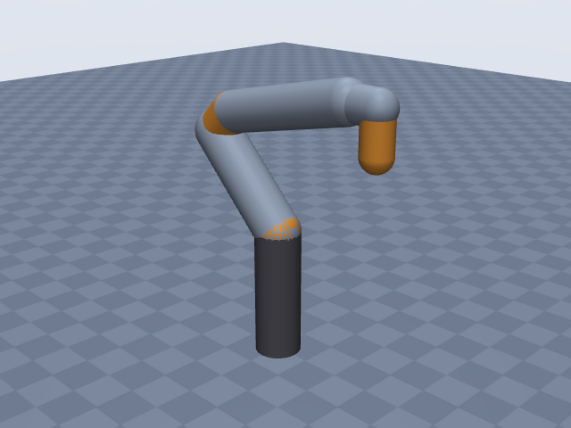
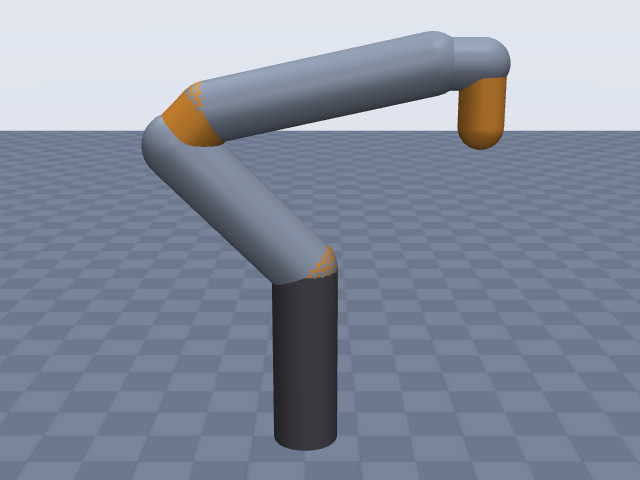
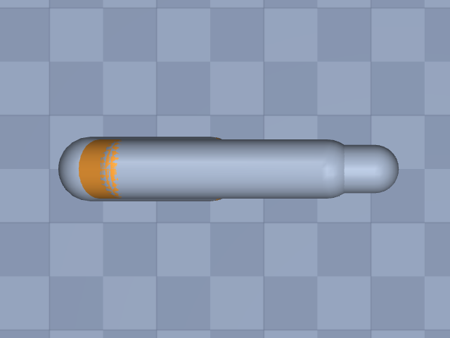

# franka_panda

Franka Emika · Panda arm (FER), 7-DOF, without hand · Franka Emika Panda arm only, EE site at the tool flange face (DH "Flange" row).

**Status: ✔ PASSED** · 11/11 checks passed · 0 blocking error(s) · 1 iteration(s), status `passed` · MuJoCo 3.3.0

## Views (home pose)

## Verification checks

| Check | Result | Measured | Expected | Tolerance | Severity | Message / fix hint |
|---|---|---|---|---|---|---|
| `compiles` | ✔ pass | — | — | — | error | loads with MuJoCo 3.3.0, mj_forward finite |
| `joint_structure` | ✔ pass | [[A1, hinge], [A2, hinge], [A3, hinge], [A4, hinge], [A5, hinge], [A6, hinge], [A7, hinge]] | [[A1, hinge], [A2, hinge], [A3, hinge], [A4, hinge], [A5, hinge], [A6, hinge], [A7, hinge]] | — | error | 7 joints match by name, type and chain order |
| `ee_site` | ✔ pass | ee_site | ee_site | — | error | site 'ee_site' on last body 'A7_link' |
| `joint_limits` | ✔ pass | A1: [-2.897, 2.897], A2: [-1.763, 1.763], A3: [-2.897, 2.897], A4: [-3.072, -0.06981], A5: [-2.897, 2.897], A6: [-0.01745, 3.752], A7: [-2.897, 2.897] | A1: [-2.897, 2.897], A2: [-1.763, 1.763], A3: [-2.897, 2.897], A4: [-3.072, -0.06981], A5: [-2.897, 2.897], A6: [-0.01745, 3.752], A7: [-2.897, 2.897] | hinge_rad: 0.001, slide_m: 1.000e-04 | error | all joint ranges match the spec (max diff 4.27e-12) |
| `reach` | ✔ pass | 0.8579 | 0.855 | 0.05 | error | max reach 0.858 m within 0.3% of rated 0.855 m |
| `total_mass` | ✔ pass | 17.8 | 17.8 | 0.05 | error | model mass 17.800 kg within 0.0% of 17.800 kg |
| `inertia_valid` | ✔ pass | — | — | — | error | 8 bodies have positive mass and valid inertia |
| `self_collision_home` | ✔ pass | 0 | 0 | 0.001 | error | no self-collision deeper than 1 mm at home (0 touching pairs) |
| `stable_hold` | ✔ pass | 0.01059 | 0 | drift_hinge_rad: 0.05, drift_slide_m: 0.005, final_speed: 0.1 | error | holds home for 2 s: max drift 0.0106, final speed 0.0000 |
| `actuators` | ✔ pass | 7 | 7 | — | error | every spec joint is driven by exactly one actuator |
| `sources_complete` | ✔ pass | 0 | 0 | — | error | every number in the spec has a source or is listed as an estimate |

## Key specifications

| | |
|---|---|
| DOF | 7 |
| Total mass | 17.8 kg |
| Reach | 0.855 m (shoulder → ee_site) |
| Payload | 3 kg |
| Repeatability | ± 1.000e-04 m |
| Convention | dh_modified |
| Units | length m, angle deg |

## Joints

| # | Joint | Type | Lower | Upper | Effort limit | Velocity limit | Home |
|---|---|---|---|---|---|---|---|
| 1 | `A1` | hinge | -166 deg | 166 deg | 87 N·m | 150 deg/s | 0 deg |
| 2 | `A2` | hinge | -101 deg | 101 deg | 87 N·m | 150 deg/s | -45 deg |
| 3 | `A3` | hinge | -166 deg | 166 deg | 87 N·m | 150 deg/s | 0 deg |
| 4 | `A4` | hinge | -176 deg | -4 deg | 87 N·m | 150 deg/s | -135 deg |
| 5 | `A5` | hinge | -166 deg | 166 deg | 12 N·m | 180 deg/s | 0 deg |
| 6 | `A6` | hinge | -1 deg | 215 deg | 12 N·m | 180 deg/s | 90 deg |
| 7 | `A7` | hinge | -166 deg | 166 deg | 12 N·m | 180 deg/s | 45 deg |

## Sources

| Field path | Source |
|---|---|
| `joints[*].dh` | <https://frankarobotics.github.io/docs/robot_specifications.html> |
| `joints[6].dh` | <https://www.diag.uniroma1.it/~labrob/pub/papers/RAL_2019_PandaDynamicModel_PreprintXplore.pdf> |
| `ee.origin` | <https://frankarobotics.github.io/docs/robot_specifications.html> |
| `joints[*].limits` | <https://www.generationrobots.com/media/Panda_Datasheet_May_2019.pdf> |
| `joints[*].velocity_limit` | <https://www.generationrobots.com/media/Panda_Datasheet_May_2019.pdf> |
| `joints[*].effort_limit` | <https://frankarobotics.github.io/docs/robot_specifications.html> |
| `joints[*].home` | <https://raw.githubusercontent.com/frankaemika/libfranka/master/examples/generate_joint_position_motion.cpp> |
| `total_mass` | <https://centers.ulbsibiu.ro/incon/wp-content/uploads/Datasheet-Franka-Emika-Panda-Research-collaborative-robot.pdf> |
| `payload` | <https://www.generationrobots.com/media/Panda_Datasheet_May_2019.pdf> |
| `reach` | <https://www.generationrobots.com/media/Panda_Datasheet_May_2019.pdf> |
| `repeatability` | <https://www.generationrobots.com/media/Panda_Datasheet_May_2019.pdf> |

## Estimates

Fields whose values were estimated rather than read from a source:

- `base.link.geometry`
- `joints[*].link.geometry`

## Spec notes

DH: modified (Craig) table from the FCI docs (values extracted via web search; direct fetch blocked), alpha converted from rad (pi/2) to 90 deg; joint-7 row (a = 0.088 m, alpha = pi/2) from Gaz et al. RA-L 2019. The "Flange" row (d = 0.107 m) is not a joint and is ee.origin. Joint limits are the datasheet degree values (FER); velocities are datasheet deg/s (A5-A7 180 deg/s seen in one datasheet version only); torques from FCI. Home is libfranka's example start pose q_goal = {0, -pi/4, 0, -3pi/4, 0, pi/2, pi/4} written in deg, needed because A4 = 0 is outside its range. Mass 17.8 kg is the datasheet's "~17.8 kg" (handbook: "approx. 18 kg"). Repeatability "<+/- 0.1 mm" written as 0.0001 m. Reach "Maximum reach 855 mm": the datasheet extract does not say from/to where; shoulder -> flange is an interpretation. Link radii are estimates from product photos (no housing diameters published): ~0.12 m diameter at base/shoulder, tapering towards the wrist.

## Iteration history

| # | Time | Result | Errors | Failed | Failed checks | Note |
|---|---|---|---|---|---|---|
| 1 | 2026-11-05T07:46:03+00:00 | ✔ pass | 0 | 0 |  | initial spec: FCI modified DH table, datasheet limits, libfranka start pose as home |

Status: `passed` · max iterations 8

---
Generated by sim-anything on 2026-11-05 07:46 UTC.
