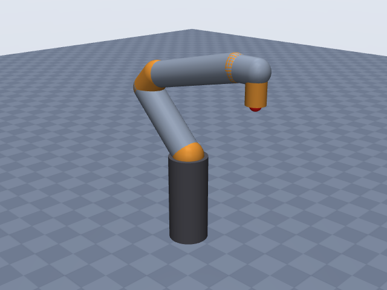
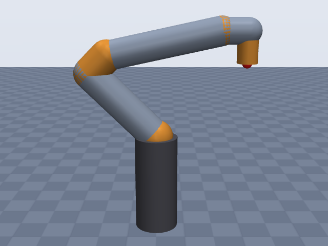
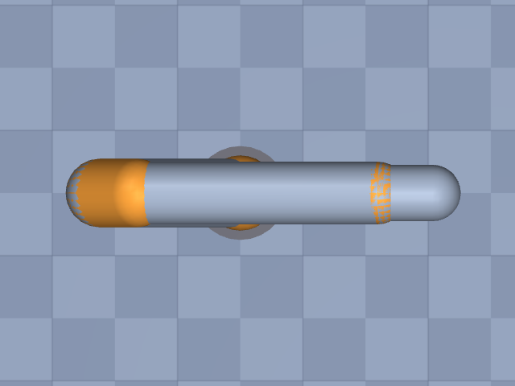

# franka_panda

Franka Emika · Panda (FER) arm, 7-DOF, without hand · Franka Emika Panda arm only (no hand); EE site at the flange face.

**Status: ✔ PASSED** · 13/14 checks passed · 0 blocking error(s) · 2 iteration(s), status `passed` · MuJoCo 3.3.0

## Views (home pose)

## Verification checks

| Check | Result | Measured | Expected | Tolerance | Severity | Message / fix hint |
|---|---|---|---|---|---|---|
| `compiles` | ✔ pass | — | — | — | error | loads with MuJoCo 3.3.0, mj_forward finite |
| `joint_structure` | ✔ pass | [[A1, hinge], [A2, hinge], [A3, hinge], [A4, hinge], [A5, hinge], [A6, hinge], [A7, hinge]] | [[A1, hinge], [A2, hinge], [A3, hinge], [A4, hinge], [A5, hinge], [A6, hinge], [A7, hinge]] | — | error | 7 joints match by name, type and chain order |
| `ee_site` | ✔ pass | ee_site | ee_site | — | error | site 'ee_site' on last body 'A7_link' |
| `kinematics_match` | ✔ pass | ee_position_m: 5.979e-16, ee_orientation_rad: 2.302e-15, joint_axis_rad: 2.080e-15, joint_position_m: 5.197e-16 | 0 | position_m: 1.000e-06, orientation_rad: 1.000e-06 | error | model kinematics match the spec on 20 configurations (max EE error 6.0e-16 m, 2.3e-15 rad) |
| `joint_limits` | ✔ pass | A1: [-2.897, 2.897], A2: [-1.763, 1.763], A3: [-2.897, 2.897], A4: [-3.072, -0.06981], A5: [-2.897, 2.897], A6: [-0.01745, 3.752], A7: [-2.897, 2.897] | A1: [-2.897, 2.897], A2: [-1.763, 1.763], A3: [-2.897, 2.897], A4: [-3.072, -0.06981], A5: [-2.897, 2.897], A6: [-0.01745, 3.752], A7: [-2.897, 2.897] | hinge_rad: 0.001, slide_m: 1.000e-04 | error | all joint ranges match the spec (max diff 4.27e-12) |
| `reach` | ✔ pass | 0.8579 | 0.855 | 0.05 | error | max reach 0.858 m within 0.3% of rated 0.855 m |
| `total_mass` | ✔ pass | 17.8 | 17.8 | 0.05 | error | model mass 17.800 kg within 0.0% of 17.800 kg |
| `mass_plausibility` | ✔ pass | — | — | — | warning | link densities, mass shares and mass per reach are plausible |
| `inertia_valid` | ✔ pass | — | — | — | error | 8 bodies have positive mass and valid inertia |
| `self_collision_home` | ✔ pass | 0 | 0 | 0.001 | error | no self-collision deeper than 1 mm at home (0 touching pairs) |
| `collision_exclusions` | ✘ fail | 1 | 0 | — | warning | 1 of 4 excluded pair(s) are neither parent/child nor separated only by zero-length links, so contacts between them are never checked: base / A1_link (parent/child; MuJoCo does not filter a world-fixed parent); base / A2_link (only zero-length links between them (origins coincide with the end of 'base')); A2_link / A4_link (geoms overlap around the short link 'A3_link' in all 32 sampled configurations, 22.5 mm deep at home); A4_link / A6_link (only zero-length links between them (origins coincide with the end of 'A4_link')) **Fix:** Review the exclusions of 'A2_link' / 'A4_link': they hide any collision between those links. If they are there because the primitives overlap, make the geometry fit (joints[1].link.geometry, joints[3].link.geometry: smaller radius, explicit fromto/pos) so the exclusion is no longer needed; if the MJCF was hand-edited, remove the <exclude> or explain it in the spec's `notes`. |
| `stable_hold` | ✔ pass | 0.01052 | 0 | drift_hinge_rad: 0.05, drift_slide_m: 0.005, final_speed: 0.1 | error | holds home for 2 s: max drift 0.0105, final speed 0.0000 |
| `actuators` | ✔ pass | 7 | 7 | — | error | every spec joint is driven by exactly one actuator |
| `sources_complete` | ✔ pass | 0 | 0 | — | error | every number in the spec has a source or is listed as an estimate (11 of 56 estimated) |

## Key specifications

| | |
|---|---|
| DOF | 7 |
| Total mass | 17.8 kg |
| Reach | 855 mm (shoulder → ee_site) |
| Payload | 3 kg |
| Repeatability | ± 0.1 mm |
| Convention | dh_modified |
| Units | length mm, angle deg |

## Joints

| # | Joint | Type | Lower | Upper | Effort limit | Velocity limit | Home |
|---|---|---|---|---|---|---|---|
| 1 | `A1` | hinge | -166 deg | 166 deg | 87 N·m | 150 deg/s | 0 deg |
| 2 | `A2` | hinge | -101 deg | 101 deg | 87 N·m | 150 deg/s | -45 deg |
| 3 | `A3` | hinge | -166 deg | 166 deg | 87 N·m | 150 deg/s | 0 deg |
| 4 | `A4` | hinge | -176 deg | -4 deg | 87 N·m | 150 deg/s | -135 deg |
| 5 | `A5` | hinge | -166 deg | 166 deg | 12 N·m | 180 deg/s | 0 deg |
| 6 | `A6` | hinge | -1 deg | 215 deg | 12 N·m | 180 deg/s | 90 deg |
| 7 | `A7` | hinge | -166 deg | 166 deg | 12 N·m | 180 deg/s | 45 deg |

## Sources

| Field path | Source |
|---|---|
| `joints[*].dh` | <https://frankarobotics.github.io/docs/robot_specifications.html> |
| `joints[6].dh.alpha` | <https://www.diag.uniroma1.it/~labrob/pub/papers/RAL_2019_PandaDynamicModel_PreprintXplore.pdf> |
| `ee.origin` | <https://frankarobotics.github.io/docs/robot_specifications.html> |
| `joints[*].limits` | <https://www.generationrobots.com/media/Panda_Datasheet_May_2019.pdf> |
| `joints[*].velocity_limit` | <https://www.generationrobots.com/media/Panda_Datasheet_May_2019.pdf> |
| `joints[*].effort_limit` | <https://frankarobotics.github.io/docs/robot_specifications.html> |
| `total_mass` | <https://centers.ulbsibiu.ro/incon/wp-content/uploads/Datasheet-Franka-Emika-Panda-Research-collaborative-robot.pdf> |
| `payload` | <https://www.generationrobots.com/media/Panda_Datasheet_May_2019.pdf> |
| `reach.value` | <https://www.generationrobots.com/media/Panda_Datasheet_May_2019.pdf> |
| `repeatability` | <https://www.generationrobots.com/media/Panda_Datasheet_May_2019.pdf> |

## Estimates

Fields whose values were estimated rather than read from a source:

- `joints[*].link.geometry`
- `joints[1].home`
- `joints[3].home`
- `joints[5].home`
- `joints[6].home`
- `reach.measured_from`
- `reach.measured_to`

## Spec notes

Kinematic source: published DH table (Franka Control Interface docs, "Craig's convention", primary; joint 7 alpha from the Gaz et al. RA-L 2019 Panda identification paper, peer-reviewed, which gives the same modified-DH table). All values from web-search extracts (Franka doc hosts blocked here). Rows copied as published; metres written in mm (x1000) and pi/2 rad as 90 deg; theta_i = q_i. The "Flange" row (a 0, d 0.107 m, alpha 0, theta 0) is not a joint and goes into ee.origin, so the EE site is the flange face centre. The current FCI page heads the table for FR3/FER; the older Panda page and the paper give the same table for the Panda. Joint ranges and speeds are the Panda datasheet (May 2019) degree values (second-hand: reseller copy at generationrobots.com of the Franka datasheet); the FCI FER table gives 2.1750 / 2.6100 rad/s (124.6 / 149.5 deg/s), lower than the datasheet's 150 / 180 deg/s, and the A5-A7 180 deg/s appears in one datasheet version only. Torques 87 Nm (A1-A4) and 12 Nm (A5-A7) from FCI. Total mass ~17.8 kg (second-hand datasheet copy on a university site; handbook says approx. 18 kg); no per-link masses published, so the builder distributes the total. Home: A4's range (-176..-4 deg) excludes 0, so the zero pose is not allowed; home is estimated as A2 = -45, A4 = -135, A6 = 90, A7 = 45 (others 0): the usual Panda ready posture as seen in product photos (upper arm tilted back, elbow folded, flange pointing straight down at about 307 mm forward, 590 mm up). Reach 855 mm: the datasheet does not say from where to where; the shoulder (A2 axis) to flange distance with the arm stretched is about 858 mm from the DH lengths, so measured_from shoulder / measured_to ee_site, both listed as estimates. Link radii are estimates from product photos (shoulder 60, upper links 55, forearm 50, wrist 50/45, flange link 35 mm).

## Iteration history

| # | Time | Result | Errors | Failed | Failed checks | Note |
|---|---|---|---|---|---|---|
| 1 | 2026-11-05T08:30:57+00:00 | ✘ fail | 1 | 2 | `self_collision_home` | initial spec: FCI modified DH + flange row, datasheet ranges/speeds, FCI torques, estimated ready-pose home |
| 2 | 2026-11-05T08:31:16+00:00 | ✔ pass | 0 | 1 |  | home to the Panda ready pose (A2 -45, A7 45 added; flange points down), A7 flange-link radius 40->35 mm (estimate) to clear the A4/A5 overlap |

Status: `passed` · max iterations 8

---
Generated by sim-anything on 2026-11-05 08:31 UTC.
