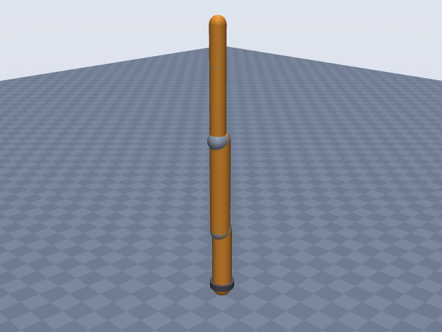
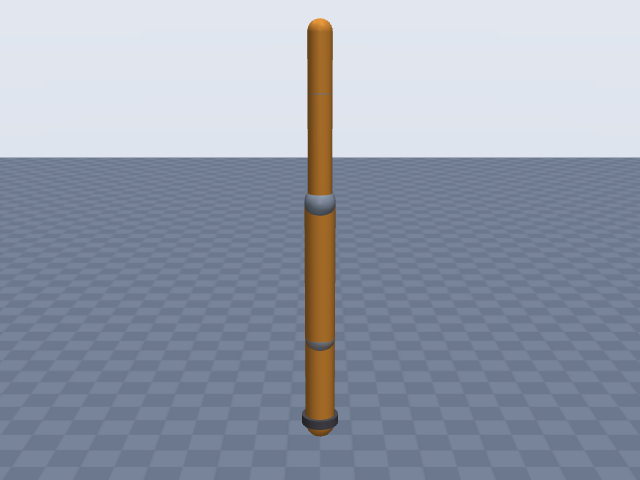
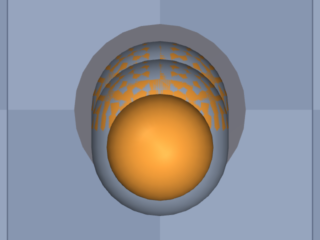

# kinova_gen3

Kinova · Gen3 ultra lightweight robot, 7-DOF spherical wrist (no gripper) · Kinova Gen3 7-DOF arm, spherical wrist, arm only, EE site at the tool interface (DH frame 7).

**Status: ✔ PASSED** · 10/11 checks passed · 0 blocking error(s) · 1 iteration(s), status `passed` · MuJoCo 3.3.0

## Views (home pose)

## Verification checks

| Check | Result | Measured | Expected | Tolerance | Severity | Message / fix hint |
|---|---|---|---|---|---|---|
| `compiles` | ✔ pass | — | — | — | error | loads with MuJoCo 3.3.0, mj_forward finite |
| `joint_structure` | ✔ pass | [[joint_1, hinge], [joint_2, hinge], [joint_3, hinge], [joint_4, hinge], [joint_5, hinge], [joint_6, hinge], [joint_7, hinge]] | [[joint_1, hinge], [joint_2, hinge], [joint_3, hinge], [joint_4, hinge], [joint_5, hinge], [joint_6, hinge], [joint_7, hinge]] | — | error | 7 joints match by name, type and chain order |
| `ee_site` | ✔ pass | ee_site | ee_site | — | error | site 'ee_site' on last body 'joint_7_link' |
| `joint_limits` | ✘ fail | joint_1: —, joint_2: [-2.25, 2.25], joint_3: —, joint_4: [-2.58, 2.58], joint_5: —, joint_6: [-2.1, 2.1], joint_7: — | joint_1: —, joint_2: [-2.25, 2.25], joint_3: —, joint_4: [-2.58, 2.58], joint_5: —, joint_6: [-2.1, 2.1], joint_7: — | hinge_rad: 0.001, slide_m: 1.000e-04 | warning | spec gives no limits for 'joint_1', 'joint_3', 'joint_5', 'joint_7' **Fix:** Add joints[0].limits, joints[2].limits, joints[4].limits, joints[6].limits from the datasheet (with a source) or as an estimate. |
| `reach` | ✔ pass | 0.9029 | 0.902 | 0.05 | error | max reach 0.903 m within 0.1% of rated 0.902 m |
| `total_mass` | ✔ pass | 8.2 | 8.2 | 0.05 | error | model mass 8.200 kg within 0.0% of 8.200 kg |
| `inertia_valid` | ✔ pass | — | — | — | error | 8 bodies have positive mass and valid inertia |
| `self_collision_home` | ✔ pass | 0 | 0 | 0.001 | error | no self-collision deeper than 1 mm at home (0 touching pairs) |
| `stable_hold` | ✔ pass | 0 | 0 | drift_hinge_rad: 0.05, drift_slide_m: 0.005, final_speed: 0.1 | error | holds home for 2 s: max drift 0.0000, final speed 0.0000 |
| `actuators` | ✔ pass | 7 | 7 | — | error | every spec joint is driven by exactly one actuator |
| `sources_complete` | ✔ pass | 0 | 0 | — | error | every number in the spec has a source or is listed as an estimate |

## Key specifications

| | |
|---|---|
| DOF | 7 |
| Total mass | 8.2 kg |
| Reach | 0.902 m (shoulder → ee_site) |
| Payload | 4 kg |
| Convention | dh_standard |
| Units | length m, angle deg |

## Joints

| # | Joint | Type | Lower | Upper | Effort limit | Velocity limit | Home |
|---|---|---|---|---|---|---|---|
| 1 | `joint_1` | hinge | — | — | 54 N·m | 78 deg/s | 0 deg |
| 2 | `joint_2` | hinge | -128.9 deg | 128.9 deg | 54 N·m | 78 deg/s | 0 deg |
| 3 | `joint_3` | hinge | — | — | 54 N·m | 78 deg/s | 0 deg |
| 4 | `joint_4` | hinge | -147.8 deg | 147.8 deg | 54 N·m | 78 deg/s | 0 deg |
| 5 | `joint_5` | hinge | — | — | 34 N·m | 150 deg/s | 0 deg |
| 6 | `joint_6` | hinge | -120.3 deg | 120.3 deg | 34 N·m | 150 deg/s | 0 deg |
| 7 | `joint_7` | hinge | — | — | 34 N·m | 150 deg/s | 0 deg |

## Sources

| Field path | Source |
|---|---|
| `base.origin` | <https://github.com/Sahilnarola-1007/kinova-kinematics/blob/main/design.md> |
| `joints[*].dh` | <https://github.com/Sahilnarola-1007/kinova-kinematics/blob/main/design.md> |
| `joints[*].limits` | <https://www.kinovarobotics.com/uploads/User-Guide-Gen3-R07.pdf> |
| `joints[*].velocity_limit` | <https://www.kinovarobotics.com/uploads/User-Guide-Gen3-R07.pdf> |
| `joints[*].effort_limit` | <https://www.kinovarobotics.com/uploads/User-Guide-Gen3-R07.pdf> |
| `total_mass` | <https://www.kinovarobotics.com/product/gen3-robots> |
| `payload` | <https://www.kinovarobotics.com/uploads/Kinova_Onepager_Gen3_2024_EN.pdf> |
| `reach` | <https://www.kinovarobotics.com/uploads/User-Guide-Gen3-R07.pdf> |

## Estimates

Fields whose values were estimated rather than read from a source:

- `joints[*].link.geometry`

## Spec notes

DH table (classic DH; base row alpha=pi; rows 1-6 alpha=pi/2; row 7 alpha=pi; theta_i = q_i + pi for i=2..7) is quoted from a secondary source (the design notes of an FK library, which attribute it to the Kinova Gen3 7-DOF kinematic parameters / User Guide without a table reference); the official guide's DH table (p.197 of R07) could not be fetched. Every d value is cross-checked against the User Guide Table 9 geometric parameters: 284.8 = base to shoulder, 11.8 = 5.4 + 6.4 joint offsets, 420.8 = 210.4 + 210.4 upper arm halves, 314.3 = 208.4 + 105.9 forearm + first wrist length, 167.4 = 105.9 + 61.5 second wrist length + last actuator to end effector. 12.8 is the only d value not directly checkable from the extracted Table 9 (it would be 6.4 + 6.4). Joints 1, 3, 5, 7 are continuous (guide: "no limit"), so their limits are omitted. Limits of joints 2/4/6 are the newer R07 software limits (older guide: 126/147/117). velocity_limit is the guide's max unloaded speed converted exactly: 13 RPM = 78 deg/s (large actuators, joints 1-4), 25 RPM = 150 deg/s (small actuators, joints 5-7); actuator-to-joint mapping from the spec sheet. effort_limit is the guide's peak torque (large 54 N*m, small 34 N*m); nominal is 39 / 13 N*m. total_mass 8.2 kg from the product page (guide: 8.3 kg with vision module). payload 4.0 kg is mid-range continuous (2.0 kg full-range continuous, 4.5 kg peak). Reach 902 mm is measured from the shoulder (actuator 2 frame) to the end-effector frame. Link capsule radii are rough estimates (no housing diameters found): 45 mm for links driven by the large actuators, 35 mm for the small-actuator links, chosen as plausible for an arm whose wrist segments are 105.9 mm long; not measured from any drawing.

## Iteration history

| # | Time | Result | Errors | Failed | Failed checks | Note |
|---|---|---|---|---|---|---|
| 1 | 2026-11-05T07:47:17+00:00 | ✔ pass | 0 | 1 |  | initial spec: classic DH table (secondary source, cross-checked with User Guide Table 9), R07 limits/speeds/torques |

Status: `passed` · max iterations 8

---
Generated by sim-anything on 2026-11-05 07:47 UTC.
