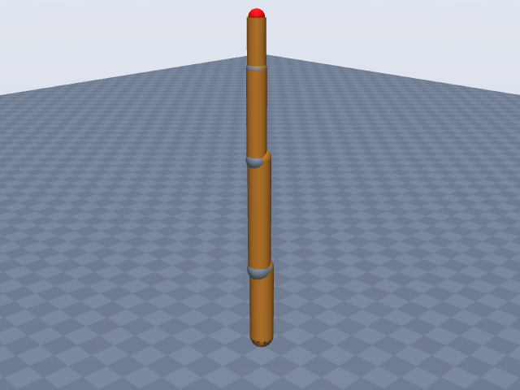
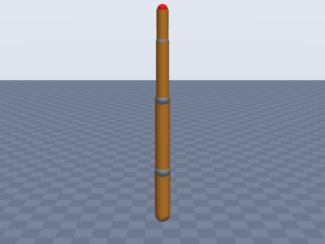
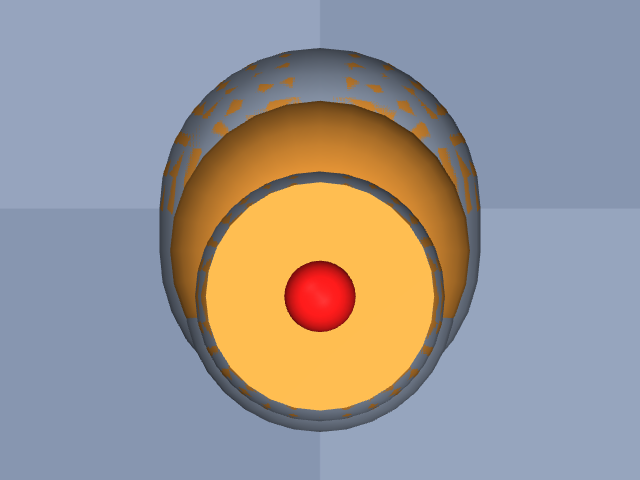

# kinova_gen3

Kinova · Gen3 ultra lightweight robot, 7-DoF spherical wrist (no gripper)

**Status: ✔ PASSED** · 12/14 checks passed · 0 blocking error(s) · 2 iteration(s), status `passed` · MuJoCo 3.3.0

## Views (home pose)

## Verification checks

| Check | Result | Measured | Expected | Tolerance | Severity | Message / fix hint |
|---|---|---|---|---|---|---|
| `compiles` | ✔ pass | — | — | — | error | loads with MuJoCo 3.3.0, mj_forward finite |
| `joint_structure` | ✔ pass | [[actuator_1, hinge], [actuator_2, hinge], [actuator_3, hinge], [actuator_4, hinge], [actuator_5, hinge], [actuator_6, hinge], [actuator_7, hinge]] | [[actuator_1, hinge], [actuator_2, hinge], [actuator_3, hinge], [actuator_4, hinge], [actuator_5, hinge], [actuator_6, hinge], [actuator_7, hinge]] | — | error | 7 joints match by name, type and chain order |
| `ee_site` | ✔ pass | ee_site | ee_site | — | error | site 'ee_site' on last body 'actuator_7_link' |
| `kinematics_match` | ✔ pass | ee_position_m: 6.924e-16, ee_orientation_rad: 1.942e-15, joint_axis_rad: 1.917e-15, joint_position_m: 7.348e-16 | 0 | position_m: 1.000e-06, orientation_rad: 1.000e-06 | error | model kinematics match the spec on 20 configurations (max EE error 6.9e-16 m, 1.9e-15 rad) |
| `joint_limits` | ✘ fail | actuator_1: —, actuator_2: [-2.25, 2.25], actuator_3: —, actuator_4: [-2.58, 2.58], actuator_5: —, actuator_6: [-2.1, 2.1], actuator_7: — | actuator_1: —, actuator_2: [-2.25, 2.25], actuator_3: —, actuator_4: [-2.58, 2.58], actuator_5: —, actuator_6: [-2.1, 2.1], actuator_7: — | hinge_rad: 0.001, slide_m: 1.000e-04 | warning | spec gives no limits for 'actuator_1', 'actuator_3', 'actuator_5', 'actuator_7' **Fix:** Add joints[0].limits, joints[2].limits, joints[4].limits, joints[6].limits from the datasheet (with a source) or as an estimate. |
| `reach` | ✔ pass | 0.9029 | 0.902 | 0.05 | error | max reach 0.903 m within 0.1% of rated 0.902 m |
| `total_mass` | ✔ pass | 8.2 | 8.2 | 0.05 | error | model mass 8.200 kg within 0.0% of 8.200 kg |
| `mass_plausibility` | ✔ pass | — | — | — | warning | link densities, mass shares and mass per reach are plausible |
| `inertia_valid` | ✔ pass | — | — | — | error | 8 bodies have positive mass and valid inertia |
| `self_collision_home` | ✔ pass | 0 | 0 | 0.001 | error | no self-collision deeper than 1 mm at home (0 touching pairs) |
| `collision_exclusions` | ✘ fail | 2 | 0 | — | warning | 2 of 4 excluded pair(s) are neither parent/child nor separated only by zero-length links, so contacts between them are never checked: base / actuator_1_link (parent/child; MuJoCo does not filter a world-fixed parent); actuator_1_link / actuator_3_link (geoms overlap around the short link 'actuator_2_link' in all 32 sampled configurations, 75.2 mm deep at home); actuator_3_link / actuator_5_link (geoms overlap around the short link 'actuator_4_link' in all 32 sampled configurations, 64.2 mm deep at home); actuator_5_link / actuator_7_link (only zero-length links between them (origins coincide with the end of 'actuator_5_link')) **Fix:** Review the exclusions of 'actuator_1_link' / 'actuator_3_link', 'actuator_3_link' / 'actuator_5_link': they hide any collision between those links. If they are there because the primitives overlap, make the geometry fit (joints[0].link.geometry, joints[2].link.geometry, joints[4].link.geometry: smaller radius, explicit fromto/pos) so the exclusion is no longer needed; if the MJCF was hand-edited, remove the <exclude> or explain it in the spec's `notes`. |
| `stable_hold` | ✔ pass | 0 | 0 | drift_hinge_rad: 0.05, drift_slide_m: 0.005, final_speed: 0.1 | error | holds home for 2 s: max drift 0.0000, final speed 0.0000 |
| `actuators` | ✔ pass | 7 | 7 | — | error | every spec joint is driven by exactly one actuator |
| `sources_complete` | ✔ pass | 0 | 0 | — | error | every number in the spec has a source or is listed as an estimate (8 of 51 estimated) |

## Key specifications

| | |
|---|---|
| DOF | 7 |
| Total mass | 8.2 kg |
| Reach | 0.902 m (shoulder → ee_site) |
| Payload | 4 kg |
| Convention | dh_standard |
| Units | length m, angle deg |

## Joints

| # | Joint | Type | Lower | Upper | Effort limit | Velocity limit | Home |
|---|---|---|---|---|---|---|---|
| 1 | `actuator_1` | hinge | — | — | 54 N·m | 78 deg/s | 0 deg |
| 2 | `actuator_2` | hinge | -128.9 deg | 128.9 deg | 54 N·m | 78 deg/s | 0 deg |
| 3 | `actuator_3` | hinge | — | — | 54 N·m | 78 deg/s | 0 deg |
| 4 | `actuator_4` | hinge | -147.8 deg | 147.8 deg | 54 N·m | 78 deg/s | 0 deg |
| 5 | `actuator_5` | hinge | — | — | 34 N·m | 150 deg/s | 0 deg |
| 6 | `actuator_6` | hinge | -120.3 deg | 120.3 deg | 34 N·m | 150 deg/s | 0 deg |
| 7 | `actuator_7` | hinge | — | — | 34 N·m | 150 deg/s | 0 deg |

## Sources

| Field path | Source |
|---|---|
| `joints[*].dh` | <https://raw.githubusercontent.com/Sahilnarola-1007/kinova-kinematics/main/design.md> |
| `base.origin` | <https://raw.githubusercontent.com/Sahilnarola-1007/kinova-kinematics/main/design.md> |
| `joints[*].limits` | <https://www.kinovarobotics.com/uploads/User-Guide-Gen3-R07.pdf> |
| `joints[*].velocity_limit` | <https://www.kinovarobotics.com/uploads/User-Guide-Gen3-R07.pdf> |
| `joints[*].effort_limit` | <https://www.kinovarobotics.com/uploads/User-Guide-Gen3-R07.pdf> |
| `total_mass` | <https://www.kinovarobotics.com/product/gen3-robots> |
| `payload` | <https://www.kinovarobotics.com/uploads/Kinova_Onepager_Gen3_2024_EN.pdf> |
| `reach` | <https://www.kinovarobotics.com/uploads/User-Guide-Gen3-R07.pdf> |

## Estimates

Fields whose values were estimated rather than read from a source:

- `base.link.geometry`
- `joints[*].link.geometry`

## Spec notes

Kinematic source: published DH table (classical DH, Kinova Gen3 User Guide section "Denavit-Hartenberg (DH) parameters - 7 DoF spherical wrist"), but obtained SECOND-HAND: the guide PDF and every mirror (kinovarobotics.com, csis.pace.edu, manualslib, scribd, manualmachine, manuals.plus, manuals.online, unchainedrobotics.de) were blocked from this session and search extracts only returned the table of contents, so the rows were copied from a third-party transcription (Sahilnarola-1007/kinova-kinematics design.md section 5.1, a C++ FK library; not a robot-description file) that does not cite the guide page. Cross-check against the guide's own Table 9 geometric parameters (primary, via search extract): |d1| = 156.4 + 128.4 = 284.8 mm ("Base to shoulder 284.8"), |d3| = 210.4 + 210.4 (two upper-arm halves), |d5| = 208.4 + 105.9 (forearm + first wrist length), |d7| = 105.9 + 61.5 (second wrist length + last actuator to end effector), |d2| = 5.4 + 6.4 and |d4| = 6.4 + 6.4 (the guide's 5.4 / 6.4 mm joint offsets), and q = 0 gives the arm straight up with the flange at 1.1873 m = sum of all Table 9 lengths; every DH length is consistent with the primary geometry. DH row 0 (alpha = pi) is a fixed base->frame-0 rotation, put in base.origin rpy [180, 0, 0]. Angles pi/2 and pi converted to 90 / 180 deg; lengths kept in m. EE site = DH frame 7 = the tool interface (flange face) of actuator 7 (the design.md extra +0.113 m tool offset is for a gripper and is not used). Joint limits: newer guide Table 35 "angular limits" (software limits) +-128.9 / +-147.8 / +-120.3 deg for actuators 2 / 4 / 6; older guide lists +-126 / +-147 / +-117. Actuators 1, 3, 5, 7 have "no limit" (continuous) so their limits are omitted. Actuators: joints 1-4 large, 5-7 small (Gen3 specifications sheet R01). velocity_limit is the R07 "maximum unloaded speed" converted exactly from RPM (13 RPM = 78 deg/s large, 25 RPM = 150 deg/s small; older guide says 17 RPM for the large actuator). effort_limit is the R07 peak torque (54 N m large, 34 N m small; older guide: 74 N m large peak). Mass 8.2 kg from the product page (guide: 8.3 kg with vision module, no gripper). Payload 4.0 kg is the one-pager's mid-range continuous payload (2.0 kg full-range continuous, 4.5 kg peak). Reach 902 mm (written 0.902 because the spec length unit is m) is defined by the guide (search extract) as from the shoulder (actuator 2 frame) to the end-effector frame. Link geometry radii and extents are estimates (no housing diameters found): roughly the proportions of product photos, ~90 mm diameter shoulder/upper arm tapering to ~64 mm at the wrist. Link masses are not published; total_mass is distributed by volume.

## Iteration history

| # | Time | Result | Errors | Failed | Failed checks | Note |
|---|---|---|---|---|---|---|
| 1 | 2026-11-05T08:31:04+00:00 | ✘ fail | 1 | 4 | `reach` | initial spec: classical DH table (second-hand copy of the user guide table), R07 limits/torques, auto link geometry |
| 2 | 2026-11-05T08:31:13+00:00 | ✔ pass | 0 | 2 |  | reach 902 mm written as 0.902 (spec length unit is m) |

Status: `passed` · max iterations 8

---
Generated by sim-anything on 2026-11-05 08:31 UTC.
