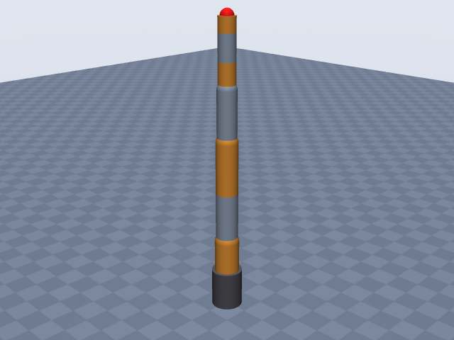
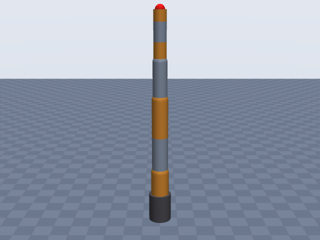
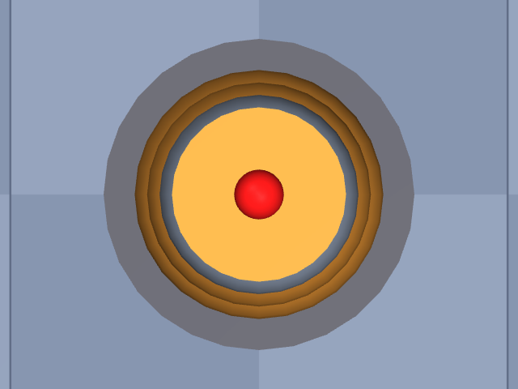

# kinova_gen3

Kinova · Gen3 ultra lightweight robot, 7-DOF spherical wrist, no gripper · Kinova Gen3 7-DOF arm without gripper; q = 0 is the straight-up configuration; EE site at the end-effector (tool interface) frame, 61.5 mm past actuator 7.

**Status: ✔ PASSED** · 13/14 checks passed · 0 blocking error(s) · 1 iteration(s), status `passed` · MuJoCo 3.3.0

## Views (home pose)

## Verification checks

| Check | Result | Measured | Expected | Tolerance | Severity | Message / fix hint |
|---|---|---|---|---|---|---|
| `compiles` | ✔ pass | — | — | — | error | loads with MuJoCo 3.3.0, mj_forward finite |
| `joint_structure` | ✔ pass | [[actuator_1, hinge], [actuator_2, hinge], [actuator_3, hinge], [actuator_4, hinge], [actuator_5, hinge], [actuator_6, hinge], [actuator_7, hinge]] | [[actuator_1, hinge], [actuator_2, hinge], [actuator_3, hinge], [actuator_4, hinge], [actuator_5, hinge], [actuator_6, hinge], [actuator_7, hinge]] | — | error | 7 joints match by name, type and chain order |
| `ee_site` | ✔ pass | ee_site | ee_site | — | error | site 'ee_site' on last body 'actuator_7_link' |
| `kinematics_match` | ✔ pass | ee_position_m: 4.441e-16, ee_orientation_rad: 8.605e-16, joint_axis_rad: 7.345e-16, joint_position_m: 2.431e-16 | 0 | position_m: 1.000e-06, orientation_rad: 1.000e-06 | error | model kinematics match the spec on 20 configurations (max EE error 4.4e-16 m, 8.6e-16 rad) |
| `joint_limits` | ✘ fail | actuator_1: —, actuator_2: [-2.25, 2.25], actuator_3: —, actuator_4: [-2.58, 2.58], actuator_5: —, actuator_6: [-2.1, 2.1], actuator_7: — | actuator_1: —, actuator_2: [-2.25, 2.25], actuator_3: —, actuator_4: [-2.58, 2.58], actuator_5: —, actuator_6: [-2.1, 2.1], actuator_7: — | hinge_rad: 0.001, slide_m: 1.000e-04 | warning | spec gives no limits for 'actuator_1', 'actuator_3', 'actuator_5', 'actuator_7' **Fix:** Add joints[0].limits, joints[2].limits, joints[4].limits, joints[6].limits from the datasheet (with a source) or as an estimate. |
| `reach` | ✔ pass | 0.9025 | 0.902 | 0.05 | error | max reach 0.902 m within 0.1% of rated 0.902 m |
| `total_mass` | ✔ pass | 8.2 | 8.2 | 0.05 | error | model mass 8.200 kg within 0.0% of 8.200 kg |
| `mass_plausibility` | ✔ pass | — | — | — | warning | link densities, mass shares and mass per reach are plausible |
| `inertia_valid` | ✔ pass | — | — | — | error | 8 bodies have positive mass and valid inertia |
| `self_collision_home` | ✔ pass | 0 | 0 | 0.001 | error | no self-collision deeper than 1 mm at home (0 touching pairs) |
| `collision_exclusions` | ✔ pass | 0 | 0 | — | warning | 1 excluded pair(s), all parent/child or separated only by zero-length links: base / actuator_1_link (parent/child; MuJoCo does not filter a world-fixed parent) |
| `stable_hold` | ✔ pass | 0 | 0 | drift_hinge_rad: 0.05, drift_slide_m: 0.005, final_speed: 0.1 | error | holds home for 2 s: max drift 0.0000, final speed 0.0000 |
| `actuators` | ✔ pass | 7 | 7 | — | error | every spec joint is driven by exactly one actuator |
| `sources_complete` | ✔ pass | 0 | 0 | — | error | every number in the spec has a source or is listed as an estimate (22 of 45 estimated) |

## Key specifications

| | |
|---|---|
| DOF | 7 |
| Total mass | 8.2 kg |
| Reach | 902 mm (shoulder → ee_site) |
| Payload | 4 kg |
| Convention | offset |
| Units | length mm, angle deg |

## Joints

| # | Joint | Type | Lower | Upper | Effort limit | Velocity limit | Home |
|---|---|---|---|---|---|---|---|
| 1 | `actuator_1` | hinge | — | — | 54 N·m | 78 deg/s | 0 deg |
| 2 | `actuator_2` | hinge | -128.9 deg | 128.9 deg | 54 N·m | 78 deg/s | 0 deg |
| 3 | `actuator_3` | hinge | — | — | 54 N·m | 78 deg/s | 0 deg |
| 4 | `actuator_4` | hinge | -147.8 deg | 147.8 deg | 54 N·m | 78 deg/s | 0 deg |
| 5 | `actuator_5` | hinge | — | — | 34 N·m | 150 deg/s | 0 deg |
| 6 | `actuator_6` | hinge | -120.3 deg | 120.3 deg | 34 N·m | 150 deg/s | 0 deg |
| 7 | `actuator_7` | hinge | — | — | 34 N·m | 150 deg/s | 0 deg |

## Sources

| Field path | Source |
|---|---|
| `joints[1].limits` | <https://www.kinovarobotics.com/uploads/User-Guide-Gen3-R07.pdf> |
| `joints[3].limits` | <https://www.kinovarobotics.com/uploads/User-Guide-Gen3-R07.pdf> |
| `joints[5].limits` | <https://www.kinovarobotics.com/uploads/User-Guide-Gen3-R07.pdf> |
| `joints[*].velocity_limit` | <https://www.kinovarobotics.com/uploads/User-Guide-Gen3-R07.pdf> |
| `joints[*].effort_limit` | <https://www.kinovarobotics.com/uploads/User-Guide-Gen3-R07.pdf> |
| `total_mass` | <https://www.kinovarobotics.com/product/gen3-robots> |
| `payload` | <https://www.kinovarobotics.com/uploads/Kinova_Onepager_Gen3_2024_EN.pdf> |
| `reach` | <https://www.kinovarobotics.com/uploads/User-Guide-Gen3-R07.pdf> |

## Estimates

Fields whose values were estimated rather than read from a source:

- `joints[*].origin`
- `joints[*].axis`
- `ee.origin`
- `joints[*].link.geometry`

## Spec notes

Kinematic source: dimension table (Gen3 user guide "Table 9: 7 DoF spherical wrist robot geometric parameters", lengths in mm), mapped to joints by me, so the chain is class 3 (drawing/dimension table) with every origin and axis listed as an estimate. The guide also has a "Denavit-Hartenberg (DH) parameters - 7 DoF spherical wrist" table, but its values could not be extracted (direct fetches of kinovarobotics.com, manualshive.com and arxiv.org fail in this environment; searches only returned the table of contents). The geometric lengths came from a Scribd/manualslib copy of the guide (second-hand host of the manufacturer document). Mapping (estimate): q = 0 is the arm pointing straight up, inferred from the length table (stacked base-to-actuator heights) and from joints 2/4/6 having limits symmetric about 0; joints 1/3/5/7 (continuous) roll about the arm's long axis (z), joints 2/4/6 bend about base y; all frames parallel to the base. Joint origins along z: actuator 1 at 156.4, actuator 2 at 284.8 (base to shoulder, so 128.4 after actuator 1), then 210.4, 210.4, 208.4, 105.9, 105.9, and the EE site 61.5 past actuator 7 ("Last actuator to end efector"). Where the roll joints sit along their own axis does not change the kinematics. The two small lateral joint offsets in the table (5.4 mm and 6.4 mm) could not be assigned to joints from the extract, so they are omitted (the arm is modelled as perfectly in-line); this is the main known kinematic error (about 1 cm lateral). Bending-joint signs (+y for 2, 4, 6) are guesses; the roll/bend layout matches product photos, but a mirrored sign is possible. EE site: the arm has no flange separate from the end-effector interface on actuator 7; I put the site at the guide's "end effector" point, 61.5 mm beyond actuator 7 along the last axis (the tool interface face, no gripper). Joint limits: newer guide (R07) Table 35, actuator 2 +-128.9, actuator 4 +-147.8, actuator 6 +-120.3 deg (software limits; older guide: +-126/+-147/+-117); actuators 1/3/5/7 have "no limit", so their limits are omitted. Speeds: guide R07 "maximum unloaded speed is 25 RPM (small) and 13 RPM (large)", converted exactly (13 RPM = 78 deg/s, 25 RPM = 150 deg/s); torques: peak 54 Nm (large) and 34 Nm (small) from the same guide (nominal 39/13 Nm). Large actuators drive joints 1-4 and small ones joints 5-7 per the Gen3 specifications sheet (reseller copy, https://hotrobotics.co.uk/wp-content/uploads/2021/07/Gen3-Specifications-R01.pdf, second-hand host). Mass 8.2 kg (product page, 7-DoF; guide says 8.3 kg with vision module, no gripper). Payload 4.0 kg = mid-range continuous (2.0 kg full-range continuous, 4.5 kg peak). Reach 902 mm "from the shoulder (Actuator 2 frame) to the end effector frame" (guide); the length sum 420.8 + 208.4 + 211.8 + 61.5 = 902.5 mm agrees. Repeatability not found. Link radii (50/45/45/40/35/35 mm capsules, 35 mm end cylinder) estimated from product photos; no housing diameters were found. Link masses not published (builder distributes 8.2 kg by volume).

## Iteration history

| # | Time | Result | Errors | Failed | Failed checks | Note |
|---|---|---|---|---|---|---|
| 1 | 2026-11-05T10:56:58+00:00 | ✔ pass | 0 | 1 |  | initial offset spec from user-guide geometric parameter table (straight-up zero pose), R07 limits/speeds/torques |

Status: `passed` · max iterations 8

---
Generated by sim-anything on 2026-11-05 10:56 UTC.
