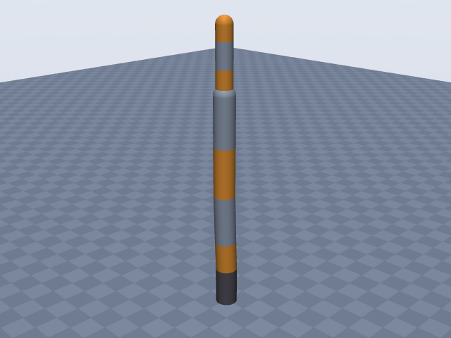
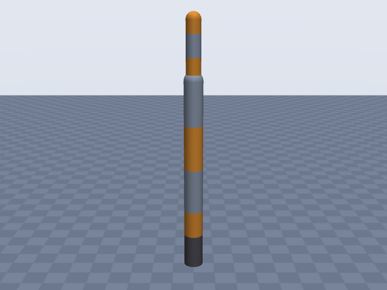
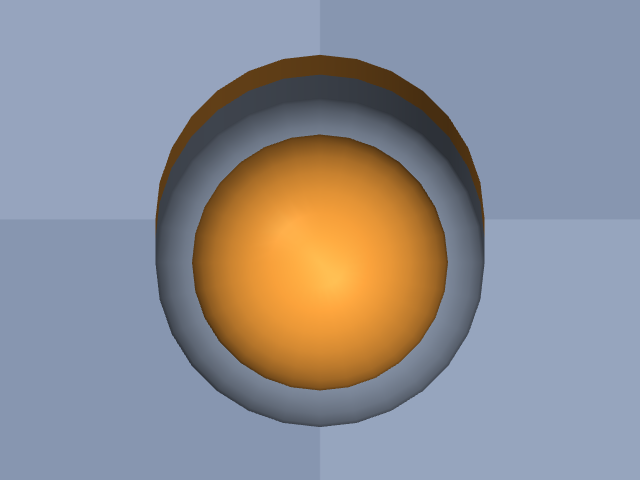

# kinova_gen3_7dof

Kinova · Gen3 7-DoF (spherical wrist), bare arm, EE = interface module frame

**Status: ✔ PASSED** · 13/15 checks passed · 0 blocking error(s) · 2 iteration(s), status `passed` · MuJoCo 3.3.0

## Views (home pose)

## Verification checks

| Check | Result | Measured | Expected | Tolerance | Severity | Message / fix hint |
|---|---|---|---|---|---|---|
| `compiles` | ✔ pass | — | — | — | error | loads with MuJoCo 3.3.0, mj_forward finite |
| `joint_structure` | ✔ pass | [[joint_1, hinge], [joint_2, hinge], [joint_3, hinge], [joint_4, hinge], [joint_5, hinge], [joint_6, hinge], [joint_7, hinge]] | [[joint_1, hinge], [joint_2, hinge], [joint_3, hinge], [joint_4, hinge], [joint_5, hinge], [joint_6, hinge], [joint_7, hinge]] | — | error | 7 joints match by name, type and chain order |
| `ee_site` | ✔ pass | ee_site | ee_site | — | error | site 'ee_site' on last body 'joint_7_link' |
| `kinematics_match` | ✔ pass | ee_position_m: 4.441e-16, ee_orientation_rad: 7.555e-16, joint_axis_rad: 6.799e-16, joint_position_m: 2.450e-16 | 0 | position_m: 1.000e-06, orientation_rad: 1.000e-06 | error | model kinematics match the spec on 20 configurations (max EE error 4.4e-16 m, 7.6e-16 rad) |
| `joint_limits` | ✘ fail | joint_1: —, joint_2: [-2.199, 2.199], joint_3: —, joint_4: [-2.566, 2.566], joint_5: —, joint_6: [-2.042, 2.042], joint_7: — | joint_1: —, joint_2: [-2.199, 2.199], joint_3: —, joint_4: [-2.566, 2.566], joint_5: —, joint_6: [-2.042, 2.042], joint_7: — | hinge_rad: 0.001, slide_m: 1.000e-04 | warning | spec gives no limits for 'joint_1', 'joint_3', 'joint_5', 'joint_7' **Fix:** Add joints[0].limits, joints[2].limits, joints[4].limits, joints[6].limits from the datasheet (with a source) or as an estimate. |
| `reach` | ✔ pass | 0.908 | 0.902 | 0.05 | error | max reach 0.908 m within 0.7% of rated 0.902 m |
| `drawing` | ✔ pass | — | — | — | info | no drawing dimensions in the spec; the zero pose is not checked against a drawing |
| `total_mass` | ✔ pass | 8.2 | 8.2 | 0.05 | error | model mass 8.200 kg within 0.0% of 8.200 kg |
| `mass_plausibility` | ✔ pass | — | — | — | warning | link densities, mass shares and mass per reach are plausible |
| `inertia_valid` | ✔ pass | — | — | — | error | 8 bodies have positive mass and valid inertia |
| `self_collision_home` | ✔ pass | 0 | 0 | 0.001 | error | no self-collision deeper than 1 mm at home (0 touching pairs) |
| `collision_exclusions` | ✔ pass | 0 | 0 | — | warning | 1 excluded pair(s), all parent/child or separated only by zero-length links: base / joint_1_link (parent/child; MuJoCo does not filter a world-fixed parent) |
| `stable_hold` | ✔ pass | 0 | 0 | drift_hinge_rad: 0.05, drift_slide_m: 0.005, final_speed: 0.1 | error | holds home for 2 s: max drift 0.0000, final speed 0.0000 |
| `actuators` | ✔ pass | 7 | 7 | — | error | every spec joint is driven by exactly one actuator |
| `sources_complete` | ✘ fail | 0.9091 | 0 | 0.5 | warning | every number is covered, but 30 of 33 (91%) are estimates **Fix:** More than half of the numbers are estimates: look for sources (datasheet, manual, DH table) for the ones that matter most, i.e. link lengths / DH rows, joint limits, total_mass and reach, and move them from `estimates` to `sources`. |

## Key specifications

| | |
|---|---|
| DOF | 7 |
| Total mass | 8.2 kg |
| Reach | 902 mm (shoulder → ee_site) |
| Payload | 2 kg |
| Convention | offset |
| Units | length mm, angle deg |

## Joints

| # | Joint | Type | Lower | Upper | Effort limit | Velocity limit | Home |
|---|---|---|---|---|---|---|---|
| 1 | `joint_1` | hinge | — | — | — | — | 0 deg |
| 2 | `joint_2` | hinge | -126 deg | 126 deg | — | — | 0 deg |
| 3 | `joint_3` | hinge | — | — | — | — | 0 deg |
| 4 | `joint_4` | hinge | -147 deg | 147 deg | — | — | 0 deg |
| 5 | `joint_5` | hinge | — | — | — | — | 0 deg |
| 6 | `joint_6` | hinge | -117 deg | 117 deg | — | — | 0 deg |
| 7 | `joint_7` | hinge | — | — | — | — | 0 deg |

## Sources

| Field path | Source |
|---|---|
| `total_mass` | <https://www.kinovarobotics.com/uploads/Kinova_Onepager_Gen3_2024_EN.pdf> |
| `payload` | <https://www.kinovarobotics.com/uploads/Kinova_Onepager_Gen3_2024_EN.pdf> |
| `reach.value` | <https://www.kinovarobotics.com/uploads/Kinova_Onepager_Gen3_2024_EN.pdf> |

## Estimates

Fields whose values were estimated rather than read from a source:

- `joints[*].origin`
- `joints[*].axis`
- `ee.origin`
- `joints[*].link.geometry`
- `base.link.geometry`
- `joints[1].limits`
- `joints[3].limits`
- `joints[5].limits`
- `reach.measured_from`
- `reach.measured_to`

## Spec notes

Kinematic source: inferred from a dimension/length list (User Guide Table 9 "7 DoF spherical wrist robot geometric parameters"), known only second-hand from search-engine excerpts of two user-uploaded copies of the guide that agree (https://www.scribd.com/document/624143328/gen3, https://www.manualslib.com/manual/1529186/Kinova-Gen3.html?page=49; partial agreement from https://manualmachine.com/kinova/gen3/2576994-user-manual/). No document could be opened; the official DH table, base and interface transforms and the zero-pose frame figure (Figure 70) were not retrievable. The kinematics are therefore INFERRED and SECOND-HAND, and convention `offset` is used. The raw lengths (156.4, 284.8, 5.4, 6.4, 210.4 x2, 208.4, 105.9 x2, 61.5 mm) are copied unchanged, but every length-to-joint mapping, axis direction and offset sign is my judgement, so joints[*].origin, joints[*].axis and ee.origin are all listed as estimates. Mapping used: q = 0 is assumed to be the arm straight up (vertical candle pose), frames parallel to the base; base mounting face -> J1 156.4 mm; J1 -> J2 = 284.8 - 156.4 = 128.4 mm up, with the 5.4 mm "joint 1-2 offset" placed laterally along -y; J2 -> J3 = 210.4 mm up with the 6.4 mm "joint 2-3 offset" laterally along -y; J3 -> J4 210.4; J4 -> J5 208.4 (forearm); J5 -> J6 105.9; J6 -> J7 105.9; J7 -> interface module 61.5. The offset directions (y, sign -) are guesses: the excerpt gave neither direction nor sign, and the real arm may alternate them or carry an offset at another joint that the excerpt did not list. The length list likely leaves out further lateral offsets (e.g. J3-J4, J4-J5); these are unverified and not modelled, so expect lateral position errors of about 10 mm. Axes are assumed alternating roll/pitch: J1, J3, J5, J7 about z (along the link); J2, J4, J6 about +y; positive directions are guesses. Consistency check (my arithmetic): 210.4+210.4+208.4+105.9+105.9+61.5 = 902.5 mm from J2 to the interface module, matching the 902 mm rated reach. Reach 902 mm (one-pager, 7 DoF column; search excerpt only, document not opened). Its definition, from the actuator 2 frame to the interface module frame, is a search-tool paraphrase of the manualmachine mirror (not a quote), so reach.measured_from = shoulder and reach.measured_to = ee_site (interface module frame, no gripper) are estimates. Joint limits J2 +-126, J4 +-147, J6 +-117 deg are paraphrased Table 10 values (software limits; search excerpt, second-hand, possibly rounded; the two mirror copies agree), so they are listed as estimates. J1, J3, J5, J7 are continuous, so they have no limits. Total mass 8.2 kg (one-pager, 7 DoF, no gripper; search excerpt only, document not opened). Payload 2.0 kg = full-range continuous (one-pager; search excerpt only, document not opened); the mid-range continuous figure is 4.0 kg. Torques, speeds and repeatability are omitted (paraphrase only or conflicting). Link radii (45 mm large actuators, 35 mm small) and the base cylinder are rough estimates from the general size of the arm; no housing diameters were found. No drawing cross-check dimensions were available, so `drawing` is omitted.

## Iteration history

| # | Time | Result | Errors | Failed | Failed checks | Note |
|---|---|---|---|---|---|---|
| 1 | 2026-11-09T00:42:04+00:00 | ✔ pass | 0 | 2 |  | initial build of spec as written |
| 2 | 2026-11-09T00:44:41+00:00 | ✔ pass | 0 | 2 |  | re-run after spec writer moved J2/J4/J6 limits and reach endpoints to estimates; no numbers changed |

Status: `passed` · max iterations 8

---
Generated by sim-anything on 2026-11-09 00:44 UTC.
