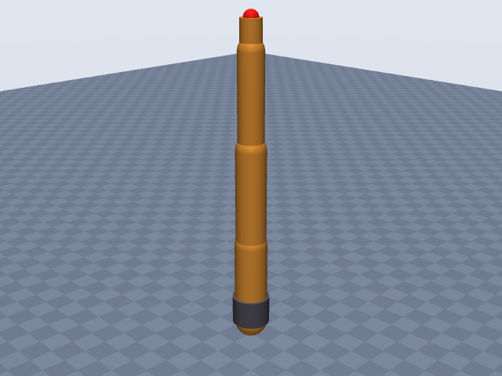
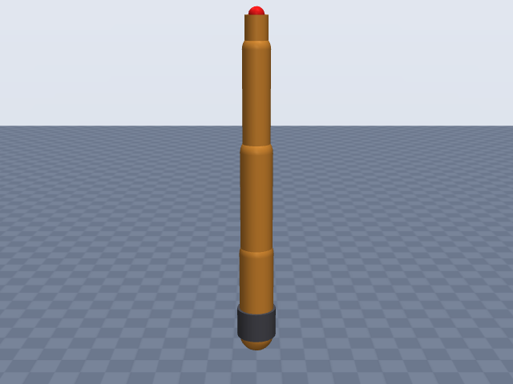
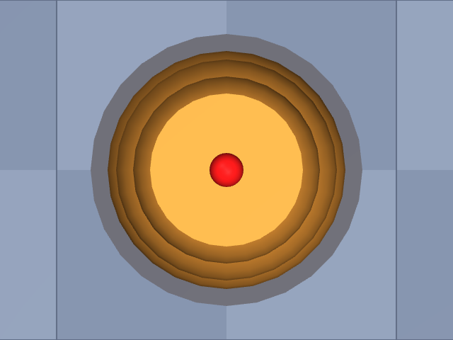

# kuka_iiwa14

KUKA · LBR iiwa 14 R820 · 7-DOF lightweight arm, arm only (no media flange / gripper); EE site at the A7 output flange face.

**Status: ✔ PASSED** · 11/11 checks passed · 0 blocking error(s) · 1 iteration(s), status `passed` · MuJoCo 3.3.0

## Views (home pose)

## Verification checks

| Check | Result | Measured | Expected | Tolerance | Severity | Message / fix hint |
|---|---|---|---|---|---|---|
| `compiles` | ✔ pass | — | — | — | error | loads with MuJoCo 3.3.0, mj_forward finite |
| `joint_structure` | ✔ pass | [[A1, hinge], [A2, hinge], [A3, hinge], [A4, hinge], [A5, hinge], [A6, hinge], [A7, hinge]] | [[A1, hinge], [A2, hinge], [A3, hinge], [A4, hinge], [A5, hinge], [A6, hinge], [A7, hinge]] | — | error | 7 joints match by name, type and chain order |
| `ee_site` | ✔ pass | ee_site | ee_site | — | error | site 'ee_site' on last body 'A7_link' |
| `joint_limits` | ✔ pass | A1: [-2.967, 2.967], A2: [-2.094, 2.094], A3: [-2.967, 2.967], A4: [-2.094, 2.094], A5: [-2.967, 2.967], A6: [-2.094, 2.094], A7: [-3.054, 3.054] | A1: [-2.967, 2.967], A2: [-2.094, 2.094], A3: [-2.967, 2.967], A4: [-2.094, 2.094], A5: [-2.967, 2.967], A6: [-2.094, 2.094], A7: [-3.054, 3.054] | hinge_rad: 0.001, slide_m: 1.000e-04 | error | all joint ranges match the spec (max diff 3.20e-12) |
| `reach` | ✔ pass | 0.82 | 0.82 | 0.05 | error | max reach 0.820 m within 0.0% of rated 0.820 m |
| `total_mass` | ✔ pass | 29.9 | 29.9 | 0.05 | error | model mass 29.900 kg within 0.0% of 29.900 kg |
| `inertia_valid` | ✔ pass | — | — | — | error | 8 bodies have positive mass and valid inertia |
| `self_collision_home` | ✔ pass | 0 | 0 | 0.001 | error | no self-collision deeper than 1 mm at home (0 touching pairs) |
| `stable_hold` | ✔ pass | 0 | 0 | drift_hinge_rad: 0.05, drift_slide_m: 0.005, final_speed: 0.1 | error | holds home for 2 s: max drift 0.0000, final speed 0.0000 |
| `actuators` | ✔ pass | 7 | 7 | — | error | every spec joint is driven by exactly one actuator |
| `sources_complete` | ✔ pass | 0 | 0 | — | error | every number in the spec has a source or is listed as an estimate |

## Key specifications

| | |
|---|---|
| DOF | 7 |
| Total mass | 29.9 kg |
| Reach | 820 mm (shoulder → wrist_center) |
| Payload | 14 kg |
| Repeatability | ± 0.15 mm |
| Convention | offset |
| Units | length mm, angle deg |

## Joints

| # | Joint | Type | Lower | Upper | Effort limit | Velocity limit | Home |
|---|---|---|---|---|---|---|---|
| 1 | `A1` | hinge | -170 deg | 170 deg | 320 N·m | 85 deg/s | 0 deg |
| 2 | `A2` | hinge | -120 deg | 120 deg | 320 N·m | 85 deg/s | 0 deg |
| 3 | `A3` | hinge | -170 deg | 170 deg | 176 N·m | 100 deg/s | 0 deg |
| 4 | `A4` | hinge | -120 deg | 120 deg | 176 N·m | 75 deg/s | 0 deg |
| 5 | `A5` | hinge | -170 deg | 170 deg | 110 N·m | 130 deg/s | 0 deg |
| 6 | `A6` | hinge | -120 deg | 120 deg | 40 N·m | 135 deg/s | 0 deg |
| 7 | `A7` | hinge | -175 deg | 175 deg | 40 N·m | 135 deg/s | 0 deg |

## Sources

| Field path | Source |
|---|---|
| `joints[*].origin` | <https://apps.kuka.com/KUKA/virtualshowroom/assets/downloads/KUKA_LBR_Med_EN.pdf> |
| `ee.origin` | <https://apps.kuka.com/KUKA/virtualshowroom/assets/downloads/KUKA_LBR_Med_EN.pdf> |
| `joints[*].limits` | <https://my.kuka.com/s/product/lbr-iiwa-14-r820/01t58000002hnktAAA?language=en_US> |
| `joints[*].velocity_limit` | <https://git.phschoen.de/phschoen/lwr_server/raw/commit/1debece1117ae5d940d2f15c0647304bf45473c6/lwrserv/doc/LBRiiwa_en.pdf> |
| `joints[*].effort_limit` | <https://git.phschoen.de/phschoen/lwr_server/raw/commit/1debece1117ae5d940d2f15c0647304bf45473c6/lwrserv/doc/LBRiiwa_en.pdf> |
| `total_mass` | <https://my.kuka.com/s/product/lbr-iiwa-14-r820/01t58000002hnktAAA?language=en_US> |
| `payload` | <https://my.kuka.com/s/product/lbr-iiwa-14-r820/01t58000002hnktAAA?language=en_US> |
| `reach` | <https://my.kuka.com/s/product/lbr-iiwa-14-r820/01t58000002hnktAAA?language=en_US> |
| `repeatability` | <https://my.kuka.com/s/product/lbr-iiwa-14-r820/01t58000002hnktAAA?language=en_US> |

## Estimates

Fields whose values were estimated rather than read from a source:

- `joints[*].axis`
- `base.link.geometry`
- `joints[*].link.geometry`

## Spec notes

Kinematics: KUKA publishes no DH table, so the chain uses the offset convention with q = 0 = arm straight up. Segment lengths are the KUKA work-envelope dimensions for the 14 R820: A 1306, B 1180, C 360, D 420, E 400, F 126, G 820, H 255 mm (LBR Med brochure; the KMR iiwa brochure gives the same A-E, G, H for the standard LBR iiwa 14 R820). The extracts do not label the letters, so their meaning is an interpretation, chosen because it is internally exact: C = base mounting face to A2, D = A2 to A4, E = A4 to A6, F = A6 to output flange, B = C+D+E = 1180 (A6 height when stretched up), A = B+F = 1306 (flange height when stretched up), G = D+E = 820 = maximum reach, which is therefore modelled as A2 (shoulder) to A6 (wrist centre). H = 255 is not used (meaning unknown). A3, A5, A7 lie on the segment lines, so their frames are placed at A2, A4, A6 respectively (any point on the line gives the same kinematics). Joint axis directions (A1/A3/A5/A7 along the arm, A2/A4/A6 about one horizontal axis) follow the 7-axis roll-pitch layout seen in product photos; the positive rotation sense of A2/A4/A6 is not published in what could be read and is an estimate (+y for all three). Joint ranges from the product page (A1/A3/A5 +-170, A2/A4/A6 +-120, A7 +-175). Max speeds and max torques per axis from the KUKA specification "LBR iiwa 7 R800, LBR iiwa 14 R820" (mirror; garbled text extract, column alignment read by the search tool): A1-A7 320/320/176/176/110/40/40 Nm and 85/85/100/75/130/135/135 deg/s; the A1-A5 speeds match the product page "speed with rated payload". Link radii and base cylinder are estimates from product photos (no housing diameters found). Link masses omitted (builder distributes total_mass). Mass 29.9 kg is "approx." on the product page.

## Iteration history

| # | Time | Result | Errors | Failed | Failed checks | Note |
|---|---|---|---|---|---|---|
| 1 | 2026-11-05T07:47:44+00:00 | ✔ pass | 0 | 0 |  | initial offset spec from KUKA envelope dimensions C/D/E/F, product page ranges, spec axis data |

Status: `passed` · max iterations 8

---
Generated by sim-anything on 2026-11-05 07:47 UTC.
