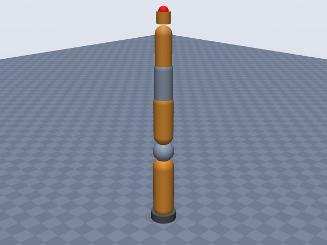
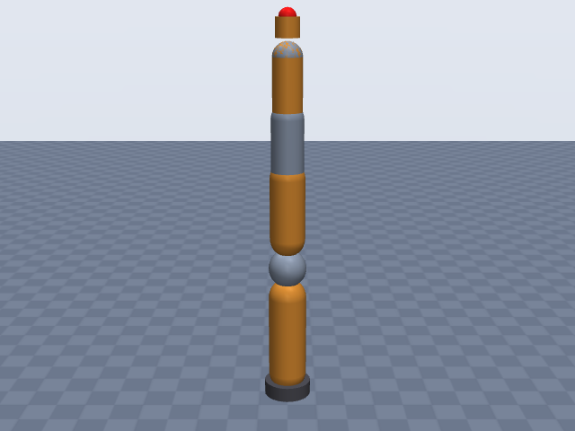
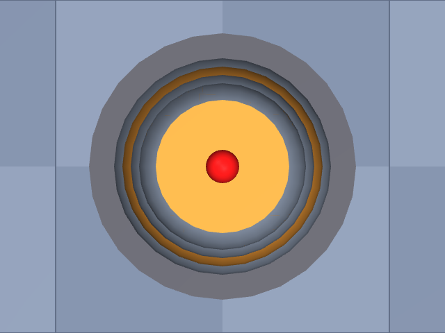

# kuka_iiwa14

KUKA · LBR iiwa 14 R820 · 7-DOF lightweight arm, arm only (no tool), EE site on the mechanical (tool) flange face.

**Status: ✔ PASSED** · 14/14 checks passed · 0 blocking error(s) · 1 iteration(s), status `passed` · MuJoCo 3.3.0

## Views (home pose)

## Verification checks

| Check | Result | Measured | Expected | Tolerance | Severity | Message / fix hint |
|---|---|---|---|---|---|---|
| `compiles` | ✔ pass | — | — | — | error | loads with MuJoCo 3.3.0, mj_forward finite |
| `joint_structure` | ✔ pass | [[A1, hinge], [A2, hinge], [A3, hinge], [A4, hinge], [A5, hinge], [A6, hinge], [A7, hinge]] | [[A1, hinge], [A2, hinge], [A3, hinge], [A4, hinge], [A5, hinge], [A6, hinge], [A7, hinge]] | — | error | 7 joints match by name, type and chain order |
| `ee_site` | ✔ pass | ee_site | ee_site | — | error | site 'ee_site' on last body 'A7_link' |
| `kinematics_match` | ✔ pass | ee_position_m: 3.886e-16, ee_orientation_rad: 1.003e-15, joint_axis_rad: 6.280e-16, joint_position_m: 3.372e-16 | 0 | position_m: 1.000e-06, orientation_rad: 1.000e-06 | error | model kinematics match the spec on 20 configurations (max EE error 3.9e-16 m, 1.0e-15 rad) |
| `joint_limits` | ✔ pass | A1: [-2.967, 2.967], A2: [-2.094, 2.094], A3: [-2.967, 2.967], A4: [-2.094, 2.094], A5: [-2.967, 2.967], A6: [-2.094, 2.094], A7: [-3.054, 3.054] | A1: [-2.967, 2.967], A2: [-2.094, 2.094], A3: [-2.967, 2.967], A4: [-2.094, 2.094], A5: [-2.967, 2.967], A6: [-2.094, 2.094], A7: [-3.054, 3.054] | hinge_rad: 0.001, slide_m: 1.000e-04 | error | all joint ranges match the spec (max diff 3.20e-12) |
| `reach` | ✔ pass | 0.82 | 0.82 | 0.05 | error | max reach 0.820 m within 0.0% of rated 0.820 m |
| `total_mass` | ✔ pass | 29.9 | 29.9 | 0.05 | error | model mass 29.900 kg within 0.0% of 29.900 kg |
| `mass_plausibility` | ✔ pass | — | — | — | warning | link densities, mass shares and mass per reach are plausible |
| `inertia_valid` | ✔ pass | — | — | — | error | 8 bodies have positive mass and valid inertia |
| `self_collision_home` | ✔ pass | 0 | 0 | 0.001 | error | no self-collision deeper than 1 mm at home (0 touching pairs) |
| `collision_exclusions` | ✔ pass | 0 | 0 | — | warning | 2 excluded pair(s), all parent/child or separated only by zero-length links: base / A1_link (parent/child; MuJoCo does not filter a world-fixed parent); A5_link / A7_link (only zero-length links between them (origins coincide with the end of 'A5_link')) |
| `stable_hold` | ✔ pass | 0 | 0 | drift_hinge_rad: 0.05, drift_slide_m: 0.005, final_speed: 0.1 | error | holds home for 2 s: max drift 0.0000, final speed 0.0000 |
| `actuators` | ✔ pass | 7 | 7 | — | error | every spec joint is driven by exactly one actuator |
| `sources_complete` | ✔ pass | 0 | 0 | — | error | every number in the spec has a source or is listed as an estimate (26 of 57 estimated) |

## Key specifications

| | |
|---|---|
| DOF | 7 |
| Total mass | 29.9 kg |
| Reach | 820 mm (shoulder → wrist_center) |
| Payload | 14 kg |
| Repeatability | ± 0.15 mm |
| Convention | offset |
| Units | length mm, angle deg |

## Joints

| # | Joint | Type | Lower | Upper | Effort limit | Velocity limit | Home |
|---|---|---|---|---|---|---|---|
| 1 | `A1` | hinge | -170 deg | 170 deg | 320 N·m | 85 deg/s | 0 deg |
| 2 | `A2` | hinge | -120 deg | 120 deg | 320 N·m | 85 deg/s | 0 deg |
| 3 | `A3` | hinge | -170 deg | 170 deg | 176 N·m | 100 deg/s | 0 deg |
| 4 | `A4` | hinge | -120 deg | 120 deg | 176 N·m | 75 deg/s | 0 deg |
| 5 | `A5` | hinge | -170 deg | 170 deg | 110 N·m | 130 deg/s | 0 deg |
| 6 | `A6` | hinge | -120 deg | 120 deg | 40 N·m | 135 deg/s | 0 deg |
| 7 | `A7` | hinge | -175 deg | 175 deg | 40 N·m | 135 deg/s | 0 deg |

## Sources

| Field path | Source |
|---|---|
| `joints[*].limits` | <https://my.kuka.com/s/product/lbr-iiwa-14-r820/01t58000002hnktAAA?language=en_US> |
| `joints[0].velocity_limit` | <https://my.kuka.com/s/product/lbr-iiwa-14-r820/01t58000002hnktAAA?language=en_US> |
| `joints[1].velocity_limit` | <https://my.kuka.com/s/product/lbr-iiwa-14-r820/01t58000002hnktAAA?language=en_US> |
| `joints[2].velocity_limit` | <https://my.kuka.com/s/product/lbr-iiwa-14-r820/01t58000002hnktAAA?language=en_US> |
| `joints[3].velocity_limit` | <https://my.kuka.com/s/product/lbr-iiwa-14-r820/01t58000002hnktAAA?language=en_US> |
| `joints[4].velocity_limit` | <https://my.kuka.com/s/product/lbr-iiwa-14-r820/01t58000002hnktAAA?language=en_US> |
| `joints[5].velocity_limit` | <https://git.phschoen.de/phschoen/lwr_server/raw/commit/1debece1117ae5d940d2f15c0647304bf45473c6/lwrserv/doc/LBRiiwa_en.pdf> |
| `joints[6].velocity_limit` | <https://git.phschoen.de/phschoen/lwr_server/raw/commit/1debece1117ae5d940d2f15c0647304bf45473c6/lwrserv/doc/LBRiiwa_en.pdf> |
| `joints[0].effort_limit` | <https://git.phschoen.de/phschoen/lwr_server/raw/commit/1debece1117ae5d940d2f15c0647304bf45473c6/lwrserv/doc/LBRiiwa_en.pdf> |
| `joints[1].effort_limit` | <https://git.phschoen.de/phschoen/lwr_server/raw/commit/1debece1117ae5d940d2f15c0647304bf45473c6/lwrserv/doc/LBRiiwa_en.pdf> |
| `joints[3].effort_limit` | <https://storage.googleapis.com/bucket-two-leobotics/product/datasheet-fiche-technique-robot-axe-industriel-collaboratif-7-axes-kuka-lbr-iiwa-7-r800-2-14-r820-2.pdf> |
| `joints[4].effort_limit` | <https://storage.googleapis.com/bucket-two-leobotics/product/datasheet-fiche-technique-robot-axe-industriel-collaboratif-7-axes-kuka-lbr-iiwa-7-r800-2-14-r820-2.pdf> |
| `joints[5].effort_limit` | <https://git.phschoen.de/phschoen/lwr_server/raw/commit/1debece1117ae5d940d2f15c0647304bf45473c6/lwrserv/doc/LBRiiwa_en.pdf> |
| `joints[6].effort_limit` | <https://git.phschoen.de/phschoen/lwr_server/raw/commit/1debece1117ae5d940d2f15c0647304bf45473c6/lwrserv/doc/LBRiiwa_en.pdf> |
| `total_mass` | <https://my.kuka.com/s/product/lbr-iiwa-14-r820/01t58000002hnktAAA?language=en_US> |
| `payload` | <https://my.kuka.com/s/product/lbr-iiwa-14-r820/01t58000002hnktAAA?language=en_US> |
| `reach.value` | <https://my.kuka.com/s/product/lbr-iiwa-14-r820/01t58000002hnktAAA?language=en_US> |
| `repeatability` | <https://my.kuka.com/s/product/lbr-iiwa-14-r820/01t58000002hnktAAA?language=en_US> |

## Estimates

Fields whose values were estimated rather than read from a source:

- `joints[*].origin`
- `joints[*].axis`
- `joints[2].effort_limit`
- `ee.origin`
- `reach.measured_from`
- `reach.measured_to`
- `base.link.geometry`
- `joints[*].link.geometry`

## Spec notes

Kinematic source: dimension drawing (KUKA work-envelope figure/table, letters A-G, read from web-search extracts of a third-party mirror of the KUKA LBR iiwa document; the PDF itself could not be opened), so convention offset with the stretched-up pose as q = 0. The letters are not labelled in the extracts; mapping is inferred and therefore every joint origin is listed as an estimate: C = 360 = base mounting face to A2 axis (joints[1].origin z), D = 420 = A2 to A4, E = 400 = A4 to A6, G = 820 = D + E = reach, B = 1180 = C + G (top of the wrist-centre envelope), A = 1306 = total height to the flange, so A6 axis to flange face = A - B = 126 mm (ee.origin z). The same arithmetic holds for the iiwa 7 R800 row of the same table (1266/1140/340/400/400/800, 1266 - 1140 = 126), which supports the mapping. The LBR Med 14 R820 brochure gives the same A = 1306 and B = 1180. Where the roll joints A3, A5, A7 sit along their own axes does not change the kinematics; A3 and A5 are put at the midpoints of D and E (210, 200) and A7 at the A6 centre (estimates). A2/A4/A6 are pitch axes and A1/A3/A5/A7 are roll axes along the arm (the iiwa's alternating roll/pitch layout; no source read gives axis vectors); the axis signs (A4 reversed relative to A2 and A6) are an estimate: no source states the positive directions. Reach 820 mm is not defined in the sources; it equals D + E, so it is taken as shoulder (A2) to wrist centre (A6), listed as an estimate. Joint ranges are the product-page ranges (A1/A3/A5 +-170, A2/A4/A6 +-120, A7 +-175). Speeds A1-A5 from the product page; A6/A7 135 deg/s from the search extract of the spec axis-data table (also on the iiwa 14 R820 CR page). Torques: A1/A2 320, A6/A7 40 Nm from the spec axis-data table extract; A4 176 and A5 110 from a garbled distributor-brochure extract (second-hand); A3 176 is the unlabelled value in that extract, so it is an estimate. Total mass 29.9 kg ("approx.") distributed by volume; no link masses published. Housing radii are estimates from product photos (no diameters published). Second-hand sources: the mirrored KUKA PDF (git.phschoen.de) and the distributor brochure, both read only as search extracts.

## Iteration history

| # | Time | Result | Errors | Failed | Failed checks | Note |
|---|---|---|---|---|---|---|
| 1 | 2026-11-05T08:30:10+00:00 | ✔ pass | 0 | 0 |  | initial spec: offset chain from KUKA work-envelope letters C/D/E and A-B flange distance, product-page limits/speeds |

Status: `passed` · max iterations 8

---
Generated by sim-anything on 2026-11-05 08:30 UTC.
