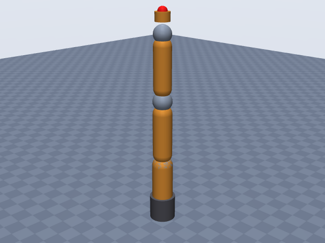
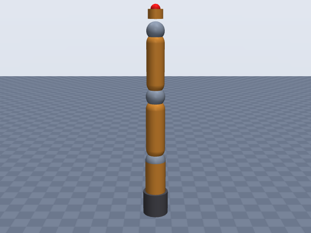
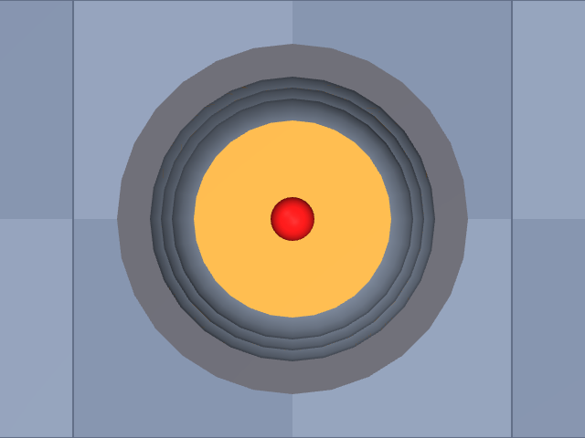

# kuka_iiwa14

KUKA · LBR iiwa 14 R820 (7-DOF), arm only, no media flange · KUKA LBR iiwa 14 R820, offset convention from the KUKA work-envelope dimension table (letters C, D, E, A).

**Status: ✔ PASSED** · 13/14 checks passed · 0 blocking error(s) · 1 iteration(s), status `passed` · MuJoCo 3.3.0

## Views (home pose)

## Verification checks

| Check | Result | Measured | Expected | Tolerance | Severity | Message / fix hint |
|---|---|---|---|---|---|---|
| `compiles` | ✔ pass | — | — | — | error | loads with MuJoCo 3.3.0, mj_forward finite |
| `joint_structure` | ✔ pass | [[A1, hinge], [A2, hinge], [A3, hinge], [A4, hinge], [A5, hinge], [A6, hinge], [A7, hinge]] | [[A1, hinge], [A2, hinge], [A3, hinge], [A4, hinge], [A5, hinge], [A6, hinge], [A7, hinge]] | — | error | 7 joints match by name, type and chain order |
| `ee_site` | ✔ pass | ee_site | ee_site | — | error | site 'ee_site' on last body 'A7_link' |
| `kinematics_match` | ✔ pass | ee_position_m: 4.871e-16, ee_orientation_rad: 1.003e-15, joint_axis_rad: 6.280e-16, joint_position_m: 3.957e-16 | 0 | position_m: 1.000e-06, orientation_rad: 1.000e-06 | error | model kinematics match the spec on 20 configurations (max EE error 4.9e-16 m, 1.0e-15 rad) |
| `joint_limits` | ✔ pass | A1: [-2.967, 2.967], A2: [-2.094, 2.094], A3: [-2.967, 2.967], A4: [-2.094, 2.094], A5: [-2.967, 2.967], A6: [-2.094, 2.094], A7: [-3.054, 3.054] | A1: [-2.967, 2.967], A2: [-2.094, 2.094], A3: [-2.967, 2.967], A4: [-2.094, 2.094], A5: [-2.967, 2.967], A6: [-2.094, 2.094], A7: [-3.054, 3.054] | hinge_rad: 0.001, slide_m: 1.000e-04 | error | all joint ranges match the spec (max diff 3.20e-12) |
| `reach` | ✔ pass | 0.82 | 0.82 | 0.05 | error | max reach 0.820 m within 0.0% of rated 0.820 m |
| `total_mass` | ✔ pass | 29.9 | 29.9 | 0.05 | error | model mass 29.900 kg within 0.0% of 29.900 kg |
| `mass_plausibility` | ✔ pass | — | — | — | warning | link densities, mass shares and mass per reach are plausible |
| `inertia_valid` | ✔ pass | — | — | — | error | 8 bodies have positive mass and valid inertia |
| `self_collision_home` | ✔ pass | 0 | 0 | 0.001 | error | no self-collision deeper than 1 mm at home (0 touching pairs) |
| `collision_exclusions` | ✔ pass | 0 | 0 | — | warning | 4 excluded pair(s), all parent/child or separated only by zero-length links: base / A1_link (parent/child; MuJoCo does not filter a world-fixed parent); A1_link / A3_link (only zero-length links between them (origins coincide with the end of 'A1_link')); A3_link / A5_link (only zero-length links between them (origins coincide with the end of 'A3_link')); A5_link / A7_link (only zero-length links between them (origins coincide with the end of 'A5_link')) |
| `stable_hold` | ✔ pass | 0 | 0 | drift_hinge_rad: 0.05, drift_slide_m: 0.005, final_speed: 0.1 | error | holds home for 2 s: max drift 0.0000, final speed 0.0000 |
| `actuators` | ✔ pass | 7 | 7 | — | error | every spec joint is driven by exactly one actuator |
| `sources_complete` | ✘ fail | 0.5098 | 0 | 0.5 | warning | every number is covered, but 26 of 51 (51%) are estimates **Fix:** More than half of the numbers are estimates: look for sources (datasheet, manual, DH table) for the ones that matter most, i.e. link lengths / DH rows, joint limits, total_mass and reach, and move them from `estimates` to `sources`. |

## Key specifications

| | |
|---|---|
| DOF | 7 |
| Total mass | 29.9 kg |
| Reach | 820 mm (shoulder → wrist_center) |
| Payload | 14 kg |
| Repeatability | ± 0.15 mm |
| Convention | offset |
| Units | length mm, angle deg |

## Joints

| # | Joint | Type | Lower | Upper | Effort limit | Velocity limit | Home |
|---|---|---|---|---|---|---|---|
| 1 | `A1` | hinge | -170 deg | 170 deg | 320 N·m | 85 deg/s | 0 deg |
| 2 | `A2` | hinge | -120 deg | 120 deg | 320 N·m | 85 deg/s | 0 deg |
| 3 | `A3` | hinge | -170 deg | 170 deg | — | 100 deg/s | 0 deg |
| 4 | `A4` | hinge | -120 deg | 120 deg | — | 75 deg/s | 0 deg |
| 5 | `A5` | hinge | -170 deg | 170 deg | — | 130 deg/s | 0 deg |
| 6 | `A6` | hinge | -120 deg | 120 deg | — | 135 deg/s | 0 deg |
| 7 | `A7` | hinge | -175 deg | 175 deg | — | 135 deg/s | 0 deg |

## Sources

| Field path | Source |
|---|---|
| `joints[*].limits` | <https://my.kuka.com/s/product/lbr-iiwa-14-r820/01t58000002hnktAAA?language=en_US> |
| `joints[0].velocity_limit` | <https://my.kuka.com/s/product/lbr-iiwa-14-r820/01t58000002hnktAAA?language=en_US> |
| `joints[1].velocity_limit` | <https://my.kuka.com/s/product/lbr-iiwa-14-r820/01t58000002hnktAAA?language=en_US> |
| `joints[2].velocity_limit` | <https://my.kuka.com/s/product/lbr-iiwa-14-r820/01t58000002hnktAAA?language=en_US> |
| `joints[3].velocity_limit` | <https://my.kuka.com/s/product/lbr-iiwa-14-r820/01t58000002hnktAAA?language=en_US> |
| `joints[4].velocity_limit` | <https://my.kuka.com/s/product/lbr-iiwa-14-r820/01t58000002hnktAAA?language=en_US> |
| `joints[0].effort_limit` | <https://git.phschoen.de/phschoen/lwr_server/raw/commit/1debece1117ae5d940d2f15c0647304bf45473c6/lwrserv/doc/LBRiiwa_en.pdf> |
| `joints[1].effort_limit` | <https://git.phschoen.de/phschoen/lwr_server/raw/commit/1debece1117ae5d940d2f15c0647304bf45473c6/lwrserv/doc/LBRiiwa_en.pdf> |
| `reach.value` | <https://my.kuka.com/s/product/lbr-iiwa-14-r820/01t58000002hnktAAA?language=en_US> |
| `total_mass` | <https://my.kuka.com/s/product/lbr-iiwa-14-r820/01t58000002hnktAAA?language=en_US> |
| `payload` | <https://my.kuka.com/s/product/lbr-iiwa-14-r820/01t58000002hnktAAA?language=en_US> |
| `repeatability` | <https://my.kuka.com/s/product/lbr-iiwa-14-r820/01t58000002hnktAAA?language=en_US> |

## Estimates

Fields whose values were estimated rather than read from a source:

- `joints[*].origin`
- `joints[*].axis`
- `joints[5].velocity_limit`
- `joints[6].velocity_limit`
- `ee.origin`
- `base.link.geometry`
- `joints[*].link.geometry`
- `reach.measured_from`
- `reach.measured_to`

## Spec notes

Kinematic source: dimension table/drawing (KUKA work-envelope dimensions A-G for the LBR iiwa 14 R820, read from search extracts of KUKA documents), letter-to-link mapping inferred, so all origins are estimates. Values (14 R820): A 1306, B 1180, C 360, D 420, E 400, F 255, G 820 mm. Mapping used: C = base to A2 axis, D = A2 to A4, E = A4 to A6, G = 820 = D + E (rated reach, so reach is taken as A2 (shoulder) -> A6 (wrist centre)), B = 1180 = C + G (top of the reach sphere), A = 1306 = C + D + E + 126, so the A6-axis -> flange distance is taken as 126 mm (no media flange). The letters are not labelled in the extracts, hence estimates. q = 0 is the stretched vertical pose (ranges are symmetric about it); A1/A3/A5/A7 are coaxial with the vertical, A2/A4/A6 are horizontal pitch axes. Positive directions of A2/A4/A6 are not in any available source: +y, -y, +y chosen as a guess (estimate). Joint ranges and A1-A5 speeds: my.KUKA product page; A6/A7 135 deg/s only on the cleanroom variant page (assumed same arm). Torques: only A1/A2 = 320 Nm kept, from a search extract of a KUKA brochure copy hosted on git.phschoen.de (second-hand host); other axes omitted because the extracts were garbled and mixed with the 7 R800 column. Mass 29.9 kg is "approx." on the product page. All link and base radii are estimates from product photos (no housing diameters found). The KUKA spec notes the arm height depends on the media flange; the model has no media flange.

## Iteration history

| # | Time | Result | Errors | Failed | Failed checks | Note |
|---|---|---|---|---|---|---|
| 1 | 2026-11-05T10:55:11+00:00 | ✔ pass | 0 | 1 |  | initial spec: offset chain from KUKA envelope letters C/D/E/A (mapping estimated), product-page ranges/speeds |

Status: `passed` · max iterations 8

---
Generated by sim-anything on 2026-11-05 10:55 UTC.
