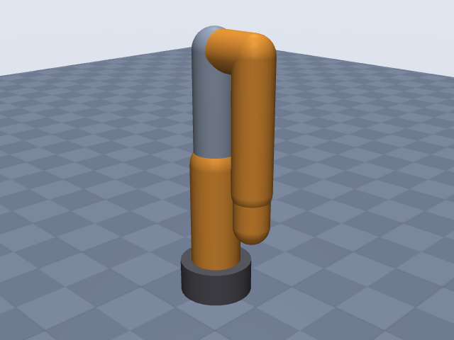
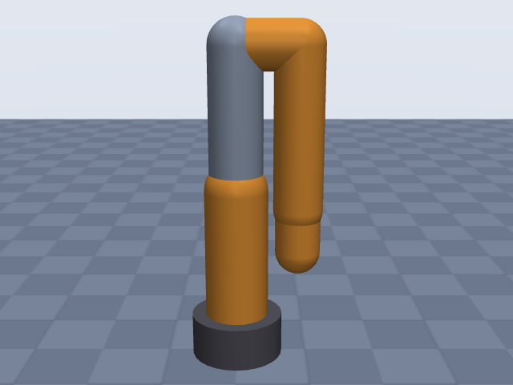
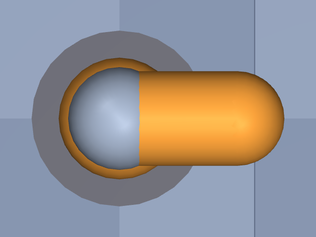

# ufactory_lite6

UFactory · Lite 6 · UFactory Lite 6 (6-DOF), arm only without gripper, EE site at the tool flange (modified-DH frame 6).

**Status: ✔ PASSED** · 14/14 checks passed · 0 blocking error(s) · 2 iteration(s), status `passed` · MuJoCo 3.3.0

## Views (home pose)

## Verification checks

| Check | Result | Measured | Expected | Tolerance | Severity | Message / fix hint |
|---|---|---|---|---|---|---|
| `compiles` | ✔ pass | — | — | — | error | loads with MuJoCo 3.3.0, mj_forward finite |
| `joint_structure` | ✔ pass | [[J1, hinge], [J2, hinge], [J3, hinge], [J4, hinge], [J5, hinge], [J6, hinge]] | [[J1, hinge], [J2, hinge], [J3, hinge], [J4, hinge], [J5, hinge], [J6, hinge]] | — | error | 6 joints match by name, type and chain order |
| `ee_site` | ✔ pass | ee_site | ee_site | — | error | site 'ee_site' on last body 'J6_link' |
| `kinematics_match` | ✔ pass | ee_position_m: 3.402e-16, ee_orientation_rad: 1.595e-15, joint_axis_rad: 9.738e-16, joint_position_m: 3.312e-16 | 0 | position_m: 1.000e-06, orientation_rad: 1.000e-06 | error | model kinematics match the spec on 20 configurations (max EE error 3.4e-16 m, 1.6e-15 rad) |
| `joint_limits` | ✔ pass | J1: [-6.283, 6.283], J2: [-2.618, 2.618], J3: [-0.06109, 5.236], J4: [-6.283, 6.283], J5: [-2.164, 2.164], J6: [-6.283, 6.283] | J1: [-6.283, 6.283], J2: [-2.618, 2.618], J3: [-0.06109, 5.236], J4: [-6.283, 6.283], J5: [-2.164, 2.164], J6: [-6.283, 6.283] | hinge_rad: 0.001, slide_m: 1.000e-04 | error | all joint ranges match the spec (max diff 2.99e-12) |
| `reach` | ✔ pass | 0.4437 | 0.44 | 0.05 | error | max reach 0.444 m within 0.8% of rated 0.440 m |
| `total_mass` | ✔ pass | 8 | 8 | 0.05 | error | model mass 8.000 kg within 0.0% of 8.000 kg |
| `mass_plausibility` | ✔ pass | — | — | — | warning | link densities, mass shares and mass per reach are plausible |
| `inertia_valid` | ✔ pass | — | — | — | error | 7 bodies have positive mass and valid inertia |
| `self_collision_home` | ✔ pass | 0 | 0 | 0.001 | error | no self-collision deeper than 1 mm at home (0 touching pairs) |
| `collision_exclusions` | ✔ pass | 0 | 0 | — | warning | 3 excluded pair(s), all parent/child or separated only by zero-length links: base / J1_link (parent/child; MuJoCo does not filter a world-fixed parent); base / J2_link (only zero-length links between them (origins coincide with the end of 'base')); J3_link / J5_link (only zero-length links between them (origins coincide with the end of 'J3_link')) |
| `stable_hold` | ✔ pass | 0.01003 | 0 | drift_hinge_rad: 0.05, drift_slide_m: 0.005, final_speed: 0.1 | error | holds home for 2 s: max drift 0.0100, final speed 0.0000 |
| `actuators` | ✔ pass | 6 | 6 | — | error | every spec joint is driven by exactly one actuator |
| `sources_complete` | ✔ pass | 0 | 0 | — | error | every number in the spec has a source or is listed as an estimate (13 of 53 estimated) |

## Key specifications

| | |
|---|---|
| DOF | 6 |
| Total mass | 8 kg |
| Reach | 440 mm (shoulder → wrist_center) |
| Payload | 0.6 kg |
| Repeatability | ± 0.5 mm |
| Convention | dh_modified |
| Units | length mm, angle deg |

## Joints

| # | Joint | Type | Lower | Upper | Effort limit | Velocity limit | Home |
|---|---|---|---|---|---|---|---|
| 1 | `J1` | hinge | -360 deg | 360 deg | — | 180 deg/s | 0 deg |
| 2 | `J2` | hinge | -150 deg | 150 deg | — | 180 deg/s | 0 deg |
| 3 | `J3` | hinge | -3.5 deg | 300 deg | — | 180 deg/s | 0 deg |
| 4 | `J4` | hinge | -360 deg | 360 deg | — | 180 deg/s | 0 deg |
| 5 | `J5` | hinge | -124 deg | 124 deg | — | 180 deg/s | 0 deg |
| 6 | `J6` | hinge | -360 deg | 360 deg | — | 180 deg/s | 0 deg |

## Sources

| Field path | Source |
|---|---|
| `joints[*].dh` | <https://docs.supportarticle.ufactory.cc/support_articles/developer/kinematic-and-dynamic-parameters/lite6.html> |
| `joints[*].link.mass` | <https://docs.supportarticle.ufactory.cc/support_articles/developer/kinematic-and-dynamic-parameters/lite6.html> |
| `joints[*].limits` | <https://www.ufactory.cc/wp-content/uploads/2025/05/Lite6_Hardware_Manual_V2.6.0.pdf> |
| `joints[*].velocity_limit` | <https://www.ufactory.cc/wp-content/uploads/2023/04/Lite-6-Developer-Manual-V1.11.0.pdf> |
| `total_mass` | <https://docs.lite6.ufactory.cc/8.technical_specifications.html> |
| `payload` | <https://docs.lite6.ufactory.cc/8.technical_specifications.html> |
| `reach.value` | <https://docs.lite6.ufactory.cc/8.technical_specifications.html> |
| `repeatability` | <https://docs.lite6.ufactory.cc/8.technical_specifications.html> |

## Estimates

Fields whose values were estimated rather than read from a source:

- `joints[*].link.geometry`
- `base.link.geometry`
- `reach.measured_from`
- `reach.measured_to`

## Spec notes

Kinematic source: published DH table (UFACTORY support article "Kinematic and dynamic parameters - Lite6", first table labelled "Modified D-H parameters", primary; values from web-search extracts because the ufactory hosts could not be fetched from this environment). Convention dh_modified: each published row (theta offset, d, alpha, a) is stored verbatim on its joint (row 1 has a = 0, alpha = 0 as expected for a modified table; there is no separate flange row). Theta offsets -90 deg on J2 and J3 copied as published. EE site: modified-DH frame 6 (d6 = 61.5 mm), taken as the tool flange face; no extra ee offset. Arm only, no gripper. Joint limits from the hardware manual V2.6.0: J1 +-360, J2 +-150, J3 -3.5..300, J4 +-360, J5 +-124, J6 +-360 deg. Velocity: developer manual gives one maximum joint speed, 180 deg/s, applied to every joint. Joint torques not published: omitted. Mass: 8 kg ("8KG", robot alone, technical-specifications docs); the product page spec card says 7.2 kg (conflict, documentation value used). Link masses from the support article (sum 5.922 kg); the remainder is the base. Only the link-2 CoM was extracted (frame unstated), so CoMs are omitted. Payload 600 g written as 0.6 kg. Reach 440 mm; the definition is not stated. The Cartesian range "X: +-440mm; Y: +-440mm; Z: -165~683.5mm" has its top at 683.5 = 243.3 (d1, shoulder height) + 440.2, i.e. a sphere of ~440 mm about the shoulder, and 440 mm is shorter than the shoulder-to-flange length (200 + sqrt(87^2 + 227.6^2) + 61.5 = 505 mm) but close to the shoulder-to-wrist-centre length (443.7 mm). So measured_from shoulder and measured_to wrist_center are estimates. Repeatability +-0.5 mm (manufacturer; one reseller page says +-0.2 mm, not used). Collision geometry: radii estimated from product photos scaled by the 130 x 140 mm footprint (base cylinder radius 65 mm from the 130 mm footprint width, height 60 mm estimated). Explicit geometry placement (estimate, following the product's shape): J1 column from the base top (60 mm) up to the shoulder frame (-183.3 = 60 - 243.3); forearm as an L (87 mm elbow stub along x3, then 227.6 mm along z4 to the wrist centre, both the DH lengths); a 10 mm flange disk behind the flange face. The q = 0 pose is the compact folded pose (upper arm up, forearm hanging beside it, flange pointing down), as the -3.5..300 deg J3 range implies.

## Iteration history

| # | Time | Result | Errors | Failed | Failed checks | Note |
|---|---|---|---|---|---|---|
| 1 | 2026-11-05T11:01:59+00:00 | ✘ fail | 1 | 1 | `self_collision_home` | initial spec from UFACTORY modified DH table, hardware-manual limits, docs mass |
| 2 | 2026-11-05T11:02:44+00:00 | ✔ pass | 0 | 0 |  | explicit geometry following the real link shape (J1 column, L-shaped forearm, flange disk) to remove home self-collision from auto capsules |

Status: `passed` · max iterations 8

---
Generated by sim-anything on 2026-11-05 11:02 UTC.
