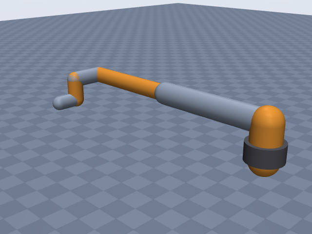
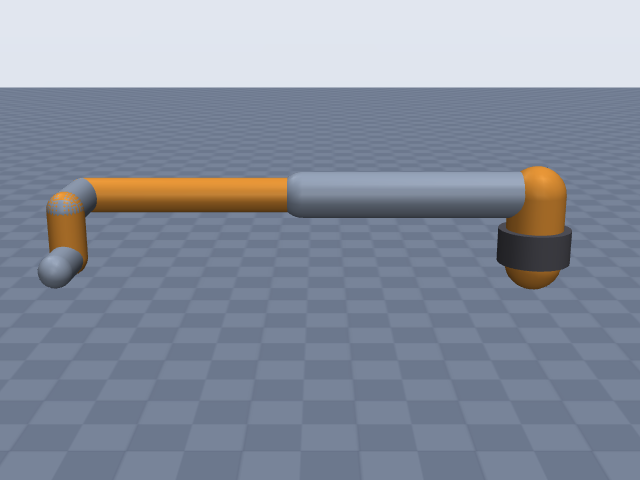
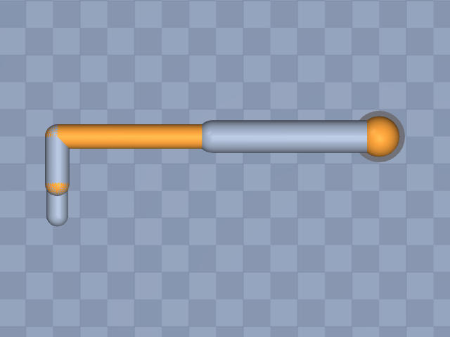

# ur10e

Universal Robots · UR10e · UR10e collaborative robot arm (e-Series), arm only, EE site at the tool flange (DH frame 6).

**Status: ✔ PASSED** · 14/14 checks passed · 0 blocking error(s) · 1 iteration(s), status `passed` · MuJoCo 3.3.0

## Views (home pose)

## Verification checks

| Check | Result | Measured | Expected | Tolerance | Severity | Message / fix hint |
|---|---|---|---|---|---|---|
| `compiles` | ✔ pass | — | — | — | error | loads with MuJoCo 3.3.0, mj_forward finite |
| `joint_structure` | ✔ pass | [[base, hinge], [shoulder, hinge], [elbow, hinge], [wrist_1, hinge], [wrist_2, hinge], [wrist_3, hinge]] | [[base, hinge], [shoulder, hinge], [elbow, hinge], [wrist_1, hinge], [wrist_2, hinge], [wrist_3, hinge]] | — | error | 6 joints match by name, type and chain order |
| `ee_site` | ✔ pass | ee_site | ee_site | — | error | site 'ee_site' on last body 'wrist_3_link' |
| `kinematics_match` | ✔ pass | ee_position_m: 6.736e-16, ee_orientation_rad: 1.208e-15, joint_axis_rad: 1.212e-15, joint_position_m: 4.699e-16 | 0 | position_m: 1.000e-06, orientation_rad: 1.000e-06 | error | model kinematics match the spec on 20 configurations (max EE error 6.7e-16 m, 1.2e-15 rad) |
| `joint_limits` | ✔ pass | base: [-6.283, 6.283], shoulder: [-6.283, 6.283], elbow: [-6.283, 6.283], wrist_1: [-6.283, 6.283], wrist_2: [-6.283, 6.283], wrist_3: [-6.283, 6.283] | base: [-6.283, 6.283], shoulder: [-6.283, 6.283], elbow: [-6.283, 6.283], wrist_1: [-6.283, 6.283], wrist_2: [-6.283, 6.283], wrist_3: [-6.283, 6.283] | hinge_rad: 0.001, slide_m: 1.000e-04 | error | all joint ranges match the spec (max diff 4.14e-13) |
| `reach` | ✔ pass | 1.364 | 1.3 | 0.05 | error | max reach 1.364 m within 4.9% of rated 1.300 m |
| `total_mass` | ✔ pass | 33.3 | 33.3 | 0.05 | error | model mass 33.300 kg within 0.0% of 33.300 kg |
| `mass_plausibility` | ✔ pass | — | — | — | warning | link densities, mass shares and mass per reach are plausible |
| `inertia_valid` | ✔ pass | — | — | — | error | 7 bodies have positive mass and valid inertia |
| `self_collision_home` | ✔ pass | 0 | 0 | 0.001 | error | no self-collision deeper than 1 mm at home (0 touching pairs) |
| `collision_exclusions` | ✔ pass | 0 | 0 | — | warning | 1 excluded pair(s), all parent/child or separated only by zero-length links: base / base_link (parent/child; MuJoCo does not filter a world-fixed parent) |
| `stable_hold` | ✔ pass | 0.01085 | 0 | drift_hinge_rad: 0.05, drift_slide_m: 0.005, final_speed: 0.1 | error | holds home for 2 s: max drift 0.0109, final speed 0.0000 |
| `actuators` | ✔ pass | 6 | 6 | — | error | every spec joint is driven by exactly one actuator |
| `sources_complete` | ✔ pass | 0 | 0 | — | error | every number in the spec has a source or is listed as an estimate (9 of 51 estimated) |

## Key specifications

| | |
|---|---|
| DOF | 6 |
| Total mass | 33.3 kg |
| Reach | 1.3 m (base_axis_horizontal → ee_site) |
| Payload | 12.5 kg |
| Repeatability | ± 5.000e-05 m |
| Convention | dh_standard |
| Units | length m, angle deg |

## Joints

| # | Joint | Type | Lower | Upper | Effort limit | Velocity limit | Home |
|---|---|---|---|---|---|---|---|
| 1 | `base` | hinge | -360 deg | 360 deg | 330 N·m | 120 deg/s | 0 deg |
| 2 | `shoulder` | hinge | -360 deg | 360 deg | 330 N·m | 120 deg/s | 0 deg |
| 3 | `elbow` | hinge | -360 deg | 360 deg | 150 N·m | 180 deg/s | 0 deg |
| 4 | `wrist_1` | hinge | -360 deg | 360 deg | 54 N·m | 180 deg/s | 0 deg |
| 5 | `wrist_2` | hinge | -360 deg | 360 deg | 54 N·m | 180 deg/s | 0 deg |
| 6 | `wrist_3` | hinge | -360 deg | 360 deg | 54 N·m | 180 deg/s | 0 deg |

## Sources

| Field path | Source |
|---|---|
| `joints[*].dh` | <https://www.universal-robots.com/articles/ur/application-installation/dh-parameters-for-calculations-of-kinematics-and-dynamics/> |
| `joints[*].link.mass` | <https://www.universal-robots.com/developer/hardware-and-motion/robot-motion-dh-parameters/> |
| `joints[*].limits` | <https://www.universal-robots.com/manuals/EN/TechSheets/UR10e_techsheet_pdf_online/UR10e_techsheet_en.pdf> |
| `joints[*].velocity_limit` | <https://www.universal-robots.com/manuals/EN/TechSheets/UR10e_techsheet_pdf_online/UR10e_techsheet_en.pdf> |
| `joints[0].effort_limit` | <https://forum.universal-robots.com/t/maximum-axis-speed-acceleration/13338> |
| `joints[1].effort_limit` | <https://forum.universal-robots.com/t/maximum-axis-speed-acceleration/13338> |
| `joints[2].effort_limit` | <https://forum.universal-robots.com/t/maximum-axis-speed-acceleration/13338> |
| `joints[4].effort_limit` | <https://www.universal-robots.com/articles/ur/robot-care-maintenance/max-joint-torques-cb3-and-e-series/> |
| `joints[5].effort_limit` | <https://www.universal-robots.com/articles/ur/robot-care-maintenance/max-joint-torques-cb3-and-e-series/> |
| `total_mass` | <https://www.universal-robots.com/manuals/EN/PDF/SW5_19/user-manual-UR10e-PDF_online/711-039-00_UR10e_User_Manual_en_Global.pdf> |
| `payload` | <https://www.universal-robots.com/manuals/EN/TechSheets/UR10e_techsheet_pdf_online/UR10e_techsheet_en.pdf> |
| `reach.value` | <https://www.universal-robots.com/manuals/EN/TechSheets/UR10e_techsheet_pdf_online/UR10e_techsheet_en.pdf> |
| `repeatability` | <https://www.universal-robots.com/manuals/EN/TechSheets/UR10e_techsheet_pdf_online/UR10e_techsheet_en.pdf> |

## Estimates

Fields whose values were estimated rather than read from a source:

- `joints[3].effort_limit`
- `joints[*].link.geometry`
- `base.link.geometry`
- `reach.measured_from`
- `reach.measured_to`

## Spec notes

Kinematic source: published DH table (UR support article "DH parameters for calculations of kinematics and dynamics", UR10e/UR12e section, primary; values taken from web-search extracts because universal-robots.com could not be fetched from this environment). Standard (distal) DH, theta_i = q_i (no theta offsets), rows copied verbatim in metres; alpha pi/2 written as 90 deg (angle unit deg for the whole file). The datasheet drawing labels (180.7, 612.7, 571.55, 119.85, 174.15 mm) agree with d1, a2, a3, d5, d4. EE site: DH frame 6, which is the tool flange face (d6 = 0.11655 m ends at the flange); no extra ee offset. Joint limits: +-360 deg for all six joints (techsheet working range). One search extract of the SW5.22 tech-spec page reported +-160 deg for the elbow; a follow-up search found only +-360 deg for the UR10e elbow, so +-360 is used (conflict noted). Velocity limits from the current techsheet (120 deg/s base and shoulder, 180 deg/s others); the 06/2023 factsheet lists 180 deg/s for base and shoulder (conflict). Torques: UR article gives joint-size ratings (Size 2 = 54 Nm, Size 3 = 150 Nm, Size 4 = 330 Nm) and states wrist 2 and wrist 3 are Size 2 on the UR10e -> 54 Nm (sourced). Base/shoulder 330 Nm and elbow 150 Nm come from a UR forum post (second-hand), consistent with the Size 4 / Size 3 ratings. Wrist 1 = 54 Nm is an estimate (assumed Size 2 like the other wrists; the forum lists all three wrists equal, at 56 Nm, which conflicts with the 54 Nm Size 2 rating). Mass: 33.3 kg robot weight from the user manual (the older tech-specs sheet gives 33.5 kg including cable). Link masses from the UR DH page (sum 29.104 kg); the remainder goes to the base. CoMs/inertias not extracted, omitted. Reach 1300 mm (techsheet; datasheet drawing "R1300"); the source does not state the endpoints in text: the drawing shows a working-area radius around the base axis, so measured_from base_axis_horizontal and measured_to ee_site (tool flange) are estimates. Repeatability +-0.05 mm (ISO 9283) written as 0.00005 m. Geometry radii are estimates from product photos scaled by the 190 mm footprint diameter (base cylinder radius 0.095 m from the 190 mm footprint diameter, height 0.09 m estimated). Arm only, no gripper.

## Iteration history

| # | Time | Result | Errors | Failed | Failed checks | Note |
|---|---|---|---|---|---|---|
| 1 | 2026-11-05T11:00:15+00:00 | ✔ pass | 0 | 0 |  | initial spec from UR DH article (standard DH), techsheet limits/speeds, user-manual mass |

Status: `passed` · max iterations 8

---
Generated by sim-anything on 2026-11-05 11:00 UTC.
