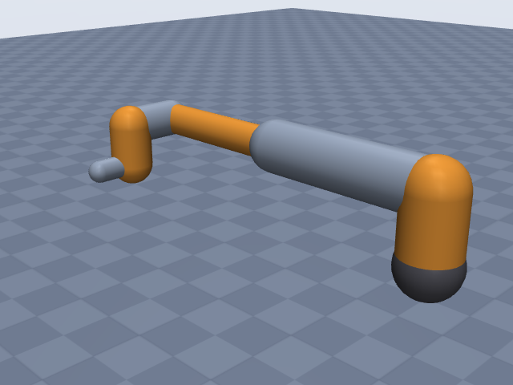
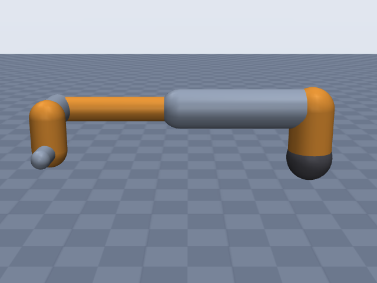
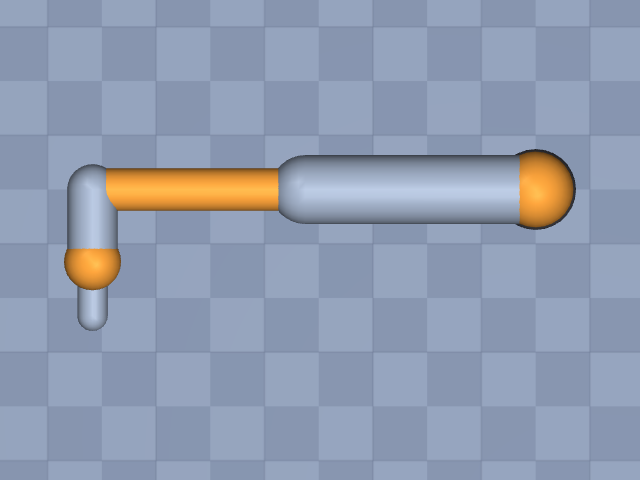

# ur5e

Universal Robots · UR5e · UR5e collaborative robot arm (e-Series), arm only (no gripper), EE site at the tool flange (DH frame 6).

**Status: ✔ PASSED** · 11/11 checks passed · 0 blocking error(s) · 2 iteration(s), status `passed` · MuJoCo 3.3.0

## Views (home pose)

## Verification checks

| Check | Result | Measured | Expected | Tolerance | Severity | Message / fix hint |
|---|---|---|---|---|---|---|
| `compiles` | ✔ pass | — | — | — | error | loads with MuJoCo 3.3.0, mj_forward finite |
| `joint_structure` | ✔ pass | [[shoulder_pan, hinge], [shoulder_lift, hinge], [elbow, hinge], [wrist_1, hinge], [wrist_2, hinge], [wrist_3, hinge]] | [[shoulder_pan, hinge], [shoulder_lift, hinge], [elbow, hinge], [wrist_1, hinge], [wrist_2, hinge], [wrist_3, hinge]] | — | error | 6 joints match by name, type and chain order |
| `ee_site` | ✔ pass | ee_site | ee_site | — | error | site 'ee_site' on last body 'wrist_3_link' |
| `joint_limits` | ✔ pass | shoulder_pan: [-6.283, 6.283], shoulder_lift: [-6.283, 6.283], elbow: [-6.283, 6.283], wrist_1: [-6.283, 6.283], wrist_2: [-6.283, 6.283], wrist_3: [-6.283, 6.283] | shoulder_pan: [-6.283, 6.283], shoulder_lift: [-6.283, 6.283], elbow: [-6.283, 6.283], wrist_1: [-6.283, 6.283], wrist_2: [-6.283, 6.283], wrist_3: [-6.283, 6.283] | hinge_rad: 0.001, slide_m: 1.000e-04 | error | all joint ranges match the spec (max diff 4.14e-13) |
| `reach` | ✔ pass | 0.828 | 0.85 | 0.05 | error | max reach 0.828 m within 2.6% of rated 0.850 m |
| `total_mass` | ✔ pass | 20.6 | 20.6 | 0.05 | error | model mass 20.600 kg within 0.0% of 20.600 kg |
| `inertia_valid` | ✔ pass | — | — | — | error | 7 bodies have positive mass and valid inertia |
| `self_collision_home` | ✔ pass | 0 | 0 | 0.001 | error | no self-collision deeper than 1 mm at home (0 touching pairs) |
| `stable_hold` | ✔ pass | 0.01083 | 0 | drift_hinge_rad: 0.05, drift_slide_m: 0.005, final_speed: 0.1 | error | holds home for 2 s: max drift 0.0108, final speed 0.0000 |
| `actuators` | ✔ pass | 6 | 6 | — | error | every spec joint is driven by exactly one actuator |
| `sources_complete` | ✔ pass | 0 | 0 | — | error | every number in the spec has a source or is listed as an estimate |

## Key specifications

| | |
|---|---|
| DOF | 6 |
| Total mass | 20.6 kg |
| Reach | 0.85 m (base_axis_horizontal → wrist_center) |
| Payload | 5 kg |
| Repeatability | ± 3.000e-05 m |
| Convention | dh_standard |
| Units | length m, angle deg |

## Joints

| # | Joint | Type | Lower | Upper | Effort limit | Velocity limit | Home |
|---|---|---|---|---|---|---|---|
| 1 | `shoulder_pan` | hinge | -360 deg | 360 deg | 150 N·m | 180 deg/s | 0 deg |
| 2 | `shoulder_lift` | hinge | -360 deg | 360 deg | 150 N·m | 180 deg/s | 0 deg |
| 3 | `elbow` | hinge | -360 deg | 360 deg | 150 N·m | 180 deg/s | 0 deg |
| 4 | `wrist_1` | hinge | -360 deg | 360 deg | 28 N·m | 180 deg/s | 0 deg |
| 5 | `wrist_2` | hinge | -360 deg | 360 deg | 28 N·m | 180 deg/s | 0 deg |
| 6 | `wrist_3` | hinge | -360 deg | 360 deg | 28 N·m | 180 deg/s | 0 deg |

## Sources

| Field path | Source |
|---|---|
| `joints[*].dh` | <https://www.universal-robots.com/articles/ur/application-installation/dh-parameters-for-calculations-of-kinematics-and-dynamics/> |
| `joints[*].link.mass` | <https://www.universal-robots.com/articles/ur/application-installation/dh-parameters-for-calculations-of-kinematics-and-dynamics/> |
| `joints[*].link.com` | <https://www.universal-robots.com/articles/ur/application-installation/dh-parameters-for-calculations-of-kinematics-and-dynamics/> |
| `joints[*].limits` | <https://www.universal-robots.com/manuals/EN/TechSheets/UR5e_techsheet_pdf_online/UR5e_techsheet_en.pdf> |
| `joints[*].velocity_limit` | <https://www.universal-robots.com/manuals/EN/TechSheets/UR5e_techsheet_pdf_online/UR5e_techsheet_en.pdf> |
| `joints[*].effort_limit` | <https://forum.universal-robots.com/t/maximum-axis-speed-acceleration/13338> |
| `base.link.geometry` | <https://www.universal-robots.com/media/1807465/ur5e_e-series_datasheets_web.pdf> |
| `total_mass` | <https://www.universal-robots.com/media/1807465/ur5e_e-series_datasheets_web.pdf> |
| `payload` | <https://www.universal-robots.com/media/1807465/ur5e_e-series_datasheets_web.pdf> |
| `reach` | <https://www.universal-robots.com/media/1807465/ur5e_e-series_datasheets_web.pdf> |
| `repeatability` | <https://www.universal-robots.com/manuals/EN/TechSheets/UR5e_techsheet_pdf_online/UR5e_techsheet_en.pdf> |

## Estimates

None: every number is backed by a source.

## Spec notes

DH table copied from UR's "DH parameters for calculations of kinematics and dynamics" article (standard DH, theta_i = q_i, no offsets); alpha pi/2 written as 90 deg, -pi/2 as -90 deg. Frame 6 is the tool flange, so ee has no extra offset. Link masses and CoMs (expressed in DH frame i) from the same article, retrieved via web-search extracts because universal-robots.com could not be fetched directly; the link 4 and link 5 CoMs as extracted differ only in the sign of y, so they are worth re-checking against the live page. Link masses sum to 17.7 kg; the base mass is not published and is left to the builder, which gives the base the remainder of the 20.6 kg total (datasheet, includes cable; user manual says 20.7 kg). Joint ranges are the techsheet working range of +-360 deg for all six joints; speeds +-180 deg/s. Effort limits: official UR torque article gives size ratings (Size 1 = 28 Nm, Size 3 = 150 Nm) and lists wrist 2 and wrist 3 as Size 1; the full per-joint mapping (150, 150, 150, 28, 28, 28 Nm) is from a UR forum post (secondary source); these are damage-limit ratings, not continuous output torques. Reach 850 mm is the R850 working-area radius on the datasheet drawing; the manual says the working area extends 850 mm from the base joint, so it is measured horizontally from the J1 axis. Neither source says to which point. With the sourced DH table the flange can get 0.93-0.97 m from the J1 axis (9-14% over 850 mm, iteration 1 failed this way), while the wrist (wrist 2 joint origin, DH frame 4) gets at most sqrt(0.8172^2 + 0.1333^2) = 0.828 m (2.6% under). The endpoint is therefore set to the wrist centre; this is an interpretation, not a sourced definition, and no endpoint reproduces 850 mm exactly. Footprint 149 mm per datasheet (techsheet says 151 mm). Link radii are not published; no radius is given and the builder derives them from the sourced link masses. Repeatability +-0.03 mm (ISO 9283) written in metres.

## Iteration history

| # | Time | Result | Errors | Failed | Failed checks | Note |
|---|---|---|---|---|---|---|
| 1 | 2026-11-05T07:46:02+00:00 | ✘ fail | 1 | 1 | `reach` | initial spec: UR DH article (standard DH), techsheet limits/speeds, datasheet mass/reach/payload |
| 2 | 2026-11-05T07:48:51+00:00 | ✔ pass | 0 | 0 |  | reach endpoint: wrist_center instead of ee_site; R850 endpoint is unstated and flange maxima exceed it by 9-14% with the sourced DH lengths |

Status: `passed` · max iterations 8

---
Generated by sim-anything on 2026-11-05 07:48 UTC.
