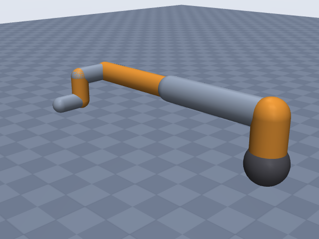
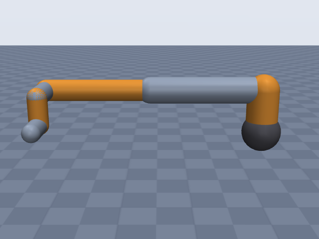
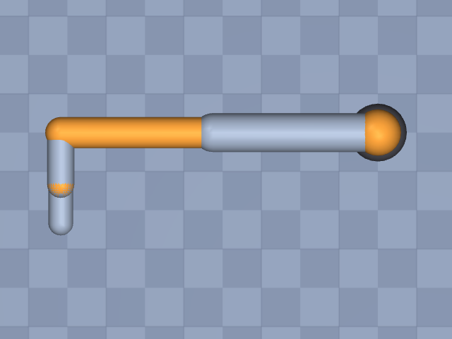

# ur5e

Universal Robots · UR5e · UR5e collaborative robot arm (e-Series), arm only, EE site at the tool flange.

**Status: ✔ PASSED** · 13/14 checks passed · 0 blocking error(s) · 2 iteration(s), status `passed` · MuJoCo 3.3.0

## Views (home pose)

## Verification checks

| Check | Result | Measured | Expected | Tolerance | Severity | Message / fix hint |
|---|---|---|---|---|---|---|
| `compiles` | ✔ pass | — | — | — | error | loads with MuJoCo 3.3.0, mj_forward finite |
| `joint_structure` | ✔ pass | [[shoulder_pan, hinge], [shoulder_lift, hinge], [elbow, hinge], [wrist_1, hinge], [wrist_2, hinge], [wrist_3, hinge]] | [[shoulder_pan, hinge], [shoulder_lift, hinge], [elbow, hinge], [wrist_1, hinge], [wrist_2, hinge], [wrist_3, hinge]] | — | error | 6 joints match by name, type and chain order |
| `ee_site` | ✔ pass | ee_site | ee_site | — | error | site 'ee_site' on last body 'wrist_3_link' |
| `kinematics_match` | ✔ pass | ee_position_m: 4.710e-16, ee_orientation_rad: 1.208e-15, joint_axis_rad: 1.212e-15, joint_position_m: 3.993e-16 | 0 | position_m: 1.000e-06, orientation_rad: 1.000e-06 | error | model kinematics match the spec on 20 configurations (max EE error 4.7e-16 m, 1.2e-15 rad) |
| `joint_limits` | ✔ pass | shoulder_pan: [-6.283, 6.283], shoulder_lift: [-6.283, 6.283], elbow: [-6.283, 6.283], wrist_1: [-6.283, 6.283], wrist_2: [-6.283, 6.283], wrist_3: [-6.283, 6.283] | shoulder_pan: [-6.283, 6.283], shoulder_lift: [-6.283, 6.283], elbow: [-6.283, 6.283], wrist_1: [-6.283, 6.283], wrist_2: [-6.283, 6.283], wrist_3: [-6.283, 6.283] | hinge_rad: 0.001, slide_m: 1.000e-04 | error | all joint ranges match the spec (max diff 4.14e-13) |
| `reach` | ✘ fail | 0.9688 | 0.85 | 0.05 | warning | max reach 0.969 m is 14.0% above rated 0.850 m; warning only: the reach definition is assumed (reach.measured_from and reach.measured_to listed in estimates) **Fix:** Reach is too long: re-check the lengths that set the measured reach (joints[1].dh.a, joints[2].dh.a, joints[5].dh.d, joints[4].dh.d; largest effect first) against the datasheet. Also check `units.length` (mm vs m). The reach definition (measured_from = base_axis_horizontal, measured_to = ee_site) is assumed, so this is only a warning. If the source does not state the reach definition, list reach.measured_from/measured_to in `estimates` instead of switching endpoints until it passes. |
| `total_mass` | ✔ pass | 20.6 | 20.6 | 0.05 | error | model mass 20.600 kg within 0.0% of 20.600 kg |
| `mass_plausibility` | ✔ pass | — | — | — | warning | link densities, mass shares and mass per reach are plausible |
| `inertia_valid` | ✔ pass | — | — | — | error | 7 bodies have positive mass and valid inertia |
| `self_collision_home` | ✔ pass | 0 | 0 | 0.001 | error | no self-collision deeper than 1 mm at home (0 touching pairs) |
| `collision_exclusions` | ✔ pass | 0 | 0 | — | warning | 1 excluded pair(s), all parent/child or separated only by zero-length links: base / shoulder_pan_link (parent/child; MuJoCo does not filter a world-fixed parent) |
| `stable_hold` | ✔ pass | 0.01084 | 0 | drift_hinge_rad: 0.05, drift_slide_m: 0.005, final_speed: 0.1 | error | holds home for 2 s: max drift 0.0108, final speed 0.0000 |
| `actuators` | ✔ pass | 6 | 6 | — | error | every spec joint is driven by exactly one actuator |
| `sources_complete` | ✔ pass | 0 | 0 | — | error | every number in the spec has a source or is listed as an estimate (7 of 53 estimated) |

## Key specifications

| | |
|---|---|
| DOF | 6 |
| Total mass | 20.6 kg |
| Reach | 850 mm (base_axis_horizontal → ee_site) |
| Payload | 5 kg |
| Repeatability | ± 0.03 mm |
| Convention | dh_standard |
| Units | length mm, angle deg |

## Joints

| # | Joint | Type | Lower | Upper | Effort limit | Velocity limit | Home |
|---|---|---|---|---|---|---|---|
| 1 | `shoulder_pan` | hinge | -360 deg | 360 deg | 150 N·m | 180 deg/s | 0 deg |
| 2 | `shoulder_lift` | hinge | -360 deg | 360 deg | 150 N·m | 180 deg/s | 0 deg |
| 3 | `elbow` | hinge | -360 deg | 360 deg | 150 N·m | 180 deg/s | 0 deg |
| 4 | `wrist_1` | hinge | -360 deg | 360 deg | 28 N·m | 180 deg/s | 0 deg |
| 5 | `wrist_2` | hinge | -360 deg | 360 deg | 28 N·m | 180 deg/s | 0 deg |
| 6 | `wrist_3` | hinge | -360 deg | 360 deg | 28 N·m | 180 deg/s | 0 deg |

## Sources

| Field path | Source |
|---|---|
| `joints[*].dh` | <https://www.universal-robots.com/articles/ur/application-installation/dh-parameters-for-calculations-of-kinematics-and-dynamics/> |
| `joints[*].link.mass` | <https://www.universal-robots.com/articles/ur/application-installation/dh-parameters-for-calculations-of-kinematics-and-dynamics/> |
| `joints[*].link.com` | <https://www.universal-robots.com/articles/ur/application-installation/dh-parameters-for-calculations-of-kinematics-and-dynamics/> |
| `joints[*].limits` | <https://www.universal-robots.com/manuals/EN/TechSheets/UR5e_techsheet_pdf_online/UR5e_techsheet_en.pdf> |
| `joints[*].velocity_limit` | <https://www.universal-robots.com/manuals/EN/TechSheets/UR5e_techsheet_pdf_online/UR5e_techsheet_en.pdf> |
| `joints[*].effort_limit` | <https://www.universal-robots.com/articles/ur/robot-care-maintenance/max-joint-torques-cb3-and-e-series/> |
| `total_mass` | <https://www.universal-robots.com/media/1807465/ur5e_e-series_datasheets_web.pdf> |
| `payload` | <https://www.universal-robots.com/media/1807465/ur5e_e-series_datasheets_web.pdf> |
| `reach.value` | <https://www.universal-robots.com/media/1807465/ur5e_e-series_datasheets_web.pdf> |
| `repeatability` | <https://www.universal-robots.com/manuals/EN/TechSheets/UR5e_techsheet_pdf_online/UR5e_techsheet_en.pdf> |

## Estimates

Fields whose values were estimated rather than read from a source:

- `joints[*].link.geometry`
- `base.link.geometry`
- `reach.measured_from`
- `reach.measured_to`

## Spec notes

Kinematic source: published DH table (UR support article "DH parameters for calculations of kinematics and dynamics", primary; values taken from web-search extracts because direct fetch of universal-robots.com is blocked). Standard DH, theta_i = q_i (no offsets). Lengths published in metres are written in mm (exact x1000 unit change; d1 162.5, a2 425, a3 392.2, d5 99.7 match the mm labels of the datasheet drawing) so reach (850 mm) and repeatability (0.03 mm) stay verbatim; CoMs likewise converted m->mm; alpha copied from pi/2, 0, -pi/2 rad and written as 90, 0, -90 deg (angle unit deg for the whole file so the +-360 deg working ranges and 180 deg/s speeds stay verbatim). Frame 6 (d6 = 0.0996 m) is the tool flange, so ee.origin is zero. Link masses and the CoMs of links 1, 2 and 5 are from the same article (offsets in the DH frame of each link); CoMs of links 3, 4, 6 were not extracted and are omitted (builder uses the geometry centroid). Total mass 20.6 kg is the datasheet value incl. cable (user manual says 20.7 kg); the base gets the remainder (20.6 - 17.7 = 2.9 kg). Joint working ranges +-360 deg (techsheet). Effort limits: UR article on max joint torques maps UR5/UR5e base, shoulder, elbow to size 3 (150 Nm) and wrists 1-3 to size 1 (28 Nm) (search extract; a UR forum post agrees); UR notes these are the joint ratings, not usable application torques. Reach 850 mm: datasheet R850 working-area radius; the manual describes a cylindrical working volume 850 mm from the base joint, so measured_from base_axis_horizontal and measured_to ee_site (flange) are my reading, listed as estimates. Geometry radii are estimates from product photos: base cylinder radius 74.5 mm from the datasheet O149 mm footprint (techsheet says O151); shoulder 60, upper arm 50, forearm 40, wrists 35, wrist 3 32 mm.

## Iteration history

| # | Time | Result | Errors | Failed | Failed checks | Note |
|---|---|---|---|---|---|---|
| 1 | 2026-11-05T08:29:11+00:00 | ✔ pass | 0 | 2 |  | initial spec: UR DH article (standard DH), techsheet ranges/speeds, datasheet mass/payload/reach, UR torque article |
| 2 | 2026-11-05T08:29:38+00:00 | ✔ pass | 0 | 1 |  | units m->mm for the whole file: reach 850 and repeatability 0.03 are mm but were read as m in iter 1 |

Status: `passed` · max iterations 8

---
Generated by sim-anything on 2026-11-05 08:29 UTC.
