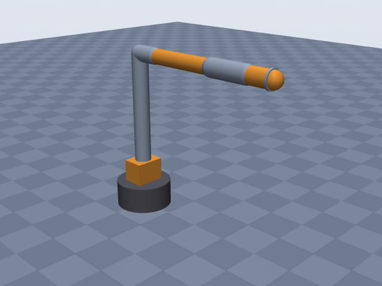
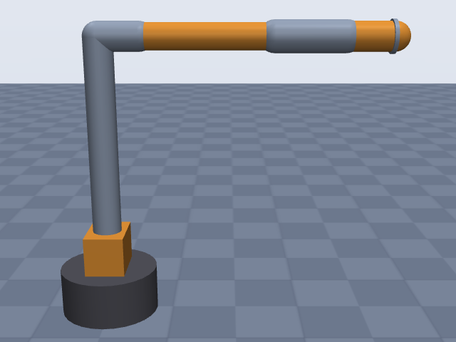
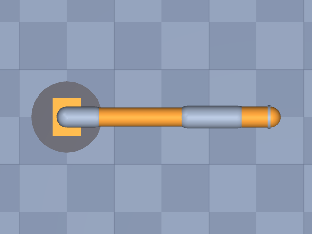

# viperx_300s

Trossen Robotics · ViperX 300 S (Interbotix ViperX-300 6DOF, vx300s), arm joints only · 6-DOF Dynamixel arm. Chain from the manufacturer's product-of-exponentials table (space frame at the waist axis, zero pose = upper arm vertical, forearm horizontal along +x). EE site at the gripper-mount face (point D of the docs' reach diagram), 70 mm past the wrist-angle axis.

**Status: ✔ PASSED** · 11/11 checks passed · 0 blocking error(s) · 1 iteration(s), status `passed` · MuJoCo 3.3.0

## Views (home pose)

## Verification checks

| Check | Result | Measured | Expected | Tolerance | Severity | Message / fix hint |
|---|---|---|---|---|---|---|
| `compiles` | ✔ pass | — | — | — | error | loads with MuJoCo 3.3.0, mj_forward finite |
| `joint_structure` | ✔ pass | [[waist, hinge], [shoulder, hinge], [elbow, hinge], [forearm_roll, hinge], [wrist_angle, hinge], [wrist_rotate, hinge]] | [[waist, hinge], [shoulder, hinge], [elbow, hinge], [forearm_roll, hinge], [wrist_angle, hinge], [wrist_rotate, hinge]] | — | error | 6 joints match by name, type and chain order |
| `ee_site` | ✔ pass | ee_site | ee_site | — | error | site 'ee_site' on last body 'wrist_rotate_link' |
| `joint_limits` | ✔ pass | waist: [-3.142, 3.142], shoulder: [-1.763, 1.763], elbow: [-1.763, 1.606], forearm_roll: [-3.142, 3.142], wrist_angle: [-1.868, 2.269], wrist_rotate: [-3.142, 3.142] | waist: [-3.142, 3.142], shoulder: [-1.763, 1.763], elbow: [-1.763, 1.606], forearm_roll: [-3.142, 3.142], wrist_angle: [-1.868, 2.269], wrist_rotate: [-3.142, 3.142] | hinge_rad: 0.001, slide_m: 1.000e-04 | error | all joint ranges match the spec (max diff 4.78e-12) |
| `reach` | ✔ pass | — | — | — | info | spec has no reach; not checked |
| `total_mass` | ✔ pass | 2.849 | — | — | info | spec has no total_mass; model mass is 2.849 kg |
| `inertia_valid` | ✔ pass | — | — | — | error | 7 bodies have positive mass and valid inertia |
| `self_collision_home` | ✔ pass | 0 | 0 | 0.001 | error | no self-collision deeper than 1 mm at home (0 touching pairs) |
| `stable_hold` | ✔ pass | 0.0103 | 0 | drift_hinge_rad: 0.05, drift_slide_m: 0.005, final_speed: 0.1 | error | holds home for 2 s: max drift 0.0103, final speed 0.0000 |
| `actuators` | ✔ pass | 6 | 6 | — | error | every spec joint is driven by exactly one actuator |
| `sources_complete` | ✔ pass | 0 | 0 | — | error | every number in the spec has a source or is listed as an estimate |

## Key specifications

| | |
|---|---|
| DOF | 6 |
| Total mass | — |
| Reach | — |
| Payload | 0.75 kg |
| Repeatability | ± 1 mm |
| Convention | offset |
| Units | length mm, angle deg |

## Joints

| # | Joint | Type | Lower | Upper | Effort limit | Velocity limit | Home |
|---|---|---|---|---|---|---|---|
| 1 | `waist` | hinge | -180 deg | 180 deg | — | — | 0 deg |
| 2 | `shoulder` | hinge | -101 deg | 101 deg | — | — | 0 deg |
| 3 | `elbow` | hinge | -101 deg | 92 deg | — | — | 0 deg |
| 4 | `forearm_roll` | hinge | -180 deg | 180 deg | — | — | 0 deg |
| 5 | `wrist_angle` | hinge | -107 deg | 130 deg | — | — | 0 deg |
| 6 | `wrist_rotate` | hinge | -180 deg | 180 deg | — | — | 0 deg |

## Sources

| Field path | Source |
|---|---|
| `joints[0].origin` | <https://docs.trossenrobotics.com/interbotix_xsarms_docs/specifications/vx300s.html> |
| `joints[1].origin` | <https://docs.trossenrobotics.com/interbotix_xsarms_docs/specifications/vx300s.html> |
| `joints[2].origin` | <https://docs.trossenrobotics.com/interbotix_xsarms_docs/specifications/vx300s.html> |
| `joints[*].axis` | <https://docs.trossenrobotics.com/interbotix_xsarms_docs/specifications/vx300s.html> |
| `joints[*].limits` | <https://docs.trossenrobotics.com/interbotix_xsarms_docs/specifications/vx300s.html> |
| `joints[5].origin` | <https://docs.trossenrobotics.com/interbotix_xsarms_docs/_downloads/ViperX-300s.pdf> |
| `joints[1].link.geometry[*].fromto` | <https://docs.trossenrobotics.com/interbotix_xsarms_docs/specifications/vx300s.html> |
| `payload` | <https://docs.trossenrobotics.com/interbotix_xsarms_docs/specifications/vx300s.html> |
| `repeatability` | <https://docs.trossenrobotics.com/interbotix_xsarms_docs/specifications/vx300s.html> |

## Estimates

Fields whose values were estimated rather than read from a source:

- `joints[3].origin`
- `joints[4].origin`
- `base.link.geometry`
- `joints[*].link.geometry[*].radius`
- `joints[*].link.geometry[*].size`
- `joints[*].link.geometry[*].pos`
- `joints[5].link.geometry`

## Spec notes

Chain: the vx300s page publishes a product-of-exponentials model (Slist, M, metres). Decoded axis points: shoulder (0,0,127.05) +y, elbow (59.55,0,427.05) +y, forearm_roll along +x at z=427.05, wrist_angle (359.55,0,427.05) +y, wrist_rotate along +x at z=427.05. joints[2].origin = elbow minus shoulder = (59.55, 0, 300). The forearm_roll and wrist_angle origins split the 300 mm elbow->wrist distance (PoE: 359.55 - 59.55) into 196.38 + 103.62; 103.62 is the drawing's dimension from the start of the forearm-roll housing to the wrist-angle axis, but which point of that housing the roll joint sits at is my reading, so both are listed as estimates (where a roll joint sits along its own axis does not change the kinematics; the 300 mm sum is sourced). wrist_rotate origin (70 mm past the wrist-angle axis along +x) is the drawing's "70" / the reach table's "C~D Wrist Tilt to Rotate 70", which ends at point D, the gripper-mount face; the joint frame is put there and the EE site coincides with it (no tool flange standard on this arm; the gripper is not modelled). Joint limits are the firmware default limits ("degrees from Zero (servo centered)"); axis signs taken as published in the PoE screw axes. Reach (750 mm) is omitted: the docs' cumulative table gives 676 mm from the shoulder to point D, 745 to the gripper rail and 812 to the finger tip, so the advertised 750 mm refers to the gripper, which is not modelled. Total mass, joint speeds and torques are not published for the arm; omitted (builder default density is used). Link radii, the base turret cylinder and the waist bracket box are rough estimates from the drawing's proportions (the drawing gives the 299.46 x 110 mm base plate and 84.5 mm turret flats, not housing diameters).

## Iteration history

| # | Time | Result | Errors | Failed | Failed checks | Note |
|---|---|---|---|---|---|---|
| 1 | 2026-11-05T07:50:18+00:00 | ✔ pass | 0 | 0 |  | initial spec: chain from Trossen vx300s PoE table, EE at gripper-mount face (drawing 70 mm), firmware limits |

Status: `passed` · max iterations 8

---
Generated by sim-anything on 2026-11-05 07:50 UTC.
