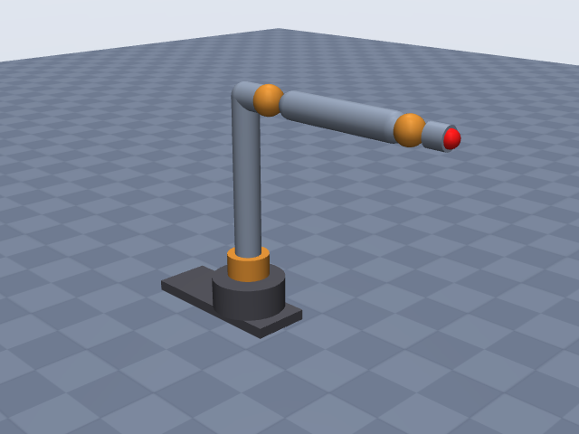
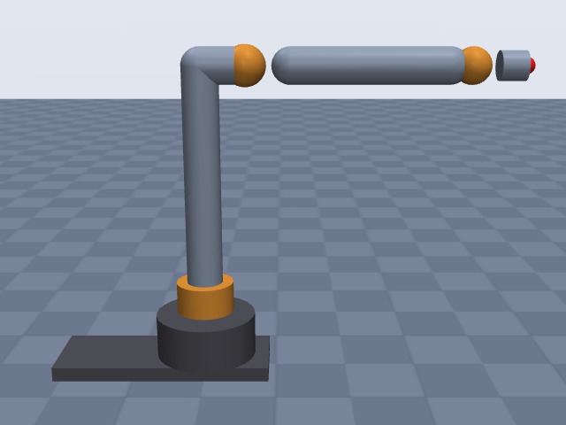
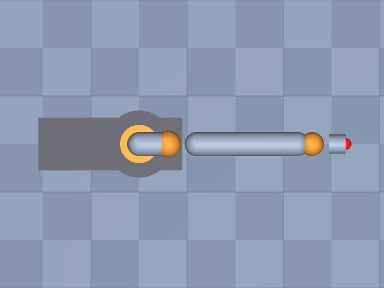

# viperx_300s

Trossen Robotics · ViperX 300 S (ViperX-300 6DOF, vx300s) · 6-DOF Interbotix X-Series arm, arm joints only (no gripper); EE site at the gripper-mount face of the wrist_rotate link.

**Status: ✔ PASSED** · 13/14 checks passed · 0 blocking error(s) · 1 iteration(s), status `passed` · MuJoCo 3.3.0

## Views (home pose)

## Verification checks

| Check | Result | Measured | Expected | Tolerance | Severity | Message / fix hint |
|---|---|---|---|---|---|---|
| `compiles` | ✔ pass | — | — | — | error | loads with MuJoCo 3.3.0, mj_forward finite |
| `joint_structure` | ✔ pass | [[waist, hinge], [shoulder, hinge], [elbow, hinge], [forearm_roll, hinge], [wrist_angle, hinge], [wrist_rotate, hinge]] | [[waist, hinge], [shoulder, hinge], [elbow, hinge], [forearm_roll, hinge], [wrist_angle, hinge], [wrist_rotate, hinge]] | — | error | 6 joints match by name, type and chain order |
| `ee_site` | ✔ pass | ee_site | ee_site | — | error | site 'ee_site' on last body 'wrist_rotate_link' |
| `kinematics_match` | ✔ pass | ee_position_m: 2.486e-16, ee_orientation_rad: 5.903e-16, joint_axis_rad: 4.079e-16, joint_position_m: 1.852e-16 | 0 | position_m: 1.000e-06, orientation_rad: 1.000e-06 | error | model kinematics match the spec on 20 configurations (max EE error 2.5e-16 m, 5.9e-16 rad) |
| `joint_limits` | ✔ pass | waist: [-3.142, 3.142], shoulder: [-1.763, 1.763], elbow: [-1.763, 1.606], forearm_roll: [-3.142, 3.142], wrist_angle: [-1.868, 2.269], wrist_rotate: [-3.142, 3.142] | waist: [-3.142, 3.142], shoulder: [-1.763, 1.763], elbow: [-1.763, 1.606], forearm_roll: [-3.142, 3.142], wrist_angle: [-1.868, 2.269], wrist_rotate: [-3.142, 3.142] | hinge_rad: 0.001, slide_m: 1.000e-04 | error | all joint ranges match the spec (max diff 4.78e-12) |
| `reach` | ✘ fail | 0.6759 | 0.75 | 0.05 | warning | max reach 0.676 m is 9.9% below rated 0.750 m; warning only: the reach definition is assumed (reach.measured_from and reach.measured_to listed in estimates) **Fix:** Reach is too short: re-check the lengths that set the measured reach (joints[2].origin.xyz, joints[4].origin.xyz, ee.origin.xyz; largest effect first) against the datasheet, joint limits that may prevent stretching out (joints[*].limits). Also check `units.length` (mm vs m). The reach definition (measured_from = shoulder, measured_to = ee_site) is assumed, so this is only a warning. If the source does not state the reach definition, list reach.measured_from/measured_to in `estimates` instead of switching endpoints until it passes. |
| `total_mass` | ✔ pass | 3.31 | — | — | info | spec has no total_mass; model mass is 3.310 kg |
| `mass_plausibility` | ✔ pass | — | — | — | warning | link densities, mass shares and mass per reach are plausible |
| `inertia_valid` | ✔ pass | — | — | — | error | 7 bodies have positive mass and valid inertia |
| `self_collision_home` | ✔ pass | 0 | 0 | 0.001 | error | no self-collision deeper than 1 mm at home (0 touching pairs) |
| `collision_exclusions` | ✔ pass | 0 | 0 | — | warning | 3 excluded pair(s), all parent/child or separated only by zero-length links: base / waist_link (parent/child; MuJoCo does not filter a world-fixed parent); shoulder_link / forearm_roll_link (only zero-length links between them (origins coincide with the end of 'shoulder_link')); forearm_roll_link / wrist_rotate_link (only zero-length links between them (origins coincide with the end of 'forearm_roll_link')) |
| `stable_hold` | ✔ pass | 0.01024 | 0 | drift_hinge_rad: 0.05, drift_slide_m: 0.005, final_speed: 0.1 | error | holds home for 2 s: max drift 0.0102, final speed 0.0000 |
| `actuators` | ✔ pass | 6 | 6 | — | error | every spec joint is driven by exactly one actuator |
| `sources_complete` | ✔ pass | 0 | 0 | — | error | every number in the spec has a source or is listed as an estimate (18 of 42 estimated) |

## Key specifications

| | |
|---|---|
| DOF | 6 |
| Total mass | — |
| Reach | 0.75 m (shoulder → ee_site) |
| Payload | 0.75 kg |
| Repeatability | ± 0.001 m |
| Convention | offset |
| Units | length m, angle deg |

## Joints

| # | Joint | Type | Lower | Upper | Effort limit | Velocity limit | Home |
|---|---|---|---|---|---|---|---|
| 1 | `waist` | hinge | -180 deg | 180 deg | — | — | 0 deg |
| 2 | `shoulder` | hinge | -101 deg | 101 deg | — | — | 0 deg |
| 3 | `elbow` | hinge | -101 deg | 92 deg | — | — | 0 deg |
| 4 | `forearm_roll` | hinge | -180 deg | 180 deg | — | — | 0 deg |
| 5 | `wrist_angle` | hinge | -107 deg | 130 deg | — | — | 0 deg |
| 6 | `wrist_rotate` | hinge | -180 deg | 180 deg | — | — | 0 deg |

## Sources

| Field path | Source |
|---|---|
| `joints[*].origin` | <https://docs.trossenrobotics.com/interbotix_xsarms_docs/specifications/vx300s.html> |
| `joints[*].axis` | <https://docs.trossenrobotics.com/interbotix_xsarms_docs/specifications/vx300s.html> |
| `joints[*].limits` | <https://docs.trossenrobotics.com/interbotix_xsarms_docs/specifications/vx300s.html> |
| `payload` | <https://docs.trossenrobotics.com/interbotix_xsarms_docs/specifications/vx300s.html> |
| `reach.value` | <https://docs.trossenrobotics.com/interbotix_xsarms_docs/specifications/vx300s.html> |
| `repeatability` | <https://docs.trossenrobotics.com/interbotix_xsarms_docs/specifications/vx300s.html> |

## Estimates

Fields whose values were estimated rather than read from a source:

- `ee.origin`
- `reach.measured_from`
- `reach.measured_to`
- `base.link.geometry`
- `joints[*].link.geometry`

## Spec notes

Kinematic source: published screw-axis (product-of-exponentials) table, Trossen vx300s specification page "Kinematic Properties" (M and Slist, space frame, metres; primary). Converted exactly to offset with all frames parallel to the base: p_i = w_i x v_i gives waist (0,0,0), shoulder (0,0,0.12705), elbow (0.05955,0,0.42705), forearm_roll on the line through (x,0,0.42705) along +x, wrist_angle (0.35955,0,0.42705), wrist_rotate on the line through (x,0,0.42705) along +x. The points chosen on the two roll axes are the elbow point for forearm_roll and the wrist_angle point for wrist_rotate (x copied from the S3 / S5 rows; any point on the axis gives the same model), so those two joints have zero origin offsets. Axis directions are the published w_i, signs kept. Cross-checks: the technical drawing (DWG 11) shows 300 / 60 (305.94) upper arm, 300 forearm, 126.75 base plate to shoulder axis (PoE gives 127.05 from the base frame origin; the 0.3 mm difference is the base-frame placement, PoE used) and the arm-reach table gives 306 / 300 / 70 sections. EE site: arm only, no tool flange; the site is on the wrist_rotate axis 0.07 m (70 mm) beyond the wrist_angle axis, at the face where the gripper bolts onto the wrist_rotate link. The 70 mm is sourced (drawing "70", reach table C~D "Wrist Tilt to Rotate" 70 mm, cumulative D = 676 mm), but reading its end point as the gripper-mount face (point D in the arm-reach picture sits at the servo/gripper-plate interface) is my interpretation, so ee.origin is listed as an estimate. The PoE home tool pose M (x = 0.536494 m) is a gripper frame 0.176944 m beyond the wrist_angle axis, i.e. on the gripper, so it is not used for the site. Joint limits: firmware default limits ("degrees from Zero (servo centered)"); assumed to use the same zero as the PoE home pose. Waist, forearm_roll and wrist_rotate are +-180 in firmware (mechanically continuous for waist per "full 360 degree of rotation"), kept as +-180. Reach: "750mm" with no stated reference points; the cumulative table puts the gripper rail at 745 mm and the finger tip at 812 mm from the shoulder, so 750 mm most likely includes the gripper; the arm-only model measures shoulder to mount face (676 mm), so the reach definition is an estimate and a mismatch is expected. Not found: total mass, link masses, joint torques/speeds (servo models are XM540-W270 for joints 1-5 (shoulder and elbow doubled) and XM430-W350 for wrist_rotate, no joint-level ratings published), so omitted. Collision radii and base shapes are estimates from the drawing's proportions (base plate 299.46 mm long; the 110 mm width and the turntable diameter were not used as sourced numbers).

## Iteration history

| # | Time | Result | Errors | Failed | Failed checks | Note |
|---|---|---|---|---|---|---|
| 1 | 2026-11-05T08:33:06+00:00 | ✔ pass | 0 | 1 |  | initial spec: exact offset conversion of the published vx300s PoE table, EE at gripper-mount face 70 mm past wrist_angle |

Status: `passed` · max iterations 8

---
Generated by sim-anything on 2026-11-05 08:33 UTC.
