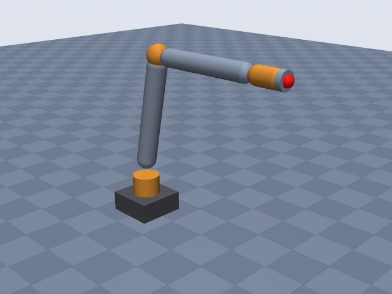
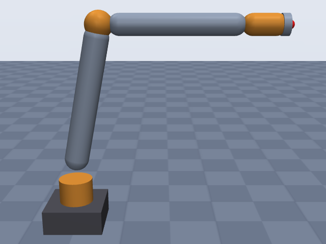
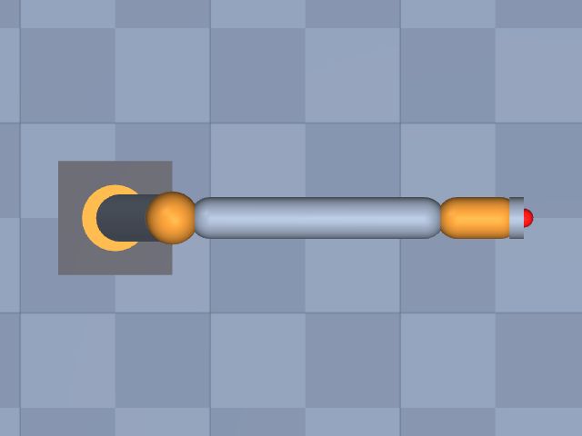

# viperx_300s

Trossen Robotics · ViperX 300 Robot Arm 6DOF (ViperX 300 S), arm joints only, no gripper · Interbotix/Trossen ViperX 300 S, offset convention from the Interbotix reach and offsets tables (inferred mapping).

**Status: ✔ PASSED** · 12/14 checks passed · 0 blocking error(s) · 1 iteration(s), status `passed` · MuJoCo 3.3.0

## Views (home pose)

## Verification checks

| Check | Result | Measured | Expected | Tolerance | Severity | Message / fix hint |
|---|---|---|---|---|---|---|
| `compiles` | ✔ pass | — | — | — | error | loads with MuJoCo 3.3.0, mj_forward finite |
| `joint_structure` | ✔ pass | [[waist, hinge], [shoulder, hinge], [elbow, hinge], [forearm_roll, hinge], [wrist_angle, hinge], [wrist_rotate, hinge]] | [[waist, hinge], [shoulder, hinge], [elbow, hinge], [forearm_roll, hinge], [wrist_angle, hinge], [wrist_rotate, hinge]] | — | error | 6 joints match by name, type and chain order |
| `ee_site` | ✔ pass | ee_site | ee_site | — | error | site 'ee_site' on last body 'wrist_rotate_link' |
| `kinematics_match` | ✔ pass | ee_position_m: 2.436e-16, ee_orientation_rad: 5.903e-16, joint_axis_rad: 4.079e-16, joint_position_m: 2.434e-16 | 0 | position_m: 1.000e-06, orientation_rad: 1.000e-06 | error | model kinematics match the spec on 20 configurations (max EE error 2.4e-16 m, 5.9e-16 rad) |
| `joint_limits` | ✔ pass | waist: [-3.142, 3.142], shoulder: [-1.763, 1.763], elbow: [-1.763, 1.606], forearm_roll: [-3.142, 3.142], wrist_angle: [-1.868, 2.269], wrist_rotate: [-3.142, 3.142] | waist: [-3.142, 3.142], shoulder: [-1.763, 1.763], elbow: [-1.763, 1.606], forearm_roll: [-3.142, 3.142], wrist_angle: [-1.868, 2.269], wrist_rotate: [-3.142, 3.142] | hinge_rad: 0.001, slide_m: 1.000e-04 | error | all joint ranges match the spec (max diff 4.78e-12) |
| `reach` | ✘ fail | 0.6759 | 0.75 | 0.05 | warning | max reach 0.676 m is 9.9% below rated 0.750 m; warning only: the reach definition is assumed (reach.measured_from and reach.measured_to listed in estimates) **Fix:** Reach is too short: re-check the lengths that set the measured reach (joints[2].origin.xyz, joints[4].origin.xyz, joints[5].origin.xyz; largest effect first) against the datasheet, a missing EE/flange offset (ee.origin.xyz), joint limits that may prevent stretching out (joints[*].limits). Also check `units.length` (mm vs m). The reach definition (measured_from = shoulder, measured_to = ee_site) is assumed (reach.measured_from, reach.measured_to not stated in the spec or listed in estimates), so this is only a warning. If the source does not state the reach definition, leave reach.measured_from/measured_to unstated or list them in `estimates` instead of switching endpoints until it passes; if it does, write them in the spec and source them. |
| `total_mass` | ✔ pass | 2.093 | — | — | info | spec has no total_mass; model mass is 2.093 kg |
| `mass_plausibility` | ✔ pass | — | — | — | warning | link densities, mass shares and mass per reach are plausible |
| `inertia_valid` | ✔ pass | — | — | — | error | 7 bodies have positive mass and valid inertia |
| `self_collision_home` | ✔ pass | 0 | 0 | 0.001 | error | no self-collision deeper than 1 mm at home (0 touching pairs) |
| `collision_exclusions` | ✔ pass | 0 | 0 | — | warning | 2 excluded pair(s), all parent/child or separated only by zero-length links: base / waist_link (parent/child; MuJoCo does not filter a world-fixed parent); shoulder_link / forearm_roll_link (only zero-length links between them (origins coincide with the end of 'shoulder_link')) |
| `stable_hold` | ✔ pass | 0.01026 | 0 | drift_hinge_rad: 0.05, drift_slide_m: 0.005, final_speed: 0.1 | error | holds home for 2 s: max drift 0.0103, final speed 0.0000 |
| `actuators` | ✔ pass | 6 | 6 | — | error | every spec joint is driven by exactly one actuator |
| `sources_complete` | ✘ fail | 0.6053 | 0 | 0.5 | warning | every number is covered, but 23 of 38 (61%) are estimates **Fix:** More than half of the numbers are estimates: look for sources (datasheet, manual, DH table) for the ones that matter most, i.e. link lengths / DH rows, joint limits, total_mass and reach, and move them from `estimates` to `sources`. |

## Key specifications

| | |
|---|---|
| DOF | 6 |
| Total mass | — |
| Reach | 750 mm (shoulder → ee_site) |
| Payload | 0.75 kg |
| Repeatability | ± 1 mm |
| Convention | offset |
| Units | length mm, angle deg |

## Joints

| # | Joint | Type | Lower | Upper | Effort limit | Velocity limit | Home |
|---|---|---|---|---|---|---|---|
| 1 | `waist` | hinge | -180 deg | 180 deg | — | — | 0 deg |
| 2 | `shoulder` | hinge | -101 deg | 101 deg | — | — | 0 deg |
| 3 | `elbow` | hinge | -101 deg | 92 deg | — | — | 0 deg |
| 4 | `forearm_roll` | hinge | -180 deg | 180 deg | — | — | 0 deg |
| 5 | `wrist_angle` | hinge | -107 deg | 130 deg | — | — | 0 deg |
| 6 | `wrist_rotate` | hinge | -180 deg | 180 deg | — | — | 0 deg |

## Sources

| Field path | Source |
|---|---|
| `joints[*].limits` | <https://docs.trossenrobotics.com/interbotix_xsarms_docs/specifications/vx300s.html> |
| `payload` | <https://docs.trossenrobotics.com/interbotix_xsarms_docs/specifications/vx300s.html> |
| `reach.value` | <https://docs.trossenrobotics.com/interbotix_xsarms_docs/specifications/vx300s.html> |
| `repeatability` | <https://docs.trossenrobotics.com/interbotix_xsarms_docs/specifications/vx300s.html> |

## Estimates

Fields whose values were estimated rather than read from a source:

- `joints[*].origin`
- `joints[*].axis`
- `joints[*].link.geometry`
- `base.link.geometry`
- `reach.measured_from`
- `reach.measured_to`

## Spec notes

Kinematic source: inferred from the Interbotix "Reach" and "Offsets & True Upper Arm Length" tables (docs.trossenrobotics.com, read through search extracts; the column/letter mapping is a best reading), so all origins are estimates. Sourced lengths used: upper arm offsets 300 mm and 60 mm with true length 306 mm and angle 11.3 deg (sqrt(300^2+60^2) = 305.9, atan(60/300) = 11.3 deg, so they are the two legs of shoulder->elbow at the zero pose: elbow 300 mm above and 60 mm forward of the shoulder axis), forearm elbow -> wrist tilt 300 mm (assumed horizontal, on the elbow height, at q = 0), wrist tilt -> wrist rotate 70 mm. Cumulative values in the table (306 elbow, 606 wrist tilt, 676 wrist rotate) are consistent with this chain. Shoulder height above the base plate is not published in anything reachable: 120 mm is an estimate from product photos (base housing plus waist bracket roughly 0.4 times the 300 mm upper-arm leg); the shoulder axis is assumed to lie on the waist axis. Forearm_roll is placed at the elbow point (any point on its axis gives the same model). Axis directions are not published: waist +z, shoulder/elbow/wrist_angle +y (positive pitches the arm down/forward; elbow +92 then folds the forearm down toward the upper arm, matching its smaller positive range), forearm_roll and wrist_rotate +x, all estimates. EE site: the docs do not give the distance to the gripper-mount face, so ee_site is at point D of the reach table ("wrist rotate", 70 mm past the wrist_angle axis, on the wrist_rotate axis), with no offset; the gripper (69 mm to the gripper rail, 68 mm more to the fingertip) is not modelled. Joint limits are the firmware default limits listed on the vx300s page. Reach 750 mm has no stated definition; shoulder -> ee_site is assumed (estimate); the table's cumulative 745 mm to the gripper rail suggests the 750 mm figure includes the gripper, so the arm-only model is expected to fall short. Total mass, speeds, torques not found: omitted.

## Iteration history

| # | Time | Result | Errors | Failed | Failed checks | Note |
|---|---|---|---|---|---|---|
| 1 | 2026-11-05T10:57:06+00:00 | ✔ pass | 0 | 2 |  | initial spec: offset chain from Interbotix reach/offset tables, shoulder height estimated, EE at wrist-rotate point D |

Status: `passed` · max iterations 8

---
Generated by sim-anything on 2026-11-05 10:57 UTC.
