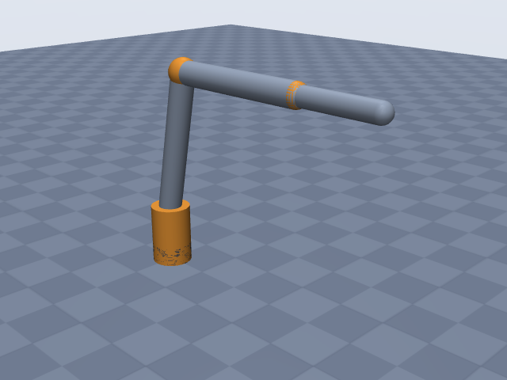
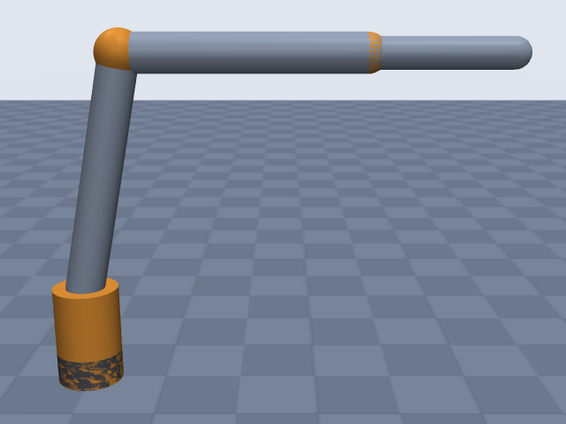
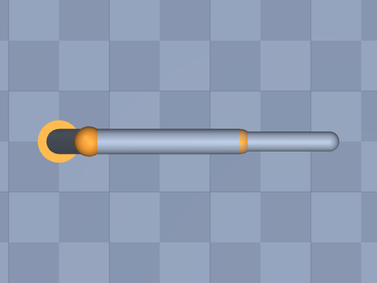

# vx300s

Trossen Robotics (Interbotix) · ViperX 300 S (ViperX-300 6DOF), arm only, no gripper

**Status: ✔ PASSED** · 15/15 checks passed · 0 blocking error(s) · 1 iteration(s), status `passed` · MuJoCo 3.3.0

## Views (home pose)

## Verification checks

| Check | Result | Measured | Expected | Tolerance | Severity | Message / fix hint |
|---|---|---|---|---|---|---|
| `compiles` | ✔ pass | — | — | — | error | loads with MuJoCo 3.3.0, mj_forward finite |
| `joint_structure` | ✔ pass | [[waist, hinge], [shoulder, hinge], [elbow, hinge], [forearm_roll, hinge], [wrist_angle, hinge], [wrist_rotate, hinge]] | [[waist, hinge], [shoulder, hinge], [elbow, hinge], [forearm_roll, hinge], [wrist_angle, hinge], [wrist_rotate, hinge]] | — | error | 6 joints match by name, type and chain order |
| `ee_site` | ✔ pass | ee_site | ee_site | — | error | site 'ee_site' on last body 'wrist_rotate_link' |
| `kinematics_match` | ✔ pass | ee_position_m: 2.544e-16, ee_orientation_rad: 5.903e-16, joint_axis_rad: 4.079e-16, joint_position_m: 1.852e-16 | 0 | position_m: 1.000e-06, orientation_rad: 1.000e-06 | error | model kinematics match the spec on 20 configurations (max EE error 2.5e-16 m, 5.9e-16 rad) |
| `joint_limits` | ✔ pass | waist: [-3.142, 3.142], shoulder: [-1.763, 1.763], elbow: [-1.763, 1.606], forearm_roll: [-3.142, 3.142], wrist_angle: [-1.868, 2.269], wrist_rotate: [-3.142, 3.142] | waist: [-3.142, 3.142], shoulder: [-1.763, 1.763], elbow: [-1.763, 1.606], forearm_roll: [-3.142, 3.142], wrist_angle: [-1.868, 2.269], wrist_rotate: [-3.142, 3.142] | hinge_rad: 0.001, slide_m: 1.000e-04 | error | all joint ranges match the spec (max diff 4.78e-12) |
| `reach` | ✔ pass | 0.7828 | 0.75 | 0.05 | error | max reach 0.783 m within 4.4% of rated 0.750 m |
| `drawing` | ✔ pass | [0.427, 0.3595] | [0.4268, 0.36] | — | error | 2 drawing dimension(s) match within tolerance |
| `total_mass` | ✔ pass | 2.692 | — | — | info | spec has no total_mass; model mass is 2.692 kg |
| `mass_plausibility` | ✔ pass | — | — | — | warning | link densities, mass shares and mass per reach are plausible |
| `inertia_valid` | ✔ pass | — | — | — | error | 7 bodies have positive mass and valid inertia |
| `self_collision_home` | ✔ pass | 0 | 0 | 0.001 | error | no self-collision deeper than 1 mm at home (0 touching pairs) |
| `collision_exclusions` | ✔ pass | 0 | 0 | — | warning | 3 excluded pair(s), all parent/child or separated only by zero-length links: base / waist_link (parent/child; MuJoCo does not filter a world-fixed parent); shoulder_link / forearm_roll_link (only zero-length links between them (origins coincide with the end of 'shoulder_link')); forearm_roll_link / wrist_rotate_link (only zero-length links between them (origins coincide with the end of 'forearm_roll_link')) |
| `stable_hold` | ✔ pass | 0.01052 | 0 | drift_hinge_rad: 0.05, drift_slide_m: 0.005, final_speed: 0.1 | error | holds home for 2 s: max drift 0.0105, final speed 0.0000 |
| `actuators` | ✔ pass | 6 | 6 | — | error | every spec joint is driven by exactly one actuator |
| `sources_complete` | ✔ pass | 0 | 0 | — | error | every number in the spec has a source or is listed as an estimate (16 of 37 estimated) |

## Key specifications

| | |
|---|---|
| DOF | 6 |
| Total mass | — |
| Reach | 0.75 m (shoulder → ee_site) |
| Payload | 0.75 kg |
| Repeatability | ± 0.001 m |
| Convention | offset |
| Units | length m, angle deg |

## Joints

| # | Joint | Type | Lower | Upper | Effort limit | Velocity limit | Home |
|---|---|---|---|---|---|---|---|
| 1 | `waist` | hinge | -180 deg | 180 deg | — | — | 0 deg |
| 2 | `shoulder` | hinge | -101 deg | 101 deg | — | — | 0 deg |
| 3 | `elbow` | hinge | -101 deg | 92 deg | — | — | 0 deg |
| 4 | `forearm_roll` | hinge | -180 deg | 180 deg | — | — | 0 deg |
| 5 | `wrist_angle` | hinge | -107 deg | 130 deg | — | — | 0 deg |
| 6 | `wrist_rotate` | hinge | -180 deg | 180 deg | — | — | 0 deg |

## Sources

| Field path | Source |
|---|---|
| `joints[*].origin` | <https://raw.githubusercontent.com/TrossenRobotics/interbotix_xsarms_docs/main/docs/specifications/vx300s.rst> |
| `joints[*].axis` | <https://raw.githubusercontent.com/TrossenRobotics/interbotix_xsarms_docs/main/docs/specifications/vx300s.rst> |
| `joints[*].limits` | <https://raw.githubusercontent.com/TrossenRobotics/interbotix_xsarms_docs/main/docs/specifications/vx300s.rst> |
| `joints[*].name` | <https://raw.githubusercontent.com/TrossenRobotics/interbotix_xsarms_docs/main/docs/_data/servos_vx300s.csv> |
| `ee.origin` | <https://raw.githubusercontent.com/TrossenRobotics/interbotix_xsarms_docs/main/docs/specifications/vx300s.rst> |
| `dof` | <https://raw.githubusercontent.com/TrossenRobotics/interbotix_xsarms_docs/main/docs/specifications/vx300s.rst> |
| `payload` | <https://raw.githubusercontent.com/TrossenRobotics/interbotix_xsarms_docs/main/docs/specifications/vx300s.rst> |
| `repeatability` | <https://raw.githubusercontent.com/TrossenRobotics/interbotix_xsarms_docs/main/docs/specifications/vx300s.rst> |
| `reach.value` | <https://raw.githubusercontent.com/TrossenRobotics/interbotix_xsarms_docs/main/docs/specifications/vx300s.rst> |
| `drawing` | <https://raw.githubusercontent.com/TrossenRobotics/interbotix_xsarms_docs/main/docs/specifications/images/vx300s_drawing.png> |

## Estimates

Fields whose values were estimated rather than read from a source:

- `base.link.geometry`
- `joints[*].link.geometry`
- `joints[2].limits`
- `joints[4].limits`
- `reach.measured_from`
- `reach.measured_to`
- `drawing[0]`
- `drawing[1]`

## Spec notes

Kinematic source: published screw-axis (product-of-exponentials) table, space frame (M + Slist) on the manufacturer's spec page (Sphinx source vx300s.rst in TrossenRobotics/interbotix_xsarms_docs, primary; the rendered docs.trossenrobotics.com page was blocked). Converted exactly to the `offset` convention with the PoE home as q = 0 (upper arm vertical, forearm horizontal along +x), all frames parallel to the base frame. Points on axes p_i = w_i x v_i (m): J1 (0,0,0) +z; J2 (0,0,0.12705) +y; J3 (0.05955,0,0.42705) +y; J4 axis +x through z = 0.42705; J5 (0.35955,0,0.42705) +y; J6 axis +x through z = 0.42705. For the two roll axes (J4, J6) any point on the axis gives the identical model; J4 is placed at x = 0.05955 (at the elbow) and J6 at x = 0.35955 (at the wrist-angle axis) so the link frames sit on the arm. Axis signs copied from Slist. Tool: M = identity rotation at (0.536494, 0, 0.42705); the page does not name the physical frame M describes (it is 0.176944 m beyond the wrist-angle axis, more than the drawing's 70 mm to the gripper mount, so it is likely a gripper/ee frame, not the wrist-rotate flange). ee_site is placed at M as published. Units: PoE units are not printed; values are consistent with metres (drawing 300 mm links = 0.3), so the file uses m. Payload "750g" -> 0.75 kg and repeatability "1mm" -> 0.001 m are exact unit conversions. Joint limits: firmware "Default Joint Limits" table (deg from servo centre), mapped by joint NAME (the table lists Wrist Angle before Forearm Roll with swapped servo IDs vs the servo CSV; CSV gives the order). The page does not state the limit sign convention relative to the PoE screw axes; the symmetric limits are unaffected, the asymmetric elbow (-101..92) and wrist_angle (-107..130) are listed as estimates because their sign alignment with the PoE axes is assumed (firmware q = PoE q). No joint is continuous. Reach "750mm" (Total Span 1500mm) has no stated definition; shoulder -> ee_site is assumed (estimate); the built model gives about 0.783 m for that, so a reach warning is expected. Do not tune geometry to it. Drawing cross-check: drawing labels 126.75 (mounting face -> shoulder axis), 300 (shoulder -> elbow level), 60 (shoulder line -> elbow axis), 300 (elbow -> wrist-angle axis); the extension-line mapping is the scout's visual reading and the sums are ours, so both drawing entries are estimates. PoE vs drawing differ by 0.3 mm (shoulder height 127.05 vs 126.75) and 0.45 mm (59.55 vs 60); tolerance 1 mm. The base frame is assumed to be the mounting face (not stated by the PoE page). Link geometry radii are estimates: base and waist from the 84.5 mm turret face width in the drawing (r = 0.04225), arm links from the XM540-W270 case (33.5 x 58.5 x 44 mm), wrist from XM430-W350 (28.5 x 46.5 x 34 mm). Not published, omitted: total mass, link masses/inertias, joint velocity and torque limits (only servo stall torque / no-load speed exist; shoulder and elbow use two servos each).

## Iteration history

| # | Time | Result | Errors | Failed | Failed checks | Note |
|---|---|---|---|---|---|---|
| 1 | 2026-11-09T00:44:15+00:00 | ✔ pass | 0 | 0 |  | initial run |

Status: `passed` · max iterations 8

---
Generated by sim-anything on 2026-11-09 00:44 UTC.
