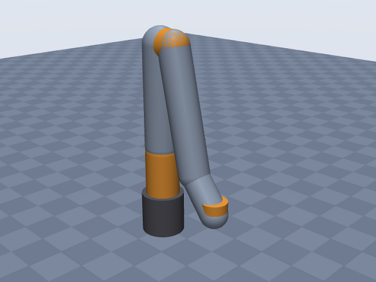
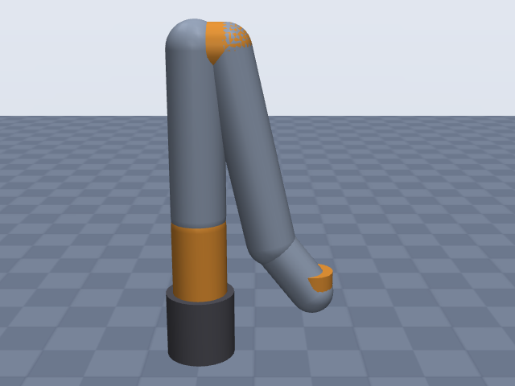
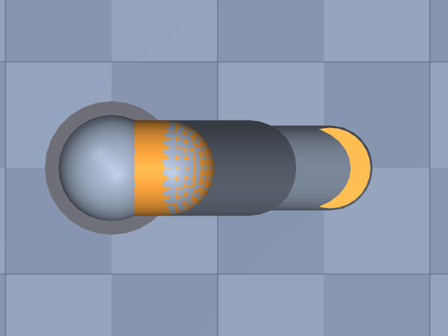

# ufactory_xarm7

UFactory · xArm 7

**Status: ✘ FAILED** · 10/11 checks passed · 1 blocking error(s) · 1 iteration(s), status `running` · MuJoCo 3.3.0

## Views (home pose)

## Verification checks

| Check | Result | Measured | Expected | Tolerance | Severity | Message / fix hint |
|---|---|---|---|---|---|---|
| `compiles` | ✔ pass | — | — | — | error | loads with MuJoCo 3.3.0, mj_forward finite |
| `joint_structure` | ✔ pass | [[joint1, hinge], [joint2, hinge], [joint3, hinge], [joint4, hinge], [joint5, hinge], [joint6, hinge], [joint7, hinge]] | [[joint1, hinge], [joint2, hinge], [joint3, hinge], [joint4, hinge], [joint5, hinge], [joint6, hinge], [joint7, hinge]] | — | error | 7 joints match by name, type and chain order |
| `ee_site` | ✔ pass | ee_site | ee_site | — | error | site 'ee_site' on last body 'joint7_link' |
| `joint_limits` | ✔ pass | joint1: [-6.283, 6.283], joint2: [-2.042, 2.025], joint3: [-6.283, 6.283], joint4: [-0.1047, 3.927], joint5: [-6.283, 6.283], joint6: [-1.693, 3.142], joint7: [-6.283, 6.283] | joint1: [-6.283, 6.283], joint2: [-2.042, 2.025], joint3: [-6.283, 6.283], joint4: [-0.1047, 3.927], joint5: [-6.283, 6.283], joint6: [-1.693, 3.142], joint7: [-6.283, 6.283] | hinge_rad: 0.001, slide_m: 1.000e-04 | error | all joint ranges match the spec (max diff 4.50e-12) |
| `reach` | ✘ fail | 0.772 | 0.7 | 0.05 | error | max reach 0.772 m is 10.3% above rated 0.700 m **Fix:** Reach is too long: re-check the link lengths (joints[4].dh.d, joints[2].dh.d, joints[0].dh.d, joints[6].dh.d) against the datasheet, the EE offset (ee.origin.xyz), and whether the rated reach is measured to the wrist center rather than the ee site (reach.measured_to) or from a different point (reach.measured_from = base_axis_horizontal). Also check `units.length` (mm vs m). |
| `total_mass` | ✔ pass | 13.7 | 13.7 | 0.05 | error | model mass 13.700 kg within 0.0% of 13.700 kg |
| `inertia_valid` | ✔ pass | — | — | — | error | 8 bodies have positive mass and valid inertia |
| `self_collision_home` | ✔ pass | 0 | 0 | 0.001 | error | no self-collision deeper than 1 mm at home (0 touching pairs) |
| `stable_hold` | ✔ pass | 0.01051 | 0 | drift_hinge_rad: 0.05, drift_slide_m: 0.005, final_speed: 0.1 | error | holds home for 2 s: max drift 0.0105, final speed 0.0000 |
| `actuators` | ✔ pass | 7 | 7 | — | error | every spec joint is driven by exactly one actuator |
| `sources_complete` | ✔ pass | 0 | 0 | — | error | every number in the spec has a source or is listed as an estimate |

## Key specifications

| | |
|---|---|
| DOF | 7 |
| Total mass | 13.7 kg |
| Reach | 700 mm (base_axis_horizontal → ee_site) |
| Payload | 3.5 kg |
| Convention | dh_modified |
| Units | length mm, angle deg |

## Joints

| # | Joint | Type | Lower | Upper | Effort limit | Velocity limit | Home |
|---|---|---|---|---|---|---|---|
| 1 | `joint1` | hinge | -360 deg | 360 deg | — | 180 deg/s | 0 deg |
| 2 | `joint2` | hinge | -117 deg | 116 deg | — | 180 deg/s | 0 deg |
| 3 | `joint3` | hinge | -360 deg | 360 deg | — | 180 deg/s | 0 deg |
| 4 | `joint4` | hinge | -6 deg | 225 deg | — | 180 deg/s | 0 deg |
| 5 | `joint5` | hinge | -360 deg | 360 deg | — | 180 deg/s | 0 deg |
| 6 | `joint6` | hinge | -97 deg | 180 deg | — | 180 deg/s | 0 deg |
| 7 | `joint7` | hinge | -360 deg | 360 deg | — | 180 deg/s | 0 deg |

## Sources

| Field path | Source |
|---|---|
| `joints[*].dh` | <https://docs.supportarticle.ufactory.cc/zhHans/support_articles/developer/kinematic-and-dynamic-parameters/xArm_Series/xarm-7.html> |
| `joints[*].limits` | <https://docs.xarm.ufactory.cc/8.technical_specifications.html> |
| `joints[*].velocity_limit` | <https://docs.xarm.ufactory.cc/8.technical_specifications.html> |
| `base.link.geometry[0].radius` | <https://docs.xarm.ufactory.cc/8.technical_specifications.html> |
| `total_mass` | <https://www.ufactory.us/product/ufactory-xarm-7> |
| `payload` | <https://www.ufactory.us/product/ufactory-xarm-7> |
| `reach.value` | <https://www.ufactory.us/product/ufactory-xarm-7> |

## Estimates

Fields whose values were estimated rather than read from a source:

- `base.link.geometry[0].fromto`
- `joints[*].link.geometry`
- `reach.measured_from`

## Spec notes

Modified DH table (UFACTORY support article, xArm 7) copied verbatim; alpha given there in rad (0, -pi/2, pi/2, pi/2, pi/2, pi/2, -pi/2) written here as exact degrees. All theta offsets are 0 in the table. No separate flange row; d7 = 97 mm is taken as the flange face (ee_site at frame 7, no extra offset). Joint ranges from the user-manual technical specifications (J2 -117~116, J4 -6~225); the "difference between xArm5/6/7" support article gives J2 -118~120 and J4 -11~225 (conflict noted, manual working range used). Joint speed: single "180 deg/s" for all joints. Total mass 13.7 kg (product page and difference article); the tech-spec chapter says 14.3 kg. Base radius 63 mm from the published footprint diameter 126 mm. Base cylinder height (120 mm) and all link radii (38-50 mm) are estimates from product photos relative to the 126 mm base. Reach 700 mm is published without a definition; the tech spec gives a Cartesian range X/Y +-700 mm in the base frame, so it is interpreted as horizontal distance from the J1 axis to the flange (estimate). Joint torques: only an ambiguous forum thread found (42/19/7 Nm groupings disputed), omitted.

## Iteration history

| # | Time | Result | Errors | Failed | Failed checks | Note |
|---|---|---|---|---|---|---|
| 1 | 2026-11-05T07:45:41+00:00 | ✘ fail | 1 | 1 | `reach` | initial spec: UFACTORY modified DH table, manual joint ranges, 126 mm footprint |

Status: `running` · max iterations 8

---
Generated by sim-anything on 2026-11-05 07:46 UTC.
