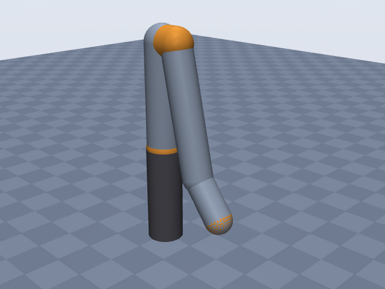
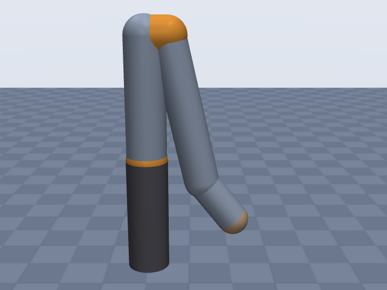
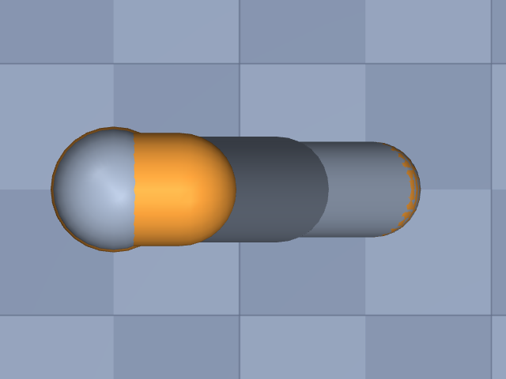

# xarm7

UFactory · xArm 7 (7-DOF), without gripper

**Status: ✔ PASSED** · 12/14 checks passed · 0 blocking error(s) · 1 iteration(s), status `passed` · MuJoCo 3.3.0

## Views (home pose)

## Verification checks

| Check | Result | Measured | Expected | Tolerance | Severity | Message / fix hint |
|---|---|---|---|---|---|---|
| `compiles` | ✔ pass | — | — | — | error | loads with MuJoCo 3.3.0, mj_forward finite |
| `joint_structure` | ✔ pass | [[joint1, hinge], [joint2, hinge], [joint3, hinge], [joint4, hinge], [joint5, hinge], [joint6, hinge], [joint7, hinge]] | [[joint1, hinge], [joint2, hinge], [joint3, hinge], [joint4, hinge], [joint5, hinge], [joint6, hinge], [joint7, hinge]] | — | error | 7 joints match by name, type and chain order |
| `ee_site` | ✔ pass | ee_site | ee_site | — | error | site 'ee_site' on last body 'joint7_link' |
| `kinematics_match` | ✔ pass | ee_position_m: 6.684e-16, ee_orientation_rad: 2.484e-15, joint_axis_rad: 2.252e-15, joint_position_m: 5.197e-16 | 0 | position_m: 1.000e-06, orientation_rad: 1.000e-06 | error | model kinematics match the spec on 20 configurations (max EE error 6.7e-16 m, 2.5e-15 rad) |
| `joint_limits` | ✔ pass | joint1: [-6.283, 6.283], joint2: [-2.042, 2.025], joint3: [-6.283, 6.283], joint4: [-0.1047, 3.927], joint5: [-6.283, 6.283], joint6: [-1.693, 3.142], joint7: [-6.283, 6.283] | joint1: [-6.283, 6.283], joint2: [-2.042, 2.025], joint3: [-6.283, 6.283], joint4: [-0.1047, 3.927], joint5: [-6.283, 6.283], joint6: [-1.693, 3.142], joint7: [-6.283, 6.283] | hinge_rad: 0.001, slide_m: 1.000e-04 | error | all joint ranges match the spec (max diff 4.50e-12) |
| `reach` | ✘ fail | 0.7721 | 0.7 | 0.05 | warning | max reach 0.772 m is 10.3% above rated 0.700 m; warning only: the reach definition is assumed (reach.measured_from and reach.measured_to listed in estimates) **Fix:** Reach is too long: re-check the lengths that set the measured reach (joints[4].dh.d, joints[2].dh.d, joints[6].dh.d, joints[6].dh.a; largest effect first) against the datasheet. Also check `units.length` (mm vs m). The reach definition (measured_from = shoulder, measured_to = ee_site) is assumed, so this is only a warning. If the source does not state the reach definition, list reach.measured_from/measured_to in `estimates` instead of switching endpoints until it passes. |
| `total_mass` | ✔ pass | 13.7 | 13.7 | 0.05 | error | model mass 13.700 kg within 0.0% of 13.700 kg |
| `mass_plausibility` | ✔ pass | — | — | — | warning | link densities, mass shares and mass per reach are plausible |
| `inertia_valid` | ✔ pass | — | — | — | error | 8 bodies have positive mass and valid inertia |
| `self_collision_home` | ✔ pass | 0 | 0 | 0.001 | error | no self-collision deeper than 1 mm at home (0 touching pairs) |
| `collision_exclusions` | ✘ fail | 1 | 0 | — | warning | 1 of 4 excluded pair(s) are neither parent/child nor separated only by zero-length links, so contacts between them are never checked: base / joint1_link (parent/child; MuJoCo does not filter a world-fixed parent); base / joint2_link (only zero-length links between them (origins coincide with the end of 'base')); joint2_link / joint4_link (geoms overlap around the short link 'joint3_link' in all 32 sampled configurations, 37.5 mm deep at home); joint4_link / joint6_link (only zero-length links between them (origins coincide with the end of 'joint4_link')) **Fix:** Review the exclusions of 'joint2_link' / 'joint4_link': they hide any collision between those links. If they are there because the primitives overlap, make the geometry fit (joints[1].link.geometry, joints[3].link.geometry: smaller radius, explicit fromto/pos) so the exclusion is no longer needed; if the MJCF was hand-edited, remove the <exclude> or explain it in the spec's `notes`. |
| `stable_hold` | ✔ pass | 0.01054 | 0 | drift_hinge_rad: 0.05, drift_slide_m: 0.005, final_speed: 0.1 | error | holds home for 2 s: max drift 0.0105, final speed 0.0000 |
| `actuators` | ✔ pass | 7 | 7 | — | error | every spec joint is driven by exactly one actuator |
| `sources_complete` | ✔ pass | 0 | 0 | — | error | every number in the spec has a source or is listed as an estimate (8 of 46 estimated) |

## Key specifications

| | |
|---|---|
| DOF | 7 |
| Total mass | 13.7 kg |
| Reach | 700 mm (shoulder → ee_site) |
| Payload | 3.5 kg |
| Repeatability | ± 0.1 mm |
| Convention | dh_modified |
| Units | length mm, angle deg |

## Joints

| # | Joint | Type | Lower | Upper | Effort limit | Velocity limit | Home |
|---|---|---|---|---|---|---|---|
| 1 | `joint1` | hinge | -360 deg | 360 deg | — | 180 deg/s | 0 deg |
| 2 | `joint2` | hinge | -117 deg | 116 deg | — | 180 deg/s | 0 deg |
| 3 | `joint3` | hinge | -360 deg | 360 deg | — | 180 deg/s | 0 deg |
| 4 | `joint4` | hinge | -6 deg | 225 deg | — | 180 deg/s | 0 deg |
| 5 | `joint5` | hinge | -360 deg | 360 deg | — | 180 deg/s | 0 deg |
| 6 | `joint6` | hinge | -97 deg | 180 deg | — | 180 deg/s | 0 deg |
| 7 | `joint7` | hinge | -360 deg | 360 deg | — | 180 deg/s | 0 deg |

## Sources

| Field path | Source |
|---|---|
| `joints[*].dh` | <https://docs.supportarticle.ufactory.cc/zhHans/support_articles/developer/kinematic-and-dynamic-parameters/xArm_Series/xarm-7.html> |
| `joints[*].limits` | <https://docs.xarm.ufactory.cc/8.technical_specifications.html> |
| `joints[*].velocity_limit` | <https://docs.xarm.ufactory.cc/8.technical_specifications.html> |
| `repeatability` | <https://docs.xarm.ufactory.cc/8.technical_specifications.html> |
| `total_mass` | <https://www.ufactory.us/product/ufactory-xarm-7> |
| `payload` | <https://www.ufactory.us/product/ufactory-xarm-7> |
| `reach.value` | <https://www.ufactory.us/product/ufactory-xarm-7> |

## Estimates

Fields whose values were estimated rather than read from a source:

- `reach.measured_from`
- `reach.measured_to`
- `base.link.geometry`
- `joints[*].link.geometry`

## Spec notes

Kinematic source: published DH table (UFACTORY support article "Kinematic and dynamic parameters - xArm 7", section "Modified D-H parameters", manufacturer, primary; read through web-search extracts because the page itself was blocked from this session). Columns theta(rad) | d(mm) | alpha(rad) | a(mm) | offset(rad); copied row by row into dh_modified (row i = a_{i-1}, alpha_{i-1}, d_i, theta_i), -pi/2 / pi/2 written as -90 / 90 deg; theta and offset columns are 0 on every row. The table has no separate flange row; the EE site is put at frame 7 (after d7 = 97 mm), taken to be the tool flange face (UFACTORY's default TCP is the flange centre); this placement is my interpretation of the table. Joint limits are the user-manual technical specifications (J1..J7 +-360, -117~116, +-360, -6~225, +-360, -97~180, +-360 deg); the xArm5/6/7 comparison support article gives J2 -118~120 and J4 -11~225 (conflict noted, manual values used). +-360 joints are kept as +-360 as published. velocity_limit = "maximum joint speed 180 deg/s" (one figure for all joints). Total mass 13.7 kg from the product page and comparison article (technical specifications chapter says 14.3 kg). Payload 3.5 kg, repeatability +-0.1 mm. Reach 700 mm is published without saying from where to where: assumed shoulder (J2 axis) to the flange (ee_site), the usual cobot definition; measured_from / measured_to are estimates, so the reach check only warns. Joint torques and link masses not found (omitted; total mass distributed by volume). Link radii are estimates from product photos (~100 mm diameter at the base and shoulder tapering to ~76 mm at the wrist); no housing diameters were found.

## Iteration history

| # | Time | Result | Errors | Failed | Failed checks | Note |
|---|---|---|---|---|---|---|
| 1 | 2026-11-05T08:33:10+00:00 | ✔ pass | 0 | 2 |  | initial spec: UFACTORY modified DH table, manual joint ranges, reach definition assumed shoulder->flange |

Status: `passed` · max iterations 8

---
Generated by sim-anything on 2026-11-05 08:33 UTC.
